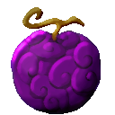
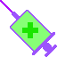
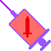
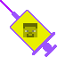
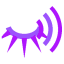

<!-- Generated by tools/build_pack_reference.py. Edit the pack sources and regenerate. -->

# Horu Horu no Mi

{ .entry-page-icon }

[Fruits](index.md) · [Mine Mine no Mi](../../reference/content/mineminenomi.md)

<!-- fruit mineminenomi:horu_horu_no_mi -->

| Stat | Value |
| --- | --- |
| Type | Paramecia |
| Tier | 1 |
| Fruit damage scaling | 1.00× at 10,000 Doriki → 2.25× at 50,000 Doriki |
| Abilities | 5 (5 active, 0 passive) |
| Fruit boxes | [Wooden Box](../fruit-boxes.md) |

See [damage calculations](../combat-stats.md#damage-from-doriki).

[Jump to awakening](#awakening)

After awakening, this fruit’s original damaging moves deal **1.5× damage**. The awakening techniques below have their own values.

!!! note "Reading the stats"
    Listed base damage is for the named part of the move. Pack and Doriki multipliers are shown separately. Times assume 20 ticks per second.

<!-- move mineminenomi:onna_hormone -->

## Onna Hormone

{ .entry-move-icon loading=lazy } *Active*

By injecting an enemy with special hormones, the user can inflict moderate debuffs on their enemies SHIFT-USE: User injects themselves

| Stat | Value |
| --- | --- |
| Cooldown | 20 s (400 ticks) |
| Pack multiplier when dealing damage | 2.8× |

<!-- move mineminenomi:chiyu_hormone -->

## Chiyu Hormone

{ .entry-move-icon loading=lazy } *Active*

The user injects the target with special hormones to stimulate the body's immune system which will nullify poisons at the cost of the user's lifespan. SHIFT-USE: User injects themselves

| Stat | Value |
| --- | --- |
| Cooldown | 20 s (400 ticks) |
| Pack multiplier when dealing damage | 2.8× |

<!-- move mineminenomi:tension_hormone -->

## Tension Hormone

{ .entry-move-icon loading=lazy } *Active*

The user injects the target with special hormones providing a supply of adrenaline that strengthens them. SHIFT-USE: User injects themselves

| Stat | Value |
| --- | --- |
| Cooldown | 20 s (400 ticks) |
| Pack multiplier when dealing damage | 2.8× |

<!-- move mineminenomi:ganmen_seicho_hormone -->

## Ganmen Seicho Hormone

{ .entry-move-icon loading=lazy } *Active*

By injecting special growth hormones into a target, their head expands to enormous proportions. SHIFT-USE: User injects themselves boosting the Death Wink ability as well

| Stat | Value |
| --- | --- |
| Cooldown | 20 s (400 ticks) |
| Pack multiplier when dealing damage | 2.8× |

<!-- move mineminenomi:death_wink -->

## Death Wink

{ .entry-move-icon loading=lazy } *Active*

The user winks really hard creating a shockwave; %s boosts it's power.

| Stat | Value |
| --- | --- |
| Cooldown | 6 s (120 ticks) |
| Pack multiplier when dealing damage | 2.8× |

## Awakening

**Source** · Awaken Awaken no Mi

| Stat | Value |
| --- | --- |
| Doriki | 40,000 |
| Active time with the fruit | About 24 hours (1,728,000 ticks) |

<!-- move awakenawakennomi:hormonal_fog -->

### Hormonal Fog { #awakening-hormonal-fog }

{ .entry-move-icon loading=lazy } *Active*

Releases a thick mist that gives allies good hormones and enemies bad ones.

| Stat | Value |
| --- | --- |
| Cooldown | 120 s (2400 ticks) |

<!-- move awakenawakennomi:hell_wink -->

### Hell Wink { #awakening-hell-wink }

{ .entry-move-icon loading=lazy } *Active*

The user winks so hard a shockwave rips through everything they look at Every hormone in the user's body makes it hit harder.

| Stat | Value |
| --- | --- |
| Base damage | 60 HP |
| Max damage | 150 HP |
| Cooldown | 30 s (600 ticks) |

<!-- move awakenawakennomi:iron_constitution -->

### Iron Constitution { #awakening-iron-constitution }

{ .entry-move-icon loading=lazy } *Passive*

The user and nearby allies don't suffer the side effects of hormones anymore.
