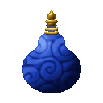
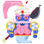
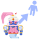
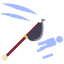
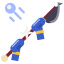
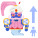

<!-- Generated by tools/build_pack_reference.py. Edit the pack sources and regenerate. -->

# Hoya Hoya no Mi

{ .entry-page-icon }

[Fruits](index.md) · [Missing Missing no Mi](../../reference/content/inomissing.md)

<!-- fruit inomissing:hoya_hoya_no_mi -->

| Stat | Value |
| --- | --- |
| Type | Paramecia |
| Tier | 2 |
| Fruit damage scaling | 1.00× at 10,000 Doriki → 2× at 50,000 Doriki |
| Abilities | 9 (8 active, 1 passive) |
| Fruit boxes | [Iron Box](../fruit-boxes.md) |

See [damage calculations](../combat-stats.md#damage-from-doriki).

!!! note "Reading the stats"
    Listed base damage is for the named part of the move. Pack and Doriki multipliers are shown separately. Times assume 20 ticks per second.

<!-- move inomissing:hoya_genie -->

## Genie

{ .entry-move-icon loading=lazy } *Active*

The user rubs their belly and a huge genie comes out, tied to them by a trail of smoke. It hunts the enemies around by itself and strikes them with its halberd. The other abilities are orders for the genie. While the genie is out, the user walks slowly and can't attack or use items. The genie can be attacked. It goes back in when it has no health left, or when the user takes a heavy hit or gets stunned. It keeps its health and slowly heals while it is in.

| Stat | Value |
| --- | --- |
| Cooldown | 15 s (300 ticks) |
| Broken cooldown | 60 s (1200 ticks) |
| Pack multiplier when dealing damage | 1.7× |

<!-- move inomissing:hoya_command -->

## Genie Command

{ .entry-move-icon loading=lazy } *Active*

The user points at the enemy they look at, and the genie goes for it before any other.

| Stat | Value |
| --- | --- |
| Cooldown | 1 s (20 ticks) |
| Conditional cooldown | 0.5 s (10 ticks) |
| Pack multiplier when dealing damage | 1.7× |

<!-- move inomissing:hoya_maji_giren -->

## Maji Giren

{ .entry-move-icon loading=lazy } *Active*

The genie slams its halberd down on the enemy it is fighting. It hits the enemies around and sweeps them away. One that guards is swept twice as far. The genie brings its halberd down with all its weight on the enemy it is fighting. The enemy is driven into the ground and can't move for a moment.

| Stat | Value |
| --- | --- |
| Base damage | 18 HP |
| Cooldown | 8 s (160 ticks) |
| Karu damage | 28 HP |
| Karu cooldown | 15 s (300 ticks) |
| Pack multiplier when dealing damage | 1.7× |

<!-- move inomissing:hoya_majin_saidan -->

## Majin Saidan

{ .entry-move-icon loading=lazy } *Active*

The genie swings its halberd and sends a great flying slash at the enemy it is fighting. It goes through every enemy in its way and cuts through wood, leaves, glass and wool.

| Stat | Value |
| --- | --- |
| Base damage | 24 HP |
| Cooldown | 10 s (200 ticks) |
| Conditional cooldown | 0.5 s (10 ticks) |
| Pack multiplier when dealing damage | 1.7× |

<!-- move inomissing:hoya_grab -->

## Genie Grab

{ .entry-move-icon loading=lazy } *Active*

The genie seizes the enemy it is fighting in its hand and holds it. The enemy can't move or attack while held, and the genie can still take orders. Using it again lets go.

| Stat | Value |
| --- | --- |
| Base damage | 6 HP |
| Cooldown | 14 s (280 ticks) |
| Pack multiplier when dealing damage | 1.7× |

<!-- move inomissing:hoya_shield -->

## Genie Shield

{ .entry-move-icon loading=lazy } *Active*

The genie comes back in front of the user and guards them with its halberd. While it is held, the genie takes the hits that come from the front instead of the user, and sends back what is shot at them. It can't attack while guarding.

| Stat | Value |
| --- | --- |
| Cooldown | 15 s (300 ticks) |
| Pack multiplier when dealing damage | 1.7× |

<!-- move inomissing:hoya_smoke -->

## Smoke

{ .entry-move-icon loading=lazy } *Active*

The genie turns to smoke for a moment. Nothing can hit it, but it can't attack.

| Stat | Value |
| --- | --- |
| Cooldown | 15 s (300 ticks) |
| Pack multiplier when dealing damage | 1.7× |

<!-- move inomissing:hoya_great_genie -->

## Great Genie

{ .entry-move-icon loading=lazy } *Active*

The genie grows gigantic for a while. Its halberd reaches much farther, and all its attacks hit harder and wider.

| Stat | Value |
| --- | --- |
| Cooldown | 45 s (900 ticks) |
| Pack multiplier when dealing damage | 1.7× |

<!-- move inomissing:hoya_genie_life -->

## Genie's Life

*Passive*

Shows the health of the genie. The genie keeps its health when it goes back in, and slowly heals while it is not out.

| Stat | Value |
| --- | --- |
| Pack multiplier when dealing damage | 1.7× |

