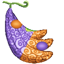
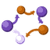
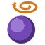

<!-- Generated by tools/build_pack_reference.py. Edit the pack sources and regenerate. -->

# Ichi Ichi no Mi

{ .entry-page-icon }

[Fruits](index.md) · [InoFruits](../../reference/content/inofruits.md)

<!-- fruit inofruits:ichi_ichi_no_mi -->

| Stat | Value |
| --- | --- |
| Type | Paramecia |
| Tier | 2 |
| Fruit damage scaling | 1.00× at 10,000 Doriki → 2× at 50,000 Doriki |
| Abilities | 5 (4 active, 1 passive) |
| Fruit boxes | [Iron Box](../fruit-boxes.md) |

See [damage calculations](../combat-stats.md#damage-from-doriki).

!!! note "Reading the stats"
    Listed base damage is for the named part of the move. Pack and Doriki multipliers are shown separately. Times assume 20 ticks per second.

<!-- move inofruits:irekae -->

## Irekae

{ .entry-move-icon loading=lazy } *Active*

The user instantly swaps places with whatever they are looking at

| Stat | Value |
| --- | --- |
| Cooldown | 15 s (300 ticks) |
| Conditional cooldown | 0.5 s (10 ticks) |
| Pack multiplier when dealing damage | 3.75× |

<!-- move inofruits:zen_irekae -->

## Zen Irekae

{ .entry-move-icon loading=lazy } *Active*

Every living thing within 20 blocks swaps places at once, including the user.

| Stat | Value |
| --- | --- |
| Cooldown | 20 s (400 ticks) |
| Pack multiplier when dealing damage | 3.75× |

<!-- move inofruits:surikae -->

## Surikae

{ .entry-move-icon loading=lazy } *Active*

Swaps the item the user is holding with the item held by the first target in the way.

| Stat | Value |
| --- | --- |
| Cooldown | 20 s (400 ticks) |
| Conditional cooldown | 0.5 s (10 ticks) |
| Pack multiplier when dealing damage | 3.75× |

<!-- move inofruits:hikikae -->

## Hikikae

{ .entry-move-icon loading=lazy } *Active*

Trades the item the user is holding for the target they're looking at, pulling them in close.

| Stat | Value |
| --- | --- |
| Cooldown | 20 s (400 ticks) |
| Conditional cooldown | 0.5 s (10 ticks) |
| Pack multiplier when dealing damage | 3.75× |

<!-- move inofruits:memai -->

## Memai

{ .entry-move-icon loading=lazy } *Passive*

Anyone moved by the user's swaps gets slowed and can't jump for 3 seconds

| Stat | Value |
| --- | --- |
| Pack multiplier when dealing damage | 3.75× |

