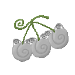
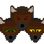
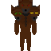
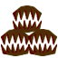
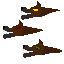
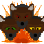

<!-- Generated by tools/build_pack_reference.py. Edit the pack sources and regenerate. -->

# Inu Inu no Mi, Model: Cerberus

{ .entry-page-icon }

[Fruits](index.md) · [Blitz Utility](../../reference/content/blitzutility.md)

<!-- fruit blitzutility:inu_inu_no_mi_model_cerberus -->

| Stat | Value |
| --- | --- |
| Type | Mythical Zoan |
| Tier | 3 |
| Fruit damage scaling | 1.00× at 10,000 Doriki → 1.75× at 50,000 Doriki |
| Abilities | 9 (7 active, 2 passive) |
| Fruit boxes | [Golden Box](../fruit-boxes.md) |

See [damage calculations](../combat-stats.md#damage-from-doriki).

!!! note "Reading the stats"
    Listed base damage is for the named part of the move. Pack and Doriki multipliers are shown separately. Times assume 20 ticks per second.

<!-- move blitzutility:cerberus_walk_point -->

## Cerberus Walk Point

{ .entry-move-icon loading=lazy } *Active · Transformation*

Transforms the user into a mythical Cerberus.

| Stat | Value |
| --- | --- |
| Pack multiplier when dealing damage | 1.3× |

<!-- move blitzutility:cerberus_heavy_point -->

## Cerberus Heavy Point

{ .entry-move-icon loading=lazy } *Active · Transformation*

Transforms the user into a half-cerberus hybrid.

| Stat | Value |
| --- | --- |
| Pack multiplier when dealing damage | 1.3× |

<!-- move blitzutility:triple_incineration -->

## Triple Incineration

*Active*

Each head fires a flaming beam. Where the beams meet is a huge fiery explosion.

| Stat | Value |
| --- | --- |
| Cooldown | 25 s (500 ticks) |
| Beam damage | 3.9 HP |
| Explosion damage | 130 HP |
| Base damage | 3.9 HP |
| Pack multiplier when dealing damage | 1.3× |

<!-- move blitzutility:mauling -->

## Mauling

{ .entry-move-icon loading=lazy } *Active*

The user with all three heads grabs a target and mauls them.

| Stat | Value |
| --- | --- |
| Cooldown | 20 s (400 ticks) |
| Base damage | 10.4 HP |
| Pack multiplier when dealing damage | 1.3× |

<!-- move blitzutility:scramble -->

## Scramble

{ .entry-move-icon loading=lazy } *Active*

The user sends out three flaming hell hound heads that hunt down a target.

| Stat | Value |
| --- | --- |
| Cooldown | 12 s (240 ticks) |
| Pack multiplier when dealing damage | 1.3× |

<!-- move blitzutility:hellhound_cross -->

## Hell Hound Cross

{ .entry-move-icon loading=lazy } *Active*

The user scratches their foe with a flaming cross slash.

| Stat | Value |
| --- | --- |
| Cooldown | 15 s (300 ticks) |
| Pack multiplier when dealing damage | 1.3× |

<!-- move blitzutility:inferno_blitz -->

## Inferno Blitz

{ .entry-move-icon loading=lazy } *Active*

The user wreathes themselves in hellfire, then blitzes forward. Slamming into an enemy sets off a fiery explosion that leaves them burning in hell flames.

| Stat | Value |
| --- | --- |
| Cooldown | 60 s (1200 ticks) |
| Base damage | 65 HP |
| Conditional cooldown | 15 s (300 ticks) |
| Pack multiplier when dealing damage | 1.3× |

<!-- move blitzutility:cerberus_night_vision -->

## Cerberus Night Vision

*Passive*

The user gains passive night vision.

| Stat | Value |
| --- | --- |
| Pack multiplier when dealing damage | 1.3× |

<!-- move blitzutility:cerberus_immunities -->

## Cerberus Immunities

*Passive*

| Stat | Value |
| --- | --- |
| Pack multiplier when dealing damage | 1.3× |

