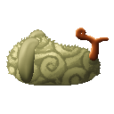
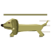

<!-- Generated by tools/build_pack_reference.py. Edit the pack sources and regenerate. -->

# Inu Inu no Mi, Model: Dachshund

{ .entry-page-icon }

[Fruits](index.md) · [Missing Missing no Mi](../../reference/content/inomissing.md)

<!-- fruit inomissing:inu_inu_no_mi_model_dachshund -->

| Stat | Value |
| --- | --- |
| Type | Zoan |
| Tier | 1 |
| Fruit damage scaling | 1.00× at 10,000 Doriki → 2.25× at 50,000 Doriki |
| Abilities | 6 (6 active, 0 passive) |
| Fruit boxes | [Wooden Box](../fruit-boxes.md) |

See [damage calculations](../combat-stats.md#damage-from-doriki).

!!! note "Reading the stats"
    Listed base damage is for the named part of the move. Pack and Doriki multipliers are shown separately. Times assume 20 ticks per second.

<!-- move inomissing:dachshund_heavy_point -->

## Dachshund Heavy Point

{ .entry-move-icon loading=lazy } *Active · Transformation*

Transforms the user into a dachshund hybrid, a small dog man that bites and barks a lot.

| Stat | Value |
| --- | --- |
| Pack multiplier when dealing damage | 2.1× |

**Stats while transformed**

| Stat | Value |
| --- | --- |
| Movement speed | +10% of base |
| Punch damage | +7 HP |
| Armor | +6 |

<!-- move inomissing:dachshund_walk_point -->

## Dachshund Walk Point

{ .entry-move-icon loading=lazy } *Active · Transformation*

Transforms the user into a dachshund, a long dog on short legs that fits through a one block gap.

| Stat | Value |
| --- | --- |
| Pack multiplier when dealing damage | 2.1× |

**Stats while transformed**

| Stat | Value |
| --- | --- |
| Movement speed | +50% of base |
| Punch damage | +5 HP |
| Armor | +3 |

<!-- move inomissing:badger_hunt -->

## Badger Hunt

{ .entry-move-icon loading=lazy } *Active*

While in the full dachshund form and on soft ground, the user goes under the ground straight to the target and jumps out under it, throwing it in the air

| Stat | Value |
| --- | --- |
| Base damage | 10 HP |
| Cooldown | 12 s (240 ticks) |
| Conditional cooldown | 0.5 s (10 ticks) |
| Pack multiplier when dealing damage | 2.1× |

<!-- move inomissing:big_bark -->

## Big Bark

{ .entry-move-icon loading=lazy } *Active*

The user barks way too loud for their size at the enemies in front of them. Small creatures run away and the others are slowed and lose their target for a moment

| Stat | Value |
| --- | --- |
| Cooldown | 12 s (240 ticks) |
| Pack multiplier when dealing damage | 2.1× |

<!-- move inomissing:wont_let_go -->

## Won't Let Go

{ .entry-move-icon loading=lazy } *Active*

The user jumps at the target and bites it and just won't let go, hanging on it and nibbling it. A strong enough hit shakes them off, use the ability again to let go

| Stat | Value |
| --- | --- |
| Base damage | 2 HP |
| Cooldown | 15 s (300 ticks) |
| Pack multiplier when dealing damage | 2.1× |

<!-- move inomissing:low_run -->

## Low Run

{ .entry-move-icon loading=lazy } *Active*

While in the full dachshund form, the user flattens down and runs fast close to the ground, so low they can go under a slab. Use the ability again to stand up

| Stat | Value |
| --- | --- |
| Cooldown | 8 s (160 ticks) |
| Pack multiplier when dealing damage | 2.1× |

