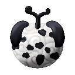
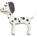
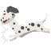
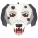
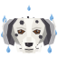
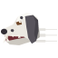
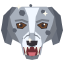
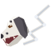

<!-- Generated by tools/build_pack_reference.py. Edit the pack sources and regenerate. -->

# Inu Inu no Mi, Model: Dalmatian

{ .entry-page-icon }

[Fruits](index.md) · [Missing Missing no Mi](../../reference/content/inomissing.md)

<!-- fruit inomissing:inu_inu_no_mi_model_dalmatian -->

| Stat | Value |
| --- | --- |
| Type | Zoan |
| Tier | 1 |
| Fruit damage scaling | 1.00× at 10,000 Doriki → 2.25× at 50,000 Doriki |
| Abilities | 12 (12 active, 0 passive) |
| Fruit boxes | [Wooden Box](../fruit-boxes.md) |

See [damage calculations](../combat-stats.md#damage-from-doriki).

!!! note "Reading the stats"
    Listed base damage is for the named part of the move. Pack and Doriki multipliers are shown separately. Times assume 20 ticks per second.

<!-- move inomissing:dalmatian_heavy_point -->

## Dalmatian Heavy Point

{ .entry-move-icon loading=lazy } *Active · Transformation*

Transforms the user into a dalmatian hybrid, a tall spotted dog man that runs fast and guards its friends.

| Stat | Value |
| --- | --- |
| Pack multiplier when dealing damage | 1.6× |

**Stats while transformed**

| Stat | Value |
| --- | --- |
| Movement speed | +15% of base |
| Punch damage | +7 HP |
| Armor | +8 |
| Toughness | +2 |

<!-- move inomissing:dalmatian_walk_point -->

## Dalmatian Walk Point

{ .entry-move-icon loading=lazy } *Active · Transformation*

Transforms the user into a big dalmatian, a fast running dog with black spots.

| Stat | Value |
| --- | --- |
| Pack multiplier when dealing damage | 1.6× |

**Stats while transformed**

| Stat | Value |
| --- | --- |
| Movement speed | +55% of base |
| Punch damage | +5 HP |
| Armor | +5 |
| Step height | +1 blocks |
| Jump | +1 |

<!-- move inomissing:kamikudaki -->

## Kamikudaki

{ .entry-move-icon loading=lazy } *Active*

The user bites hard the enemy in front of them

| Stat | Value |
| --- | --- |
| Base damage | 7 HP |
| Walk damage | 8 HP |
| Cooldown | 5 s (100 ticks) |
| Pack multiplier when dealing damage | 1.3× |

<!-- move inomissing:tobikakari -->

## Tobikakari

{ .entry-move-icon loading=lazy } *Active*

The user jumps on the target and knocks it down, holding it on the ground with their paws so it cant move for a moment

| Stat | Value |
| --- | --- |
| Base damage | 8 HP |
| Cooldown | 12 s (240 ticks) |
| Pack multiplier when dealing damage | 1.6× |

<!-- move inomissing:hoegoe -->

## Hoegoe

{ .entry-move-icon loading=lazy } *Active*

The user barks very sharp, the enemies around are pushed back and stop what they were doing

| Stat | Value |
| --- | --- |
| Cooldown | 10 s (200 ticks) |
| Pack multiplier when dealing damage | 1.6× |

<!-- move inomissing:banken -->

## Banken

{ .entry-move-icon loading=lazy } *Active*

The user guards the ally they look at and takes part of the hits for them, and growls so the enemies close by deal less damage

| Stat | Value |
| --- | --- |
| Cooldown | 20 s (400 ticks) |
| Pack multiplier when dealing damage | 1.6× |

<!-- move inomissing:miburui -->

## Miburui

{ .entry-move-icon loading=lazy } *Active*

The user shakes like a wet dog and gets rid of slowness, water and fire, the fire wont catch them again for a moment

| Stat | Value |
| --- | --- |
| Cooldown | 15 s (300 ticks) |
| Pack multiplier when dealing damage | 1.6× |

<!-- move inomissing:kyoken -->

## Kyoken

{ .entry-move-icon loading=lazy } *Active*

The user throws themself on the target like a mad dog and bites and claws it again and again, faster and faster, without letting it go

| Stat | Value |
| --- | --- |
| Hit damage | 1.8 HP |
| Cooldown | 30 s (600 ticks) |
| Conditional cooldown | 0.5 s (10 ticks) |
| Pack multiplier when dealing damage | 1.6× |

<!-- move inomissing:kiba_shigan -->

## Kiba Shigan

{ .entry-move-icon loading=lazy } *Active*

While in the hybrid form, the user darts at the enemy and bites it as fast as a Shigan, the fangs go through the armor and the wound bleeds

| Stat | Value |
| --- | --- |
| Base damage | 12 HP |
| Bleed | 3 s (60 ticks) |
| Cooldown | 8 s (160 ticks) |
| Conditional cooldown | 0.5 s (10 ticks) |
| Pack multiplier when dealing damage | 1.6× |

<!-- move inomissing:o_rankyaku -->

## O Rankyaku

{ .entry-move-icon loading=lazy } *Active*

While in the hybrid form, the user flicks their tail so fast it throws a thin air blade

| Stat | Value |
| --- | --- |
| Base damage | 10 HP |
| Cooldown | 12 s (240 ticks) |
| Pack multiplier when dealing damage | 1.6× |

<!-- move inomissing:tekkai_kaeshi_kiba -->

## Tekkai: Kaeshi Kiba

{ .entry-move-icon loading=lazy } *Active*

While in the hybrid form, the user freezes in Tekkai and takes less damage, the first enemy that hits them gets bitten back

| Stat | Value |
| --- | --- |
| Base damage | 10 HP |
| Cooldown | 10 s (200 ticks) |
| Pack multiplier when dealing damage | 1.6× |

<!-- move inomissing:soru_inazuma -->

## Soru: Inazuma

{ .entry-move-icon loading=lazy } *Active*

While in the hybrid form, the user zigzags with Soru from one enemy to the next and bites each of them

| Stat | Value |
| --- | --- |
| Base damage | 5 HP |
| Cooldown | 10 s (200 ticks) |
| Conditional cooldown | 0.5 s (10 ticks) |
| Pack multiplier when dealing damage | 1.6× |

