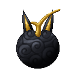
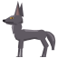
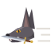
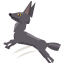
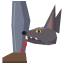
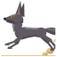

<!-- Generated by tools/build_pack_reference.py. Edit the pack sources and regenerate. -->

# Inu Inu no Mi, Model: Jackal

{ .entry-page-icon }

[Fruits](index.md) · [Missing Missing no Mi](../../reference/content/inomissing.md)

<!-- fruit inomissing:inu_inu_no_mi_model_jackal -->

| Stat | Value |
| --- | --- |
| Type | Zoan |
| Tier | 2 |
| Fruit damage scaling | 1.00× at 10,000 Doriki → 2× at 50,000 Doriki |
| Abilities | 8 (6 active, 2 passive) |
| Fruit boxes | [Iron Box](../fruit-boxes.md) |

See [damage calculations](../combat-stats.md#damage-from-doriki).

!!! note "Reading the stats"
    Listed base damage is for the named part of the move. Pack and Doriki multipliers are shown separately. Times assume 20 ticks per second.

<!-- move inomissing:jackal_heavy_point -->

## Jackal Heavy Point

{ .entry-move-icon loading=lazy } *Active · Transformation*

Transforms the user into a jackal hybrid, a tall black dog man with long legs and big ears.

| Stat | Value |
| --- | --- |
| Pack multiplier when dealing damage | 4.75× |

**Stats while transformed**

| Stat | Value |
| --- | --- |
| Movement speed | +20% of base |
| Maximum health | +20% |
| Punch damage | +8 HP |
| Armour | +8 |
| Step height | +0.5 blocks |
| Jump | +1 |

<!-- move inomissing:jackal_walk_point -->

## Jackal Walk Point

{ .entry-move-icon loading=lazy } *Active · Transformation*

Transforms the user into a big black jackal that runs very fast.

| Stat | Value |
| --- | --- |
| Pack multiplier when dealing damage | 4.75× |

**Stats while transformed**

| Stat | Value |
| --- | --- |
| Movement speed | +65% of base |
| Punch damage | +6 HP |
| Armour | +5 |
| Step height | +1 blocks |
| Jump | +2 |

<!-- move inomissing:narikiba -->

## Narikiba

{ .entry-move-icon loading=lazy } *Active*

While in the jackal form, the user takes their sword in the mouth and dashes forward cutting all enemies on the way. The sword damage is added to the cut

| Stat | Value |
| --- | --- |
| Base damage | 10 HP |
| Cooldown | 10 s (200 ticks) |
| Pack multiplier when dealing damage | 4.75× |

<!-- move inomissing:choyaku -->

## Choyaku

{ .entry-move-icon loading=lazy } *Active*

While in a jackal form, the user leaps very high where they look and lands without getting hurt. The whole jackal goes higher

| Stat | Value |
| --- | --- |
| Cooldown | 8 s (160 ticks) |
| Conditional cooldown | 0.5 s (10 ticks) |
| Pack multiplier when dealing damage | 4.75× |

<!-- move inomissing:hikagami_gari -->

## Hikagami Gari

{ .entry-move-icon loading=lazy } *Active*

The user jumps at the target and bites the back of its legs, the target is much slower and cant jump for a while

| Stat | Value |
| --- | --- |
| Base damage | 4 HP |
| Cooldown | 12 s (240 ticks) |
| Pack multiplier when dealing damage | 4.75× |

<!-- move inomissing:anubisu_no_shinpan -->

## Anubisu no Shinpan

{ .entry-move-icon loading=lazy } *Active*

The user jumps at the target and bites it to finish it off, it does almost nothing to a healthy target but a lot to a target that is low on health

| Stat | Value |
| --- | --- |
| Base damage | 3 HP |
| Judgment damage | 30 HP |
| Cooldown | 15 s (300 ticks) |
| Pack multiplier when dealing damage | 4.75× |

<!-- move inomissing:sabaku_bashiri -->

## Sabaku Bashiri

{ .entry-move-icon loading=lazy } *Passive*

While in a jackal form the user runs faster in the desert and soul sand does not slow them down

| Stat | Value |
| --- | --- |
| Pack multiplier when dealing damage | 4.75× |

<!-- move inomissing:shiniku_gui -->

## Shiniku Gui

{ .entry-move-icon loading=lazy } *Passive*

While in a jackal form the user can eat rotten flesh without getting sick and heals a bit when they finish off a creature

| Stat | Value |
| --- | --- |
| Pack multiplier when dealing damage | 4.75× |

