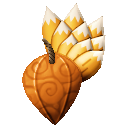
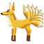

<!-- Generated by tools/build_pack_reference.py. Edit the pack sources and regenerate. -->

# Inu Inu no Mi, Model: Kyubi no Kitsune

{ .entry-page-icon }

[Fruits](index.md) · [Missing Missing no Mi](../../reference/content/inomissing.md)

<!-- fruit inomissing:inu_inu_no_mi_model_kyubi_no_kitsune -->

| Stat | Value |
| --- | --- |
| Type | Mythical Zoan |
| Tier | 3 |
| Fruit damage scaling | 1.00× at 10,000 Doriki → 1.75× at 50,000 Doriki |
| Abilities | 9 (9 active, 0 passive) |
| Fruit boxes | [Golden Box](../fruit-boxes.md) |

See [damage calculations](../combat-stats.md#damage-from-doriki).

!!! note "Reading the stats"
    Listed base damage is for the named part of the move. Pack and Doriki multipliers are shown separately. Times assume 20 ticks per second.

<!-- move inomissing:kyubi_heavy_point -->

## Kyubi Heavy Point

{ .entry-move-icon loading=lazy } *Active · Transformation*

Transforms the user into a fox-woman hybrid with nine tails, which focuses on agility and strength.

| Stat | Value |
| --- | --- |
| Pack multiplier when dealing damage | 1.05× |

**Stats while transformed**

| Stat | Value |
| --- | --- |
| Movement speed | +20% of base |
| Punch damage | +12 HP |
| Armor | +14 |
| Toughness | +3 |
| Step height | +0.5 blocks |
| Jump | +1 |

<!-- move inomissing:kyubi_walk_point -->

## Kyubi Walk Point

{ .entry-move-icon loading=lazy } *Active · Transformation*

Transforms the user into a great nine-tailed fox, which focuses on speed and long jumps.

| Stat | Value |
| --- | --- |
| Pack multiplier when dealing damage | 1.05× |

**Stats while transformed**

| Stat | Value |
| --- | --- |
| Movement speed | +55% of base |
| Punch damage | +14 HP |
| Armor | +15 |
| Toughness | +3 |
| Step height | +1 blocks |
| Jump | +1.6 |

<!-- move inomissing:face_touch -->

## Face Touch

{ .entry-move-icon loading=lazy } *Active*

The user touches whoever they look at and remembers their look. The one touched is not hurt and is not told. The ability mode key opens the memory.

| Stat | Value |
| --- | --- |
| Cooldown | 2 s (40 ticks) |
| Conditional cooldown | 0.5 s (10 ticks) |
| Pack multiplier when dealing damage | 1.65× |

<!-- move inomissing:kyubi_disguise -->

## Disguise

{ .entry-move-icon loading=lazy } *Active*

The user takes the look of someone they have touched with Face Touch, and keeps it until they use the ability again or receive a blow. Taking a look ends the fox forms The ability mode key opens the memory, where the look is chosen.

| Stat | Value |
| --- | --- |
| Cooldown | 5 s (100 ticks) |
| Pack multiplier when dealing damage | 1.05× |

<!-- move inomissing:kyubi_tail_sweep -->

## Tail Sweep

{ .entry-move-icon loading=lazy } *Active*

The user sweeps their nine tails all around them, hitting every enemy nearby and throwing them away Only in the hybrid or the fox form

| Stat | Value |
| --- | --- |
| Base damage | 20 HP |
| Walk damage | 24 HP |
| Cooldown | 10 s (200 ticks) |
| Pack multiplier when dealing damage | 1.05× |

<!-- move inomissing:kyubi_nine_tails -->

## Nine Tails

{ .entry-move-icon loading=lazy } *Active*

The user's nine tails strike in front of them one after the other, hitting every enemy there nine times Only in the hybrid or the fox form

| Stat | Value |
| --- | --- |
| Base damage | 6 HP |
| Walk damage | 7 HP |
| Cooldown | 40 s (800 ticks) |
| Pack multiplier when dealing damage | 1.05× |

<!-- move inomissing:kyubi_fox_fire -->

## Fox Fire

{ .entry-move-icon loading=lazy } *Active*

The user sends three pale flames that follow the enemy they look at, or the nearest monster, and set it on fire Only in the hybrid or the fox form

| Stat | Value |
| --- | --- |
| Base damage | 9 HP |
| Cooldown | 12 s (240 ticks) |
| Pack multiplier when dealing damage | 1.05× |

<!-- move inomissing:kyubi_fox_fire_ring -->

## Fox Fire Ring

{ .entry-move-icon loading=lazy } *Active*

Pale flames turn around the user and burn the enemies they touch, each one is spent when it burns Used again the flames left fly at the enemy they look at Only in the hybrid or the fox form

| Stat | Value |
| --- | --- |
| Base damage | 6 HP |
| Cooldown | 25 s (500 ticks) |
| Pack multiplier when dealing damage | 1.05× |

<!-- move inomissing:kyubi_vanish -->

## Vanish

{ .entry-move-icon loading=lazy } *Active*

The user vanishes for a short time and leaves a false image of themselves where they stood. Monsters go for the image, which dissipates at the first blow Striking a blow makes the user seen again Only in the hybrid or the fox form

| Stat | Value |
| --- | --- |
| Cooldown | 20 s (400 ticks) |
| Pack multiplier when dealing damage | 1.05× |

