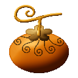
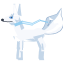
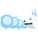
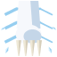

<!-- Generated by tools/build_pack_reference.py. Edit the pack sources and regenerate. -->

# Inu Inu no Mi, Model: Okuchi no Makami

{ .entry-page-icon }

[Fruits](index.md) · [Missing Missing no Mi](../../reference/content/inomissing.md)

<!-- fruit inomissing:inu_inu_no_mi_model_okuchi_no_makami -->

| Stat | Value |
| --- | --- |
| Type | Mythical Zoan |
| Tier | 3 |
| Fruit damage scaling | 1.00× at 10,000 Doriki → 1.75× at 50,000 Doriki |
| Abilities | 7 (7 active, 0 passive) |
| Fruit boxes | [Golden Box](../fruit-boxes.md) |

See [damage calculations](../combat-stats.md#damage-from-doriki).

!!! note "Reading the stats"
    Listed base damage is for the named part of the move. Pack and Doriki multipliers are shown separately. Times assume 20 ticks per second.

<!-- move inomissing:okuchi_heavy_point -->

## Okuchi Heavy Point

{ .entry-move-icon loading=lazy } *Active · Transformation*

Transforms the user into the hybrid of the wolf god, which focuses on strength and its weapons of ice.

| Stat | Value |
| --- | --- |
| Pack multiplier when dealing damage | 1.55× |

**Stats while transformed**

| Stat | Value |
| --- | --- |
| Movement speed | +25% of base |
| Punch damage | +13 HP |
| Armour | +16 |
| Toughness | +5 |
| Step height | +0.5 blocks |
| Jump | +1 |

<!-- move inomissing:okuchi_walk_point -->

## Okuchi Walk Point

{ .entry-move-icon loading=lazy } *Active · Transformation*

Transforms the user into the great white wolf god, which focuses on speed, weight and its breath of ice.

| Stat | Value |
| --- | --- |
| Pack multiplier when dealing damage | 1.55× |

**Stats while transformed**

| Stat | Value |
| --- | --- |
| Movement speed | +60% of base |
| Punch damage | +16 HP |
| Armour | +18 |
| Toughness | +6 |
| Step height | +1 blocks |
| Jump | +1.6 |

<!-- move inomissing:namuji_hyoga -->

## Namuji Hyoga

{ .entry-move-icon loading=lazy } *Active*

The user rears back and breathes out a blast of cold air that throws a wave of ice straight ahead, freezing the first enemy it hits Only in the hybrid or the wolf form, stronger from the wolf

| Stat | Value |
| --- | --- |
| Base damage | 24 HP |
| Walk damage | 30 HP |
| Cooldown | 30 s (600 ticks) |
| Pack multiplier when dealing damage | 1.55× |

<!-- move inomissing:kagamiyama -->

## Kagamiyama

{ .entry-move-icon loading=lazy } *Active*

The user coats themselves in ice that takes the blows for them. While it holds, their other abilities hit harder and freeze longer When it breaks, or when the ability is used again, it cracks off like glass, hurting and slowing the enemies around. Only in the hybrid or the wolf form

| Stat | Value |
| --- | --- |
| Burst damage | 8 HP |
| Cooldown | 50 s (1000 ticks) |
| Pack multiplier when dealing damage | 1.55× |

<!-- move inomissing:himorogiri -->

## Himorogiri

{ .entry-move-icon loading=lazy } *Active*

The user leaps, spins their weapon with a swirl of ice round their claws and strikes down from above, freezing the enemies where they land Only in the hybrid form, the bare claws strike when no weapon is held

| Stat | Value |
| --- | --- |
| Base damage | 26 HP |
| Cooldown | 12 s (240 ticks) |
| Pack multiplier when dealing damage | 1.55× |

<!-- move inomissing:okuchi_frost_weapon -->

## Frost Weapon

*Active*

The user coats what they fight with in ice, in any form or none With Frost Weapon the held weapon, or the bare hand, is coated in ice for a while and every blow hits harder and slows With Mahoroba the weapon wrapped in a frosty aura strikes the enemy in front hard and freezes it

| Stat | Value |
| --- | --- |
| Frost cooldown | 15 s (300 ticks) |
| Mahoroba damage | 22 HP |
| Mahoroba cooldown | 10 s (200 ticks) |
| Cooldown | 15 s (300 ticks) |
| Conditional cooldown | 0.5 s (10 ticks) |
| Pack multiplier when dealing damage | 1.55× |

<!-- move inomissing:okuchi_ice_wall -->

## Ice Wall

{ .entry-move-icon loading=lazy } *Active*

A wall of ice rises in front of the user and stops enemies and projectiles for a while. Using the ability again brings the wall down Only in the hybrid or the wolf form

| Stat | Value |
| --- | --- |
| Cooldown | 15 s (300 ticks) |
| Pack multiplier when dealing damage | 1.55× |

