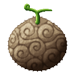
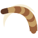
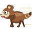
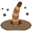

<!-- Generated by tools/build_pack_reference.py. Edit the pack sources and regenerate. -->

# Inu Inu no Mi, Model: Tanuki

{ .entry-page-icon }

[Fruits](index.md) · [Missing Missing no Mi](../../reference/content/inomissing.md)

<!-- fruit inomissing:inu_inu_no_mi_model_tanuki -->

| Stat | Value |
| --- | --- |
| Type | Zoan |
| Tier | 1 |
| Fruit damage scaling | 1.00× at 10,000 Doriki → 2.25× at 50,000 Doriki |
| Abilities | 9 (9 active, 0 passive) |
| Fruit boxes | [Wooden Box](../fruit-boxes.md) |

See [damage calculations](../combat-stats.md#damage-from-doriki).

!!! note "Reading the stats"
    Listed base damage is for the named part of the move. Pack and Doriki multipliers are shown separately. Times assume 20 ticks per second.

<!-- move inomissing:tanuki_heavy_point -->

## Tanuki Heavy Point

{ .entry-move-icon loading=lazy } *Active · Transformation*

Transforms the user into a tanuki hybrid, a round and sturdy brawler with a big belly.

| Stat | Value |
| --- | --- |
| Pack multiplier when dealing damage | 2.15× |

**Stats while transformed**

| Stat | Value |
| --- | --- |
| Movement speed | +5% of base |
| Punch damage | +5 HP |
| Armour | +8 |
| Toughness | +3 |

<!-- move inomissing:tanuki_walk_point -->

## Tanuki Walk Point

{ .entry-move-icon loading=lazy } *Active · Transformation*

Transforms the user into a tanuki, a small and quick animal that fits through a one block gap.

| Stat | Value |
| --- | --- |
| Pack multiplier when dealing damage | 2.15× |

**Stats while transformed**

| Stat | Value |
| --- | --- |
| Movement speed | +40% of base |
| Punch damage | +3 HP |
| Armour | +4 |
| Toughness | +1 |

<!-- move inomissing:tanuki_bite -->

## Tanuki Bite

{ .entry-move-icon loading=lazy } *Active*

The user quickly bites the enemy in front of them

| Stat | Value |
| --- | --- |
| Base damage | 6 HP |
| Walk damage | 7 HP |
| Cooldown | 5 s (100 ticks) |
| Pack multiplier when dealing damage | 1.6× |

<!-- move inomissing:tail_swipe -->

## Tail Swipe

{ .entry-move-icon loading=lazy } *Active*

The user spins and sweeps their tail around them, hitting all nearby enemies and pushing them away

| Stat | Value |
| --- | --- |
| Base damage | 8 HP |
| Walk damage | 6 HP |
| Cooldown | 8 s (160 ticks) |
| Pack multiplier when dealing damage | 2.15× |

<!-- move inomissing:belly_drum -->

## Belly Drum

{ .entry-move-icon loading=lazy } *Active*

While in the hybrid form, the user drums on their belly, each beat hitting all the enemies around them. The last beat pushes them back

| Stat | Value |
| --- | --- |
| Base damage | 2.5 HP |
| Cooldown | 12 s (240 ticks) |
| Pack multiplier when dealing damage | 2.15× |

<!-- move inomissing:belly_bash -->

## Belly Bash

{ .entry-move-icon loading=lazy } *Active*

While in the hybrid form, the user throws themselves forward belly first, hitting the first enemy in their way and sending it far back

| Stat | Value |
| --- | --- |
| Base damage | 12 HP |
| Cooldown | 10 s (200 ticks) |
| Pack multiplier when dealing damage | 2.15× |

<!-- move inomissing:scurry -->

## Scurry

{ .entry-move-icon loading=lazy } *Active*

While in the full tanuki form, the user dashes forward low to the ground, running between the enemies in their way, hitting and slowing them

| Stat | Value |
| --- | --- |
| Base damage | 4 HP |
| Cooldown | 7 s (140 ticks) |
| Pack multiplier when dealing damage | 1.6× |

<!-- move inomissing:play_dead -->

## Play Dead

{ .entry-move-icon loading=lazy } *Active*

While in the full tanuki form, the user drops on their side and plays dead. Creatures lose interest in them, but they cannot move or attack

| Stat | Value |
| --- | --- |
| Cooldown | 15 s (300 ticks) |
| Pack multiplier when dealing damage | 2.15× |

<!-- move inomissing:burrow -->

## Burrow

{ .entry-move-icon loading=lazy } *Active*

While in the full tanuki form and on the ground, the user digs in where they stand. For a moment nothing can hit them, but they cannot move or use other abilities

| Stat | Value |
| --- | --- |
| Cooldown | 16 s (320 ticks) |
| Pack multiplier when dealing damage | 2.15× |

