<!-- Generated by tools/build_pack_reference.py. Edit the pack sources and regenerate. -->

# Inu Inu no Mi, Model: Wolf

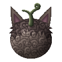{ .entry-page-icon }

[Fruits](index.md) · [Missing Missing no Mi](../../reference/content/inomissing.md)

<!-- fruit inomissing:inu_inu_no_mi_model_wolf -->

| Stat | Value |
| --- | --- |
| Type | Zoan |
| Tier | 2 |
| Fruit damage scaling | 1.00× at 10,000 Doriki → 2× at 50,000 Doriki |
| Abilities | 13 (12 active, 1 passive) |
| Fruit boxes | [Iron Box](../fruit-boxes.md) |

See [damage calculations](../combat-stats.md#damage-from-doriki).

!!! note "Reading the stats"
    Listed base damage is for the named part of the move. Pack and Doriki multipliers are shown separately. Times assume 20 ticks per second.

<!-- move inomissing:wolf_walk_point -->

## Wolf Walk Point

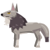{ .entry-move-icon loading=lazy } *Active · Transformation*

Transforms the user into a wolf, which focuses on speed and long jumps.

| Stat | Value |
| --- | --- |
| Pack multiplier when dealing damage | 1.85× |

**Stats while transformed**

| Stat | Value |
| --- | --- |
| Movement speed | +60% of base |
| Punch damage | +6 HP |
| Armour | +6 |
| Step height | +1 blocks |
| Jump | +1.8 |

<!-- move inomissing:wolf_heavy_point -->

## Wolf Heavy Point

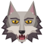{ .entry-move-icon loading=lazy } *Active · Transformation*

Transforms the user into a wolf-man hybrid with claws, which focuses on strength.

| Stat | Value |
| --- | --- |
| Pack multiplier when dealing damage | 1.85× |

**Stats while transformed**

| Stat | Value |
| --- | --- |
| Movement speed | +15% of base |
| Maximum health | +25% |
| Punch damage | +8 HP |
| Armour | +9 |
| Step height | +0.5 blocks |
| Jump | +0.8 |

<!-- move inomissing:kamitsuki -->

## Kamitsuki

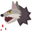{ .entry-move-icon loading=lazy } *Active*

The user jumps at the target and bites it, making it bleed. The whole wolf bites harder.

| Stat | Value |
| --- | --- |
| Base damage | 9 HP |
| Wolf damage | 12 HP |
| Bleed | 5 s (100 ticks) |
| Cooldown | 6 s (120 ticks) |
| Pack multiplier when dealing damage | 1.4× |

<!-- move inomissing:shippu -->

## Shippu

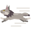{ .entry-move-icon loading=lazy } *Active*

While in the wolf form, the user runs at full speed knocking down all enemies in their path.

| Stat | Value |
| --- | --- |
| Base damage | 9 HP |
| Cooldown | 8 s (160 ticks) |
| Pack multiplier when dealing damage | 1.85× |

<!-- move inomissing:toboe -->

## Toboe

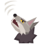{ .entry-move-icon loading=lazy } *Active*

The user howls, weakening and slowing all nearby enemies. During the night the user also hits harder and runs faster for a while.

| Stat | Value |
| --- | --- |
| Cooldown | 20 s (400 ticks) |
| Pack multiplier when dealing damage | 1.85× |

<!-- move inomissing:kyukaku -->

## Kyukaku

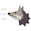{ .entry-move-icon loading=lazy } *Active*

The user smells all nearby creatures, making them glow for 10 seconds even through walls.

| Stat | Value |
| --- | --- |
| Cooldown | 20 s (400 ticks) |
| Pack multiplier when dealing damage | 1.85× |

<!-- move inomissing:yako -->

## Yako

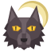{ .entry-move-icon loading=lazy } *Passive*

While in a wolf form, the user can see in the dark. During the night they are also faster and stronger, and they regenerate health.

| Stat | Value |
| --- | --- |
| Pack multiplier when dealing damage | 1.85× |

<!-- move inomissing:jusshigan -->

## Jusshigan

{ .entry-move-icon loading=lazy } *Active*

While in the hybrid form, the user joins both hands and stabs the enemy in front of them with all 10 clawed fingers at once.

| Stat | Value |
| --- | --- |
| Base damage | 9 HP |
| Cooldown | 8 s (160 ticks) |
| Conditional cooldown | 0.5 s (10 ticks) |
| Pack multiplier when dealing damage | 1.85× |

<!-- move inomissing:gekko_jusshigan -->

## Gekko Jusshigan

{ .entry-move-icon loading=lazy } *Active*

While in the hybrid form, the user springs up off the air and plunges onto the target, stabbing it with all 10 claws. Deals more damage during the night.

| Stat | Value |
| --- | --- |
| Base damage | 18 HP |
| Cooldown | 15 s (300 ticks) |
| Pack multiplier when dealing damage | 1.85× |

<!-- move inomissing:rankyaku_koro -->

## Rankyaku: Koro

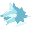{ .entry-move-icon loading=lazy } *Active*

While in the hybrid form, the user kicks a blade of air that skips across the ground towards the target. While in the hybrid form, the user kicks four wolves of air that burst on what they hit.

| Stat | Value |
| --- | --- |
| Base damage | 12 HP |
| Cooldown | 7 s (140 ticks) |
| Wolf damage | 5 HP |
| Lupus cooldown | 12 s (240 ticks) |
| Pack multiplier when dealing damage | 1.85× |

<!-- move inomissing:tekkai_kenpo_roga_no_kamae -->

## Tekkai Kenpo: Roga no Kamae

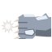{ .entry-move-icon loading=lazy } *Active*

While in the hybrid form, the user hardens their body like iron, taking less damage and no knockback but moving slower. Their punches become Okami Hajiki, which sends the target flying.

| Stat | Value |
| --- | --- |
| Base cooldown | 4 s (80 ticks) |
| Pack multiplier when dealing damage | 1.85× |

<!-- move inomissing:tekkai_kenpo -->

## Tekkai Kenpo: Don Poro

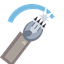{ .entry-move-icon loading=lazy } *Active*

While in the hybrid form, the user punches the enemy in front of them in the stomach with an iron fist, leaving them winded. While in the hybrid form, the user drops onto their hands and kicks the enemy in front of them up into the air.

| Stat | Value |
| --- | --- |
| Don poro damage | 10 HP |
| Don poro cooldown | 8 s (160 ticks) |
| Matenro damage | 8 HP |
| Matenro cooldown | 10 s (200 ticks) |
| Cooldown | 8 s (160 ticks) |
| Conditional cooldown | 0.5 s (10 ticks) |
| Pack multiplier when dealing damage | 1.85× |

<!-- move inomissing:rokaru_area_network -->

## Rokaru Area Network

{ .entry-move-icon loading=lazy } *Active*

While in the hybrid form, the user rushes at the enemy in sight with Soru and slashes them with both hands so fast they seem to have many.

| Stat | Value |
| --- | --- |
| Slash damage | 1.5 HP |
| Cooldown | 10 s (200 ticks) |
| Conditional cooldown | 0.5 s (10 ticks) |
| Pack multiplier when dealing damage | 1.85× |

