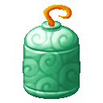
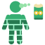

<!-- Generated by tools/build_pack_reference.py. Edit the pack sources and regenerate. -->

# Iro Iro no Mi

{ .entry-page-icon }

[Fruits](index.md) · [Missing Missing no Mi](../../reference/content/inomissing.md)

<!-- fruit inomissing:iro_iro_no_mi -->

| Stat | Value |
| --- | --- |
| Type | Paramecia |
| Tier | 1 |
| Fruit damage scaling | 1.00× at 10,000 Doriki → 2.25× at 50,000 Doriki |
| Abilities | 4 (4 active, 0 passive) |
| Fruit boxes | [Wooden Box](../fruit-boxes.md) |

See [damage calculations](../combat-stats.md#damage-from-doriki).

!!! note "Reading the stats"
    Listed base damage is for the named part of the move. Pack and Doriki multipliers are shown separately. Times assume 20 ticks per second.

<!-- move inomissing:camouflapaint -->

## Camouflapaint

{ .entry-move-icon loading=lazy } *Active*

The user sprays themselves and their allies around with paint the colours of what is behind them, so nobody sees them for a while. Their crew, the creatures that serve them and their own beasts are painted, an ally player only if they sneak. Hitting or being hit washes the paint off. Observation Haki sees through it. Use it again to wash all the paint off, the cooldown is only for the time spent

| Stat | Value |
| --- | --- |
| Cooldown | 40 s (800 ticks) |
| Pack multiplier when dealing damage | 1.65× |

<!-- move inomissing:copy_paint -->

## Copy Paint

{ .entry-move-icon loading=lazy } *Active*

The user paints themselves to look like a person they have seen, for 60 seconds. The paint is crude so up close nobody is fooled, and Observation Haki sees through it. It falls when they hit or are hit Whoever the user looks at is remembered. The ability mode key opens the memory, where the look is chosen

| Stat | Value |
| --- | --- |
| Cooldown | 45 s (900 ticks) |
| Pack multiplier when dealing damage | 1.65× |

<!-- move inomissing:migawari_nuri -->

## Migawari Nuri

{ .entry-move-icon loading=lazy } *Active*

The user paints a crude double of themselves that stands still. Monsters around go for it instead of the user until it is struck down or its time is over. Observation Haki sees through it

| Stat | Value |
| --- | --- |
| Cooldown | 30 s (600 ticks) |
| Pack multiplier when dealing damage | 1.65× |

<!-- move inomissing:hade_iro -->

## Hade Iro

{ .entry-move-icon loading=lazy } *Active*

The user sprays a bright colour on the one they look at. For a while it glows through walls for the user and their allies, and it cannot hide or turn unseen The user paints the creature they look at in the colours of another side. The creatures around attack it for a while. Not on players nor bosses

| Stat | Value |
| --- | --- |
| Cooldown | 15 s (300 ticks) |
| Confuse cooldown | 30 s (600 ticks) |
| Conditional cooldown | 0.5 s (10 ticks) |
| Pack multiplier when dealing damage | 1.65× |

