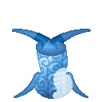
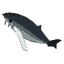

<!-- Generated by tools/build_pack_reference.py. Edit the pack sources and regenerate. -->

# Isa Isa no Mi, Model: Whale

{ .entry-page-icon }

[Fruits](index.md) · [InoFruits](../../reference/content/inofruits.md)

<!-- fruit inofruits:isa_isa_no_mi_model_whale -->

| Stat | Value |
| --- | --- |
| Type | Zoan |
| Tier | 1 |
| Fruit damage scaling | 1.00× at 10,000 Doriki → 2.25× at 50,000 Doriki |
| Abilities | 6 (5 active, 1 passive) |
| Fruit boxes | [Wooden Box](../fruit-boxes.md) |

See [damage calculations](../combat-stats.md#damage-from-doriki).

!!! note "Reading the stats"
    Listed base damage is for the named part of the move. Pack and Doriki multipliers are shown separately. Times assume 20 ticks per second.

<!-- move inofruits:isa_isa_guard_point -->

## Isa Isa Guard Point

{ .entry-move-icon loading=lazy } *Active · Transformation*

Transforms the user into a whale, which focuses on defense, barely moving on land but very fast in water.

| Stat | Value |
| --- | --- |
| Pack multiplier when dealing damage | 1.5× |

**Stats while transformed**

| Stat | Value |
| --- | --- |
| Movement speed | -90% of base |
| Step height | +1.4 blocks |
| Maximum health | +100% |
| Armor | +12 |
| Toughness | +4 |
| Punch damage | +4 HP |

<!-- move inofruits:isa_isa_heavy_point -->

## Isa Isa Heavy Point

{ .entry-move-icon loading=lazy } *Active · Transformation*

Transforms the user into a whale hybrid that can still walk at normal speed.

| Stat | Value |
| --- | --- |
| Pack multiplier when dealing damage | 1.5× |

**Stats while transformed**

| Stat | Value |
| --- | --- |
| Movement speed | -10% of base |
| Maximum health | +50% |
| Armor | +9 |
| Toughness | +3.5 |
| Punch damage | +5 HP |

<!-- move inofruits:taiatari -->

## Taiatari

{ .entry-move-icon loading=lazy } *Active*

The user jumps in the air and falls flat, crushing everything around them. A whole whale lands instead of a person, reaching almost twice as far

| Stat | Value |
| --- | --- |
| Cooldown | 15 s (300 ticks) |
| Pack multiplier when dealing damage | 1.5× |

<!-- move inofruits:shiofuki -->

## Shiofuki

{ .entry-move-icon loading=lazy } *Active*

Makes a column of water burst in front of the user launching enemies up and putting out fires. The whole whale spouts further ahead, wider and higher

| Stat | Value |
| --- | --- |
| Cooldown | 8 s (160 ticks) |
| Pack multiplier when dealing damage | 1.5× |

<!-- move inofruits:utagoe -->

## Utagoe

{ .entry-move-icon loading=lazy } *Active*

The user sings, making themselves and nearby allies resistant to damage. The whole whale's song carries further and lasts longer

| Stat | Value |
| --- | --- |
| Cooldown | 20 s (400 ticks) |
| Pack multiplier when dealing damage | 1.5× |

<!-- move inofruits:isa_rideable -->

## Isa Rideable

*Passive*

Allows other players to ride on the whale's back

| Stat | Value |
| --- | --- |
| Pack multiplier when dealing damage | 1.5× |

