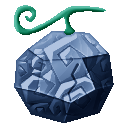
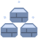
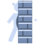
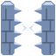
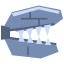

<!-- Generated by tools/build_pack_reference.py. Edit the pack sources and regenerate. -->

# Ishi Ishi no Mi

{ .entry-page-icon }

[Fruits](index.md) · [Missing Missing no Mi](../../reference/content/inomissing.md)

<!-- fruit inomissing:ishi_ishi_no_mi -->

| Stat | Value |
| --- | --- |
| Type | Paramecia |
| Tier | 3 |
| Fruit damage scaling | 1.00× at 10,000 Doriki → 1.75× at 50,000 Doriki |
| Abilities | 9 (7 active, 2 passive) |
| Fruit boxes | [Golden Box](../fruit-boxes.md) |

See [damage calculations](../combat-stats.md#damage-from-doriki).

!!! note "Reading the stats"
    Listed base damage is for the named part of the move. Pack and Doriki multipliers are shown separately. Times assume 20 ticks per second.

<!-- move inomissing:ishi_stone -->

## Stone Mass

{ .entry-move-icon loading=lazy } *Passive*

Shows the stone the user can use, the stone blocks they carry are shown in green when there is enough stone around them to use the abilities for free.

| Stat | Value |
| --- | --- |
| Pack multiplier when dealing damage | 3.95× |

<!-- move inomissing:ishi_travel -->

## Stone Assimilation

{ .entry-move-icon loading=lazy } *Passive*

The user merges with stone, crouch on a stone block to enter it and then move freely through the stone.

| Stat | Value |
| --- | --- |
| Pack multiplier when dealing damage | 3.95× |

<!-- move inomissing:pulpostone -->

## Pulpostone

{ .entry-move-icon loading=lazy } *Active*

Creates stone tentacles around the location the user is looking at, that smash down and hold in place the enemies they hit.

| Stat | Value |
| --- | --- |
| Base damage | 8 HP |
| Cooldown | 10 s (200 ticks) |
| Pack multiplier when dealing damage | 3.95× |

<!-- move inomissing:charlestone -->

## Charlestone

{ .entry-move-icon loading=lazy } *Active*

Creates multiple waves of stone spikes from the ground around the user, launching into the air all the enemies caught.

| Stat | Value |
| --- | --- |
| Base damage | 9 HP |
| Cooldown | 15 s (300 ticks) |
| Pack multiplier when dealing damage | 3.95× |

<!-- move inomissing:ishiusu -->

## Ishiusu

{ .entry-move-icon loading=lazy } *Active*

Creates two spiked stone pillars, one on each side of the enemy the user is looking at, which crush it between them.

| Stat | Value |
| --- | --- |
| Base damage | 14 HP |
| Cooldown | 15 s (300 ticks) |
| Pack multiplier when dealing damage | 3.95× |

<!-- move inomissing:bitestone -->

## Bitestone

{ .entry-move-icon loading=lazy } *Active*

Creates a giant stone head in front of the enemy the user is looking at, which bites it.

| Stat | Value |
| --- | --- |
| Base damage | 10 HP |
| Cooldown | 12 s (240 ticks) |
| Pack multiplier when dealing damage | 3.95× |

<!-- move inomissing:ishi_kobushi -->

## Ishi Kobushi

{ .entry-move-icon loading=lazy } *Active*

A stone fist comes out of the closest stone wall or floor near the enemy the user is looking at and punches it.

| Stat | Value |
| --- | --- |
| Base damage | 6 HP |
| Cooldown | 3 s (60 ticks) |
| Pack multiplier when dealing damage | 2.5× |

<!-- move inomissing:ishi_ude -->

## Ishi Ude

{ .entry-move-icon loading=lazy } *Active*

The user's arm stretches out in stone and strikes every enemy in a line in front of them.

| Stat | Value |
| --- | --- |
| Base damage | 12 HP |
| Cooldown | 10 s (200 ticks) |
| Pack multiplier when dealing damage | 3.95× |

<!-- move inomissing:ishi_giant -->

## Stone Giant

{ .entry-move-icon loading=lazy } *Active*

The user creates a giant stone body around them, hits break the stone instead of hurting the user, and it grows back while standing on stone. The giant breaks when there is no stone left. The size can be changed before using it, a bigger giant is slower and giants can't jump.

| Stat | Value |
| --- | --- |
| Cooldown | 60 s (1200 ticks) |
| Pack multiplier when dealing damage | 3.95× |

**Stats while transformed**

| Stat | Value |
| --- | --- |
| Punch damage | +20 HP |
| Step height | +1.5 blocks |

