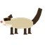

<!-- Generated by tools/build_pack_reference.py. Edit the pack sources and regenerate. -->

# Ita Ita no Mi, Model: Ferret

{ .entry-page-icon }

[Fruits](index.md) · [InoFruits](../../reference/content/inofruits.md)

<!-- fruit inofruits:ita_ita_no_mi_model_ferret -->

| Stat | Value |
| --- | --- |
| Type | Zoan |
| Tier | 2 |
| Fruit damage scaling | 1.00× at 10,000 Doriki → 2× at 50,000 Doriki |
| Abilities | 7 (7 active, 0 passive) |
| Fruit boxes | [Iron Box](../fruit-boxes.md) |

See [damage calculations](../combat-stats.md#damage-from-doriki).

!!! note "Reading the stats"
    Listed base damage is for the named part of the move. Pack and Doriki multipliers are shown separately. Times assume 20 ticks per second.

<!-- move inofruits:ita_ita_walk_point -->

## Ita Ita Walk Point

{ .entry-move-icon loading=lazy } *Active · Transformation*

Transforms the user into a ferret, which focuses on speed and staying low to the ground

| Stat | Value |
| --- | --- |
| Pack multiplier when dealing damage | 6× |

**Stats while transformed**

| Stat | Value |
| --- | --- |
| Movement speed | +55% of base |
| Punch damage | +4 HP |
| Armor | +3 |
| Step height | +0.5 blocks |
| Jump | +1.8 |
| Toughness | +1 |

<!-- move inofruits:ita_ita_heavy_point -->

## Ita Ita Heavy Point

{ .entry-move-icon loading=lazy } *Active · Transformation*

Transforms the user into a ferret hybrid, which focuses on speed and claw attacks.

| Stat | Value |
| --- | --- |
| Pack multiplier when dealing damage | 6× |

**Stats while transformed**

| Stat | Value |
| --- | --- |
| Movement speed | +34% of base |
| Punch damage | +6 HP |
| Armor | +5 |
| Step height | +0.5 blocks |
| Jump | +1.4 |
| Toughness | +1.5 |

<!-- move inofruits:weasel_bound -->

## Weasel Bound

{ .entry-move-icon loading=lazy } *Active*

The user leaps far forward and hits everything under them when landing

| Stat | Value |
| --- | --- |
| Cooldown | 5.5 s (110 ticks) |
| Base damage | 2 HP |
| Pack multiplier when dealing damage | 3.5× |

<!-- move inofruits:rending_claws -->

## Rending Claws

{ .entry-move-icon loading=lazy } *Active*

Slashes the target with thin claws making it bleed.

| Stat | Value |
| --- | --- |
| Base damage | 5 HP |
| Cooldown | 5 s (100 ticks) |
| Pack multiplier when dealing damage | 3.5× |

<!-- move inofruits:ferret_dart -->

## Ferret Dart

{ .entry-move-icon loading=lazy } *Active*

Dashes forward in an instant hitting anything in the way

| Stat | Value |
| --- | --- |
| Base damage | 3 HP |
| Cooldown | 3.5 s (70 ticks) |
| Pack multiplier when dealing damage | 3.5× |

<!-- move inofruits:saigoppe -->

## Saigoppe

{ .entry-move-icon loading=lazy } *Active*

Releases a foul musk that makes everyone nearby dizzy, sick and slow.

| Stat | Value |
| --- | --- |
| Cooldown | 20 s (400 ticks) |
| Pack multiplier when dealing damage | 6× |

<!-- move inofruits:death_sleep -->

## Death Sleep

{ .entry-move-icon loading=lazy } *Active*

The ferret plays dead, taking less damage while lying down and healing quickly

| Stat | Value |
| --- | --- |
| Min cooldown | 10 s (200 ticks) |
| Max cooldown | 20 s (400 ticks) |
| Pack multiplier when dealing damage | 6× |

