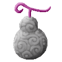

<!-- Generated by tools/build_pack_reference.py. Edit the pack sources and regenerate. -->

# Ito Ito no Mi

{ .entry-page-icon }

[Fruits](index.md) · [Mine Mine no Mi](../../reference/content/mineminenomi.md)

<!-- fruit mineminenomi:ito_ito_no_mi -->

| Stat | Value |
| --- | --- |
| Type | Paramecia |
| Tier | 3 |
| Fruit damage scaling | 1.00× at 10,000 Doriki → 1.75× at 50,000 Doriki |
| Abilities | 8 (8 active, 0 passive) |
| Fruit boxes | [Golden Box](../fruit-boxes.md) |

See [damage calculations](../combat-stats.md#damage-from-doriki).

[Jump to awakening](#awakening)

After awakening, this fruit’s original damaging moves deal **1.5× damage**. The awakening techniques below have their own values.

!!! note "Reading the stats"
    Listed base damage is for the named part of the move. Pack and Doriki multipliers are shown separately. Times assume 20 ticks per second.

<!-- move mineminenomi:parasite -->

## Parasite

{ .entry-move-icon loading=lazy } *Active*

By attaching your strings to nearby enemies, they get completely immobilized

| Stat | Value |
| --- | --- |
| Cooldown | 30 s (600 ticks) |
| Pack multiplier when dealing damage | 1.85× |

<!-- move mineminenomi:sora_no_michi -->

## Sora no Michi

{ .entry-move-icon loading=lazy } *Active*

The user attaches the strings to clouds, allowing them to move through the air

| Stat | Value |
| --- | --- |
| Conditional cooldown | 0.5 s (10 ticks) |
| Pack multiplier when dealing damage | 1.85× |

<!-- move mineminenomi:tamaito -->

## Tamaito

{ .entry-move-icon loading=lazy } *Active*

The user shoots a small bundle of strings, acting like a bullet

| Stat | Value |
| --- | --- |
| Cooldown | 1.5 s (30 ticks) |
| Pack multiplier when dealing damage | 1.4× |

<!-- move mineminenomi:fullbright -->

## Fullbright

{ .entry-move-icon loading=lazy } *Active*

Throws five strings to impale a target from above.

| Stat | Value |
| --- | --- |
| Cooldown | 12 s (240 ticks) |
| Pack multiplier when dealing damage | 1.85× |

<!-- move mineminenomi:overheat -->

## Overheat

{ .entry-move-icon loading=lazy } *Active*

The user shoots a rope made of heated strings at the opponent, exploding upon impact

| Stat | Value |
| --- | --- |
| Cooldown | 15 s (300 ticks) |
| Base damage | 60 HP |
| Projectile hit | 60 HP |
| Pack multiplier when dealing damage | 1.85× |
| Projectile hit at 50,000 Doriki with pack multiplier | 194.25 HP |

<!-- move mineminenomi:kumo_no_sugaki -->

## Kumo no Sugaki

{ .entry-move-icon loading=lazy } *Active*

Creates a huge web that protects the user from any attack

| Stat | Value |
| --- | --- |
| Min cooldown | 1 s (20 ticks) |
| Max cooldown | 7 s (140 ticks) |
| Pack multiplier when dealing damage | 1.85× |

<!-- move mineminenomi:torikago -->

## Torikago

{ .entry-move-icon loading=lazy } *Active*

Creates an indestructible dome made of strings, that damage anyone who touches them

| Stat | Value |
| --- | --- |
| Max cooldown | 10 s (200 ticks) |
| Min cooldown | 1.33333 s (26.6667 ticks) |
| Pack multiplier when dealing damage | 1.85× |

<!-- move mineminenomi:black_knight -->

## Black Knight

{ .entry-move-icon loading=lazy } *Active*

Creates a clone of the user made entirely out of compressed strings

| Stat | Value |
| --- | --- |
| Min cooldown | 2 s (40 ticks) |
| Max cooldown | 300 s (6000 ticks) |
| Pack multiplier when dealing damage | 1.85× |

## Awakening

**Source** · Awaken Awaken no Mi

| Stat | Value |
| --- | --- |
| Doriki | 40,000 |
| Active time with the fruit | About 24 hours (1,728,000 ticks) |

<!-- move awakenawakennomi:ever_white -->

### Ever White { #awakening-ever-white }

{ .entry-move-icon loading=lazy } *Active*

Covers the area in razor threads that cut and slow anyone walking on them, the user walks through freely

| Stat | Value |
| --- | --- |
| Cooldown | 120 s (2400 ticks) |
| Min cooldown | 40 s (800 ticks) |

<!-- move awakenawakennomi:break_white -->

### Break White { #awakening-break-white }

{ .entry-move-icon loading=lazy } *Active*

Makes razor threads burst out of the ground around the user, cutting and throwing enemies away. Standing on threads makes the burst bigger and stronger

| Stat | Value |
| --- | --- |
| Cooldown | 40 s (800 ticks) |
| Base damage | 36 HP |
| Empowered damage | 100 HP |

<!-- move awakenawakennomi:white_ground -->

### White Ground { #awakening-white-ground }

{ .entry-move-icon loading=lazy } *Passive*

Standing on the user's own threads makes them stronger, tougher, faster and jump higher. The user also takes no fall damage and heals slowly on their threads
