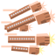

<!-- Generated by tools/build_pack_reference.py. Edit the pack sources and regenerate. -->

# Jake Jake no Mi

{ .entry-page-icon }

[Fruits](index.md) · [Missing Missing no Mi](../../reference/content/inomissing.md)

<!-- fruit inomissing:jake_jake_no_mi -->

| Stat | Value |
| --- | --- |
| Type | Paramecia |
| Tier | 2 |
| Fruit damage scaling | 1.00× at 10,000 Doriki → 2× at 50,000 Doriki |
| Abilities | 3 (3 active, 0 passive) |
| Fruit boxes | [Iron Box](../fruit-boxes.md) |

See [damage calculations](../combat-stats.md#damage-from-doriki).

!!! note "Reading the stats"
    Listed base damage is for the named part of the move. Pack and Doriki multipliers are shown separately. Times assume 20 ticks per second.

<!-- move inomissing:jake_possession -->

## Possession

{ .entry-move-icon loading=lazy } *Active*

The user turns into a jacket and jumps on a creature, that has to wear them and fights for them for a while. Each hit it takes makes it shorter. The user sees through it and takes a quarter of what it takes. Players cant be possessed, a boss only struggles a moment before throwing the user off. Use it again to get off

| Stat | Value |
| --- | --- |
| Cooldown | 40 s (800 ticks) |
| Conditional cooldown | 0.5 s (10 ticks) |
| Pack multiplier when dealing damage | 6× |

<!-- move inomissing:jake_ninin_baori -->

## Jake Jake Ninin-baori

{ .entry-move-icon loading=lazy } *Active*

The user becomes the jacket of an ally, a crewmate who crouches to agree or one of their own creatures. The ally keeps moving as they want and gets the user strength and reflexes, more with more Doriki. Use it again to get off, a crewmate takes it off by crouching again

| Stat | Value |
| --- | --- |
| Cooldown | 60 s (1200 ticks) |
| Conditional cooldown | 0.5 s (10 ticks) |
| Pack multiplier when dealing damage | 6× |

<!-- move inomissing:jake_rarara_ranbo -->

## Rarara Ranbo

{ .entry-move-icon loading=lazy } *Active*

While the user is a jacket, they throw a storm of punches with the arms of the one wearing them. Only while worn

| Stat | Value |
| --- | --- |
| Base damage | 2 HP |
| Cooldown | 5 s (100 ticks) |
| Pack multiplier when dealing damage | 3.5× |

