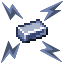

<!-- Generated by tools/build_pack_reference.py. Edit the pack sources and regenerate. -->

# Jiki Jiki no Mi

{ .entry-page-icon }

[Fruits](index.md) · [Mine Mine no Mi](../../reference/content/mineminenomi.md)

<!-- fruit mineminenomi:jiki_jiki_no_mi -->

| Stat | Value |
| --- | --- |
| Type | Paramecia |
| Tier | 3 |
| Fruit damage scaling | 1.00× at 10,000 Doriki → 1.75× at 50,000 Doriki |
| Abilities | 9 (8 active, 1 passive) |
| Fruit boxes | [Golden Box](../fruit-boxes.md) |

See [damage calculations](../combat-stats.md#damage-from-doriki).

[Jump to awakening](#awakening)

After awakening, this fruit’s original damaging moves deal **1.5× damage**. The awakening techniques below have their own values.

!!! note "Reading the stats"
    Listed base damage is for the named part of the move. Pack and Doriki multipliers are shown separately. Times assume 20 ticks per second.

<!-- move mineminenomi:attract -->

## Attract

{ .entry-move-icon loading=lazy } *Active*

Attracts all nearby magnetic objects from the ground or enemy inventories.

| Stat | Value |
| --- | --- |
| Cooldown | 3 s (60 ticks) |
| Pack multiplier when dealing damage | 1.7× |

<!-- move mineminenomi:repel -->

## Repel

{ .entry-move-icon loading=lazy } *Active*

Repels all metallic objects or projectiles near the user. When %s is active this ability will instead shoot the metalic arm forward like a projectile. Repeling enemies affected by %s into other enemies will deal damage and knock them back.

| Stat | Value |
| --- | --- |
| Cooldown | 5 s (100 ticks) |
| Punk cross damage | 20 HP |
| Base damage | 20 HP |
| Pack multiplier when dealing damage | 1.35× |

<!-- move mineminenomi:punk_gibson -->

## Punk Gibson

{ .entry-move-icon loading=lazy } *Active*

Uses %s magnetic items from the user's inventory to create a large arm increasing their punch power and reach.

| Stat | Value |
| --- | --- |
| Min cooldown | 3 s (60 ticks) |
| Max cooldown | 30 s (600 ticks) |
| Pack multiplier when dealing damage | 1.7× |

<!-- move mineminenomi:punk_pistols -->

## Punk Pistols

{ .entry-move-icon loading=lazy } *Active*

Uses %s magnetic objects from the user's inventory to form %s spears and shoots them at enemies.

| Stat | Value |
| --- | --- |
| Cooldown | 12 s (240 ticks) |
| Pack multiplier when dealing damage | 1.7× |

<!-- move mineminenomi:punk_corna_dio -->

## Punk Corna Dio

{ .entry-move-icon loading=lazy } *Active*

Uses %s magnetic items from the inventory to create a bull which can then be used to smash into enemies dealing huge damage, knocking them away and potentially stunning them.

| Stat | Value |
| --- | --- |
| Cooldown | 10 s (200 ticks) |
| Base damage | 100 HP |
| Pack multiplier when dealing damage | 1.7× |

<!-- move mineminenomi:damned_punk -->

## Damned Punk

{ .entry-move-icon loading=lazy } *Active*

Transforms the users arm into a railgun that shoots a projectile with every swing using %s magnetic objects from the users inventory per shoot, dealing massive damage on impact.

| Stat | Value |
| --- | --- |
| Cooldown | 20 s (400 ticks) |
| Projectile hit | 70 HP |
| Pack multiplier when dealing damage | 1.7× |
| Projectile hit at 50,000 Doriki with pack multiplier | 208.25 HP |

<!-- move mineminenomi:magnetic_items -->

## Magnetic Items

{ .entry-move-icon loading=lazy } *Passive*

Displays the total value of maginetic items in the user's inventory

| Stat | Value |
| --- | --- |
| Pack multiplier when dealing damage | 1.7× |

<!-- move mineminenomi:genocide_raid -->

## Genocide Raid

{ .entry-move-icon loading=lazy } *Active*

Uses %s magnetic items and sends them toward the target, spiriling around it and dealing damage over time.

| Stat | Value |
| --- | --- |
| Cooldown | 10 s (200 ticks) |
| Pack multiplier when dealing damage | 1.7× |

<!-- move mineminenomi:punk_cross -->

## Punk Cross

{ .entry-move-icon loading=lazy } *Active*

Uses %s magnetic items and stuns the target in a cross-shaped structure.

| Stat | Value |
| --- | --- |
| Cooldown | 10 s (200 ticks) |
| Pack multiplier when dealing damage | 1.7× |

## Awakening

**Source** · Awaken Awaken no Mi

| Stat | Value |
| --- | --- |
| Doriki | 40,000 |
| Active time with the fruit | About 24 hours (1,728,000 ticks) |

<!-- move awakenawakennomi:assign_world -->

### Assign World { #awakening-assign-world }

{ .entry-move-icon loading=lazy } *Active*

Magnetizes the ground into scrap that drags down enemies wearing metal and pulls their weapons away. Scrap Tempest uses the scrap from the field instead of the user's inventory

| Stat | Value |
| --- | --- |
| Cooldown | 120 s (2400 ticks) |
| Min cooldown | 40 s (800 ticks) |

<!-- move awakenawakennomi:scrap_tempest -->

### Scrap Tempest { #awakening-scrap-tempest }

{ .entry-move-icon loading=lazy } *Active*

Rips the scrap out of the ground and slams it down on the aimed spot, crushing everything nearby. More scrap makes a heavier hit, outside the field it uses the user's own metal instead

| Stat | Value |
| --- | --- |
| Min cooldown | 15 s (300 ticks) |
| Max cooldown | 45 s (900 ticks) |
| Fizzle cooldown | 2 s (40 ticks) |
| Min damage | 24 HP |
| Max damage | 88 HP |

<!-- move awakenawakennomi:ferrous_dominion -->

### Ferrous Dominion { #awakening-ferrous-dominion }

{ .entry-move-icon loading=lazy } *Passive*

Standing on the user's magnetic field gives them armor, stronger hits and knockback resistance. The field also pulls loose metal toward the user, even weapons it pulled from enemies
