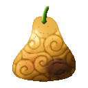
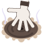
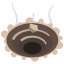
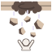
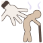
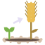

<!-- Generated by tools/build_pack_reference.py. Edit the pack sources and regenerate. -->

# Juku Juku no Mi

{ .entry-page-icon }

[Fruits](index.md) · [Missing Missing no Mi](../../reference/content/inomissing.md)

<!-- fruit inomissing:juku_juku_no_mi -->

| Stat | Value |
| --- | --- |
| Type | Paramecia |
| Tier | 1 |
| Fruit damage scaling | 1.00× at 10,000 Doriki → 2.25× at 50,000 Doriki |
| Abilities | 5 (5 active, 0 passive) |
| Fruit boxes | [Wooden Box](../fruit-boxes.md) |

See [damage calculations](../combat-stats.md#damage-from-doriki).

!!! note "Reading the stats"
    Listed base damage is for the named part of the move. Pack and Doriki multipliers are shown separately. Times assume 20 ticks per second.

<!-- move inomissing:decaying_touch -->

## Decaying Touch

{ .entry-move-icon loading=lazy } *Active*

The block the user touches rots, and the rot spreads to the blocks around it. A rotten block crumbles for good, the harder it is the longer it takes.

| Stat | Value |
| --- | --- |
| Cooldown | 6 s (120 ticks) |
| Pack multiplier when dealing damage | 1.65× |

<!-- move inomissing:sinkhole -->

## Sinkhole

{ .entry-move-icon loading=lazy } *Active*

The ground the user looks at rots into a pit that goes on deepening for a while. Sneaking, or with no ground in sight, the pit opens under the user's own feet.

| Stat | Value |
| --- | --- |
| Cooldown | 15 s (300 ticks) |
| Conditional cooldown | 0.5 s (10 ticks) |
| Pack multiplier when dealing damage | 1.65× |

<!-- move inomissing:kare_san_sui -->

## Kare-San-Sui

{ .entry-move-icon loading=lazy } *Active*

The ceiling above the enemy the user looks at rots through and falls on whoever is under it. The fallen blocks break where they land. The harder the ceiling, the longer it takes to rot and the more it hurts.

| Stat | Value |
| --- | --- |
| Cooldown | 20 s (400 ticks) |
| Pack multiplier when dealing damage | 1.65× |

<!-- move inomissing:aging_touch -->

## Aging Touch

{ .entry-move-icon loading=lazy } *Active*

Aging Touch, the enemy the user touches grows old. A creature stays old until it dies, a player or a boss for a while. A young animal grows up instead. Rot Gear, the weapon and the armor of the enemy the user touches rot, and a piece that had too little durability left breaks.

| Stat | Value |
| --- | --- |
| Cooldown | 15 s (300 ticks) |
| Pack multiplier when dealing damage | 1.65× |

<!-- move inomissing:ripen -->

## Ripen

{ .entry-move-icon loading=lazy } *Active*

The crops, the saplings and the young animals around the user reach full growth at once.

| Stat | Value |
| --- | --- |
| Cooldown | 30 s (600 ticks) |
| Conditional cooldown | 0.5 s (10 ticks) |
| Pack multiplier when dealing damage | 1.65× |

