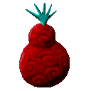
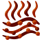
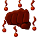

<!-- Generated by tools/build_pack_reference.py. Edit the pack sources and regenerate. -->

# Kachi Kachi no Mi

{ .entry-page-icon }

[Fruits](index.md) · [Mine Mine no Mi](../../reference/content/mineminenomi.md)

<!-- fruit mineminenomi:kachi_kachi_no_mi -->

| Stat | Value |
| --- | --- |
| Type | Paramecia |
| Tier | 1 |
| Fruit damage scaling | 1.00× at 10,000 Doriki → 2.25× at 50,000 Doriki |
| Abilities | 3 (3 active, 0 passive) |
| Fruit boxes | [Wooden Box](../fruit-boxes.md) |

See [damage calculations](../combat-stats.md#damage-from-doriki).

[Jump to awakening](#awakening)

!!! note "Reading the stats"
    Listed base damage is for the named part of the move. Pack and Doriki multipliers are shown separately. Times assume 20 ticks per second.

<!-- move mineminenomi:evaporate -->

## Evaporate

{ .entry-move-icon loading=lazy } *Active*

Evaporates the water and melts ice around the user.

| Stat | Value |
| --- | --- |
| Cooldown | 12 s (240 ticks) |
| Pack multiplier when dealing damage | 3.4× |

<!-- move mineminenomi:hot_boiling_special -->

## Hot Boiling Special

{ .entry-move-icon loading=lazy } *Active*

Hardens and heats up the fist of the user.

| Stat | Value |
| --- | --- |
| Cooldown | 5 s (100 ticks) |
| Pack multiplier when dealing damage | 2.2× |

<!-- move mineminenomi:vulcanization -->

## Vulcanization

{ .entry-move-icon loading=lazy } *Active*

Coats the user into a thick stone-like layer that increases the armor of its user.

| Stat | Value |
| --- | --- |
| Cooldown | 15 s (300 ticks) |
| Pack multiplier when dealing damage | 3.4× |

## Awakening

**Source** · Awaken Awaken no Mi

| Stat | Value |
| --- | --- |
| Doriki | 40,000 |
| Active time with the fruit | About 24 hours (1,728,000 ticks) |

<!-- move awakenawakennomi:aura_of_friction -->

### Aura of Friction { #awakening-aura-of-friction }

{ .entry-move-icon loading=lazy } *Active*

Enemies moving fast inside the aura heat up and burn, the faster they move the worse it gets.

| Stat | Value |
| --- | --- |
| Cooldown | 120 s (2400 ticks) |

<!-- move awakenawakennomi:scalding_steam -->

### Scalding Steam { #awakening-scalding-steam }

{ .entry-move-icon loading=lazy } *Active*

Boils all the water around the user in one go and scalds every enemy nearby Enemies that are wet get burned way worse.

| Stat | Value |
| --- | --- |
| Base damage | 40 HP |
| Wet damage | 90 HP |
| Cooldown | 30 s (600 ticks) |

<!-- move awakenawakennomi:friction_burn -->

### Friction Burn { #awakening-friction-burn }

{ .entry-move-icon loading=lazy } *Passive*

Every punch from the user rubs friction heat into the target, even outside the aura
