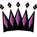
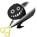
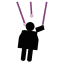

<!-- Generated by tools/build_pack_reference.py. Edit the pack sources and regenerate. -->

# Kage Kage no Mi

{ .entry-page-icon }

[Fruits](index.md) · [Mine Mine no Mi](../../reference/content/mineminenomi.md)

<!-- fruit mineminenomi:kage_kage_no_mi -->

| Stat | Value |
| --- | --- |
| Type | Paramecia |
| Tier | 2 |
| Fruit damage scaling | 1.00× at 10,000 Doriki → 2× at 50,000 Doriki |
| Abilities | 9 (8 active, 1 passive) |
| Fruit boxes | [Iron Box](../fruit-boxes.md) |

See [damage calculations](../combat-stats.md#damage-from-doriki).

[Jump to awakening](#awakening)

!!! note "Reading the stats"
    Listed base damage is for the named part of the move. Pack and Doriki multipliers are shown separately. Times assume 20 ticks per second.

<!-- move mineminenomi:doppelman -->

## Doppelman

{ .entry-move-icon loading=lazy } *Active*

Creates a living version of the user's shadow to help them fight

| Stat | Value |
| --- | --- |
| Min cooldown | 2 s (40 ticks) |
| Max cooldown | 300 s (6000 ticks) |
| Pack multiplier when dealing damage | 2.2× |

<!-- move mineminenomi:kagemusha -->

## Kagemusha

{ .entry-move-icon loading=lazy } *Active*

Allows the user to change its position with that of the Doppelman.

| Stat | Value |
| --- | --- |
| Cooldown | 5 s (100 ticks) |
| Pack multiplier when dealing damage | 2.2× |

<!-- move mineminenomi:brick_bat -->

## Brick Bat

{ .entry-move-icon loading=lazy } *Active*

Launches bats created from the user's shadow at the opponent

| Stat | Value |
| --- | --- |
| Cooldown | 5 s (100 ticks) |
| Pack multiplier when dealing damage | 1.6× |

<!-- move mineminenomi:black_box -->

## Black Box

{ .entry-move-icon loading=lazy } *Active*

Encases and suffocates the opponent in a box made of shadows.

| Stat | Value |
| --- | --- |
| Cooldown | 16 s (320 ticks) |
| Pack multiplier when dealing damage | 2.2× |

<!-- move mineminenomi:tsuno_tokage -->

## Tsuno Tokage

{ .entry-move-icon loading=lazy } *Active*

The user creates a lizard-like shadow under his opponent, which pierces them from below

| Stat | Value |
| --- | --- |
| Cooldown | 10 s (200 ticks) |
| Pack multiplier when dealing damage | 2.2× |

<!-- move mineminenomi:kage_kakumei -->

## Kage Kakumei

{ .entry-move-icon loading=lazy } *Active*

By hitting another entity the user impales %s shadows at once into them boosting their physical abilities

| Stat | Value |
| --- | --- |
| Cooldown | 10 s (200 ticks) |
| Pack multiplier when dealing damage | 2.2× |

<!-- move mineminenomi:kage_giri -->

## Kage Giri

{ .entry-move-icon loading=lazy } *Passive*

Allows the user to cut an enemy's shadow using a pair of Scissors

| Stat | Value |
| --- | --- |
| Pack multiplier when dealing damage | 2.2× |

<!-- move mineminenomi:nightmare_soldiers -->

## Nightmare Soldiers

{ .entry-move-icon loading=lazy } *Active*

Creates Nightmare Soldiers using Shadows from the user's inventory, the longer the ability charges the more soldiers it'll create

| Stat | Value |
| --- | --- |
| Min cooldown | 5 s (100 ticks) |
| Max cooldown | 15 s (300 ticks) |
| Pack multiplier when dealing damage | 2.2× |

<!-- move mineminenomi:shadows_asgard -->

## Shadow's Asgard

{ .entry-move-icon loading=lazy } *Active · Transformation*

By continuously absorbing Shadows the user's strenght increases as well as their size

| Stat | Value |
| --- | --- |
| Min cooldown | 10 s (200 ticks) |
| Max cooldown | 70 s (1400 ticks) |
| Pack multiplier when dealing damage | 2.2× |

## Awakening

**Source** · Awaken Awaken no Mi

| Stat | Value |
| --- | --- |
| Doriki | 40,000 |
| Active time with the fruit | About 24 hours (1,728,000 ticks) |

<!-- move awakenawakennomi:nightmare_banquet -->

### Nightmare Banquet { #awakening-nightmare-banquet }

{ .entry-move-icon loading=lazy } *Active*

Spreads the user's shadow over a huge area and steals the shadow of the enemies caught in it, the stronger they are the longer it takes

| Stat | Value |
| --- | --- |
| Cooldown | 120 s (2400 ticks) |

<!-- move awakenawakennomi:shadow_marionette -->

### Shadow Marionette { #awakening-shadow-marionette }

{ .entry-move-icon loading=lazy } *Active*

Takes control of an enemy with no shadow, beasts fight for the user and people can't hit the user or their allies. Only works on targets without a shadow and costs stolen shadows.

| Stat | Value |
| --- | --- |
| Min cooldown | 30 s (600 ticks) |
| Max cooldown | 180 s (3600 ticks) |
| Failed cooldown | 2 s (40 ticks) |

<!-- move awakenawakennomi:sunless_brand -->

### Sunless Brand { #awakening-sunless-brand }

{ .entry-move-icon loading=lazy } *Passive*

Enemies near the user with no shadow burn even without sunlight or open sky. Works no matter who took the shadow, it stops once they get far enough away

| Stat | Value |
| --- | --- |
| Burn damage | 5 HP |

