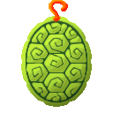
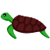
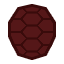
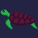
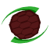
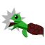

<!-- Generated by tools/build_pack_reference.py. Edit the pack sources and regenerate. -->

# Kame Kame no Mi

{ .entry-page-icon }

[Fruits](index.md) · [Mine Mine no Mi](../../reference/content/mineminenomi.md)

<!-- fruit mineminenomi:kame_kame_no_mi -->

| Stat | Value |
| --- | --- |
| Type | Zoan |
| Tier | 1 |
| Fruit damage scaling | 1.00× at 10,000 Doriki → 2.25× at 50,000 Doriki |
| Abilities | 3 (2 active, 1 passive) |
| Fruit boxes | [Wooden Box](../fruit-boxes.md) |

See [damage calculations](../combat-stats.md#damage-from-doriki).

[Jump to awakening](#awakening)

!!! note "Reading the stats"
    Listed base damage is for the named part of the move. Pack and Doriki multipliers are shown separately. Times assume 20 ticks per second.

<!-- move mineminenomi:kame_guard_point -->

## Kame Guard Point

{ .entry-move-icon loading=lazy } *Active · Transformation*

Transforms the user into a turtle, which focuses on defense. Sneaking allows you to retract into your shell.

| Stat | Value |
| --- | --- |
| Pack multiplier when dealing damage | 2.8× |

<!-- move mineminenomi:kame_walk_point -->

## Kame Walk Point

{ .entry-move-icon loading=lazy } *Active · Transformation*

Transforms the user into a turtle hybrid, which focuses on defense.

| Stat | Value |
| --- | --- |
| Pack multiplier when dealing damage | 2.8× |

<!-- move mineminenomi:kame_rideable -->

## Kame Rideable

*Passive*

Allows other players to ride on your back.

| Stat | Value |
| --- | --- |
| Pack multiplier when dealing damage | 2.8× |

## Awakening

**Source** · Awaken Awaken no Mi

| Stat | Value |
| --- | --- |
| Doriki | 40,000 |
| Active time with the fruit | About 24 hours (1,728,000 ticks) |

<!-- move awakenawakennomi:awaken_kame_walk_point -->

### Awaken Kame Walk Point { #awakening-awaken-kame-walk-point }

{ .entry-move-icon loading=lazy } *Active · Transformation*

Transforms the user into an awakened turtle, which focuses on speed.

**Stats while transformed**

| Stat | Value |
| --- | --- |
| Movement speed | +50% of base |
| Armour | +30 |
| Jump | +2 |
| Toughness | +20 |
| Punch damage | +6 HP |
| Step height | +1 blocks |

<!-- move awakenawakennomi:awaken_kame_guard_point -->

### Awaken Kame Guard Point { #awakening-awaken-kame-guard-point }

{ .entry-move-icon loading=lazy } *Active · Transformation*

Transforms the user into an awakened turtle, which focuses on defense. Sneaking hides the user in their shell where almost nothing gets through

| Stat | Value |
| --- | --- |
| Cooldown | 0.5 s (10 ticks) |

**Stats while transformed**

| Stat | Value |
| --- | --- |
| Maximum health | +20% |
| Armour | +40 |
| Jump | +1 |
| Toughness | +20 |

<!-- move awakenawakennomi:spin -->

### Spin { #awakening-spin }

{ .entry-move-icon loading=lazy } *Active*

The user hides in their shell and spins, knocking back nearby enemies and blocking most of the damage it takes

| Stat | Value |
| --- | --- |
| Base damage | 18 HP |
| Cooldown | 30 s (600 ticks) |

<!-- move awakenawakennomi:snapping_jaw -->

### Snapping Jaw { #awakening-snapping-jaw }

{ .entry-move-icon loading=lazy } *Active*

The turtle bites down on whatever is in front of it and drags it along, crushing it every second. The jaw only opens once the turtle has taken enough damage, and while it hides in its shell it barely takes any.

| Stat | Value |
| --- | --- |
| Cooldown | 45 s (900 ticks) |
| Snap damage | 40 HP |
| Crush damage | 15 HP |

