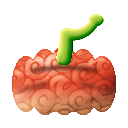

<!-- Generated by tools/build_pack_reference.py. Edit the pack sources and regenerate. -->

# Kani Kani no Mi, Model: Crab

{ .entry-page-icon }

[Fruits](index.md) · [InoFruits](../../reference/content/inofruits.md)

<!-- fruit inofruits:kani_kani_no_mi_model_crab -->

| Stat | Value |
| --- | --- |
| Type | Zoan |
| Tier | 1 |
| Fruit damage scaling | 1.00× at 10,000 Doriki → 2.25× at 50,000 Doriki |
| Abilities | 4 (4 active, 0 passive) |
| Fruit boxes | [Wooden Box](../fruit-boxes.md) |

See [damage calculations](../combat-stats.md#damage-from-doriki).

!!! note "Reading the stats"
    Listed base damage is for the named part of the move. Pack and Doriki multipliers are shown separately. Times assume 20 ticks per second.

<!-- move inofruits:kani_kani_guard_point -->

## Kani Kani Guard Point

{ .entry-move-icon loading=lazy } *Active · Transformation*

Transforms the user into a crab, which focuses on defense, can breathe underwater and walk on the sea floor.

| Stat | Value |
| --- | --- |
| Pack multiplier when dealing damage | 3.55× |

**Stats while transformed**

| Stat | Value |
| --- | --- |
| Movement speed | -25% of base |
| Step height | +0.4 blocks |
| Armor | +5 |
| Toughness | +2 |
| Punch damage | +3 HP |

<!-- move inofruits:kani_kani_heavy_point -->

## Kani Kani Heavy Point

{ .entry-move-icon loading=lazy } *Active · Transformation*

Grows a shell over the chest and a pincer on each arm, making the user hard to push and slow

| Stat | Value |
| --- | --- |
| Pack multiplier when dealing damage | 3.55× |

**Stats while transformed**

| Stat | Value |
| --- | --- |
| Movement speed | -45% of base |
| Armor | +9 |
| Toughness | +3 |
| Punch damage | +6 HP |

<!-- move inofruits:yokobashiri -->

## Yokobashiri

{ .entry-move-icon loading=lazy } *Active*

Dashes with a burst of speed and no wind up, sideways when in the shell form

| Stat | Value |
| --- | --- |
| Cooldown | 4 s (80 ticks) |
| Pack multiplier when dealing damage | 3.55× |

<!-- move inofruits:hasamikomi -->

## Hasamikomi

{ .entry-move-icon loading=lazy } *Active*

Grabs whatever is in front of the user with a claw and drags it around. The pincers crush harder and the last squeeze makes the target bleed

| Stat | Value |
| --- | --- |
| Crush damage | 1.5 HP |
| Amplified crush damage | 2.5 HP |
| Squeeze damage | 4 HP |
| Amplified squeeze damage | 6 HP |
| Cooldown | 10 s (200 ticks) |
| Pack multiplier when dealing damage | 3.55× |

