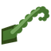
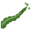
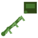

<!-- Generated by tools/build_pack_reference.py. Edit the pack sources and regenerate. -->

# Kero Kero no Mi, Model: Frog

{ .entry-page-icon }

[Fruits](index.md) · [InoFruits](../../reference/content/inofruits.md)

<!-- fruit inofruits:kero_kero_no_mi_model_frog -->

| Stat | Value |
| --- | --- |
| Type | Zoan |
| Tier | 2 |
| Fruit damage scaling | 1.00× at 10,000 Doriki → 2× at 50,000 Doriki |
| Abilities | 7 (6 active, 1 passive) |
| Fruit boxes | [Iron Box](../fruit-boxes.md) |

See [damage calculations](../combat-stats.md#damage-from-doriki).

!!! note "Reading the stats"
    Listed base damage is for the named part of the move. Pack and Doriki multipliers are shown separately. Times assume 20 ticks per second.

<!-- move inofruits:kero_kero_walk_point -->

## Kero Kero Walk Point

{ .entry-move-icon loading=lazy } *Active · Transformation*

Transforms the user into a frog, which focuses on jumping and staying low

| Stat | Value |
| --- | --- |
| Pack multiplier when dealing damage | 3.8× |

**Stats while transformed**

| Stat | Value |
| --- | --- |
| Jump | +4 |
| Step height | +1 blocks |
| Punch damage | +1 HP |

<!-- move inofruits:kero_kero_heavy_point -->

## Kero Kero Heavy Point

{ .entry-move-icon loading=lazy } *Active · Transformation*

Transforms the user into a frog hybrid with human hands, a frog head and frog legs.

| Stat | Value |
| --- | --- |
| Pack multiplier when dealing damage | 3.8× |

**Stats while transformed**

| Stat | Value |
| --- | --- |
| Movement speed | +2% of base |
| Jump | +1.6 |
| Step height | +0.6 blocks |
| Punch damage | +3 HP |

<!-- move inofruits:shita -->

## Shita

{ .entry-move-icon loading=lazy } *Active*

Shoots out the tongue, pulling whoever it hits in close and holding them.

| Stat | Value |
| --- | --- |
| Cooldown | 7 s (140 ticks) |
| Hold damage | 1 HP |
| Finish damage | 3 HP |
| Pack multiplier when dealing damage | 2.4× |

<!-- move inofruits:hoppu -->

## Hoppu

{ .entry-move-icon loading=lazy } *Active*

The user jumps up from the ground and slams anything under them when coming down.

| Stat | Value |
| --- | --- |
| Slam damage | 7 HP |
| Cooldown | 8 s (160 ticks) |
| Pack multiplier when dealing damage | 3.8× |

<!-- move inofruits:nendeki -->

## Nendeki

{ .entry-move-icon loading=lazy } *Passive*

The user's skin is sticky, the next projectile that hits them gets stuck without doing damage

| Stat | Value |
| --- | --- |
| Pack multiplier when dealing damage | 3.8× |

<!-- move inofruits:shita_muchi -->

## Shita Muchi

{ .entry-move-icon loading=lazy } *Active*

Whips the tongue out, hurting whatever it hits without pulling it.

| Stat | Value |
| --- | --- |
| Base damage | 9 HP |
| Cooldown | 4 s (80 ticks) |
| Pack multiplier when dealing damage | 2.4× |

<!-- move inofruits:tobitsuki -->

## Tobitsuki

{ .entry-move-icon loading=lazy } *Active*

Sticks the tongue onto a target or block and pulls the user to it

| Stat | Value |
| --- | --- |
| Cooldown | 6 s (120 ticks) |
| Pack multiplier when dealing damage | 3.8× |

