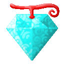

<!-- Generated by tools/build_pack_reference.py. Edit the pack sources and regenerate. -->

# Kira Kira no Mi

{ .entry-page-icon }

[Fruits](index.md) · [Mine Mine no Mi](../../reference/content/mineminenomi.md)

<!-- fruit mineminenomi:kira_kira_no_mi -->

| Stat | Value |
| --- | --- |
| Type | Paramecia |
| Tier | 2 |
| Fruit damage scaling | 1.00× at 10,000 Doriki → 2× at 50,000 Doriki |
| Abilities | 3 (3 active, 0 passive) |
| Fruit boxes | [Iron Box](../fruit-boxes.md) |

See [damage calculations](../combat-stats.md#damage-from-doriki).

[Jump to awakening](#awakening)

After awakening, this fruit’s original damaging moves deal **1.5× damage**. The awakening techniques below have their own values.

!!! note "Reading the stats"
    Listed base damage is for the named part of the move. Pack and Doriki multipliers are shown separately. Times assume 20 ticks per second.

<!-- move mineminenomi:diamond_body -->

## Diamond Body

{ .entry-move-icon loading=lazy } *Active*

Allows the user's body to become diamond, gaining high strength and defense.

| Stat | Value |
| --- | --- |
| Min cooldown | 2 s (40 ticks) |
| Max cooldown | 42 s (840 ticks) |
| Pack multiplier when dealing damage | 3.35× |

<!-- move mineminenomi:brilliant_punk -->

## Brilliant Punk

{ .entry-move-icon loading=lazy } *Active*

The user rams into the target with their diamond body.

| Stat | Value |
| --- | --- |
| Cooldown | 10 s (200 ticks) |
| Base damage | 25 HP |
| Pack multiplier when dealing damage | 3.35× |

<!-- move mineminenomi:cabochon_knuckle -->

## Cabochon Knuckle

{ .entry-move-icon loading=lazy } *Active*

Covers the user's punch in a diamond coating, dealing damage and slight knockback.

| Stat | Value |
| --- | --- |
| Cooldown | 8 s (160 ticks) |
| Pack multiplier when dealing damage | 3.35× |

## Awakening

**Source** · Awaken Awaken no Mi

| Stat | Value |
| --- | --- |
| Doriki | 40,000 |
| Active time with the fruit | About 24 hours (1,728,000 ticks) |

<!-- move awakenawakennomi:glittering_storm -->

### Glittering Storm { #awakening-glittering-storm }

{ .entry-move-icon loading=lazy } *Active*

Creates a tornado of diamond shards the user can steer, wrecking everything in its path and hurting enemies caught in it every 0.75 seconds.

| Stat | Value |
| --- | --- |
| Cooldown | 60 s (1200 ticks) |

<!-- move awakenawakennomi:brilliant_meteor -->

### Brilliant Meteor { #awakening-brilliant-meteor }

{ .entry-move-icon loading=lazy } *Active*

The user rips a huge diamond block out of the ground and throws it, it shatters into shards where it lands. If Diamond Body is active it deals 50% more damage.

| Stat | Value |
| --- | --- |
| Impact damage | 70 HP |
| Shard damage | 25 HP |
| Cooldown | 30 s (600 ticks) |
| Abort cooldown | 2 s (40 ticks) |

<!-- move awakenawakennomi:unscratchable -->

### Unscratchable { #awakening-unscratchable }

{ .entry-move-icon loading=lazy } *Passive*

While Diamond Body is active hits too weak to scratch diamond don't hurt the user at all. Armament Haki still breaks through.
