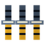
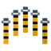

<!-- Generated by tools/build_pack_reference.py. Edit the pack sources and regenerate. -->

# Kiza Kiza no Mi

{ .entry-page-icon }

[Fruits](index.md) · [InoFruits](../../reference/content/inofruits.md)

<!-- fruit inofruits:kiza_kiza_no_mi -->

| Stat | Value |
| --- | --- |
| Type | Paramecia |
| Tier | 1 |
| Fruit damage scaling | 1.00× at 10,000 Doriki → 2.25× at 50,000 Doriki |
| Abilities | 6 (6 active, 0 passive) |
| Fruit boxes | [Wooden Box](../fruit-boxes.md) |

See [damage calculations](../combat-stats.md#damage-from-doriki).

!!! note "Reading the stats"
    Listed base damage is for the named part of the move. Pack and Doriki multipliers are shown separately. Times assume 20 ticks per second.

<!-- move inofruits:kiza_dashi -->

## Kiza Dashi

{ .entry-move-icon loading=lazy } *Active*

Puts a slider on the target the user is looking at for 20 seconds

| Stat | Value |
| --- | --- |
| Cooldown | 3 s (60 ticks) |
| Conditional cooldown | 0.5 s (10 ticks) |
| Pack multiplier when dealing damage | 2.1× |

<!-- move inofruits:hikisage -->

## Hikisage

{ .entry-move-icon loading=lazy } *Active*

Pulls down the slider on a marked target and gives the user what gets taken off.

| Stat | Value |
| --- | --- |
| Cooldown | 12 s (240 ticks) |
| Conditional cooldown | 0.5 s (10 ticks) |
| Pack multiplier when dealing damage | 2.1× |

<!-- move inofruits:kiza_modoshi -->

## Kiza Modoshi

{ .entry-move-icon loading=lazy } *Active*

The user pulls back their own sliders, removing every bad effect on them at once

| Stat | Value |
| --- | --- |
| Cooldown | 60 s (1200 ticks) |
| Pack multiplier when dealing damage | 2.1× |

<!-- move inofruits:kiza_maki -->

## Kiza Maki

{ .entry-move-icon loading=lazy } *Active*

Puts a slider on every enemy in a wide cone in front of the user, for 10 seconds.

| Stat | Value |
| --- | --- |
| Cooldown | 16 s (320 ticks) |
| Pack multiplier when dealing damage | 2.1× |

<!-- move inofruits:oshiage -->

## Oshiage

{ .entry-move-icon loading=lazy } *Active*

Pushes up the slider on a marked ally by pulling down the user's own, the user loses speed or strength and the ally gains it

| Stat | Value |
| --- | --- |
| Cooldown | 12 s (240 ticks) |
| Conditional cooldown | 0.5 s (10 ticks) |
| Pack multiplier when dealing damage | 2.1× |

<!-- move inofruits:zen_hikisage -->

## Zen Hikisage

{ .entry-move-icon loading=lazy } *Active*

Pulls down the sliders of every marked target around the user at once, they lose both speed and strength and the user gets a part of each.

| Stat | Value |
| --- | --- |
| Cooldown | 40 s (800 ticks) |
| Conditional cooldown | 0.5 s (10 ticks) |
| Pack multiplier when dealing damage | 2.1× |

