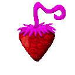

<!-- Generated by tools/build_pack_reference.py. Edit the pack sources and regenerate. -->

# Kobu Kobu No Mi

{ .entry-page-icon }

[Fruits](index.md) · [Mine Mine no Mi](../../reference/content/mineminenomi.md)

<!-- fruit mineminenomi:kobu_kobu_no_mi -->

| Stat | Value |
| --- | --- |
| Type | Paramecia |
| Tier | 1 |
| Fruit damage scaling | 1.00× at 10,000 Doriki → 2.25× at 50,000 Doriki |
| Abilities | 2 (1 active, 1 passive) |
| Fruit boxes | [Wooden Box](../fruit-boxes.md) |

See [damage calculations](../combat-stats.md#damage-from-doriki).

[Jump to awakening](#awakening)

After awakening, this fruit’s original damaging moves deal **1.5× damage**. The awakening techniques below have their own values.

!!! note "Reading the stats"
    Listed base damage is for the named part of the move. Pack and Doriki multipliers are shown separately. Times assume 20 ticks per second.

<!-- move mineminenomi:shourei -->

## Shourei

{ .entry-move-icon loading=lazy } *Active*

Increases other people's fighting spirit and physical strength by simply encouraging them with words

| Stat | Value |
| --- | --- |
| Cooldown | 60 s (1200 ticks) |
| Pack multiplier when dealing damage | 2.8× |

<!-- move mineminenomi:negative_immunities -->

## Negative Immunities

*Passive*

| Stat | Value |
| --- | --- |
| Pack multiplier when dealing damage | 2.8× |

## Awakening

**Source** · Awaken Awaken no Mi

| Stat | Value |
| --- | --- |
| Doriki | 40,000 |
| Active time with the fruit | About 24 hours (1,728,000 ticks) |

<!-- move awakenawakennomi:one_man_army -->

### One Man Army { #awakening-one-man-army }

{ .entry-move-icon loading=lazy } *Active*

The user pushes past their limits for a short time, becoming a one-man army.

| Stat | Value |
| --- | --- |
| Min cooldown | 60 s (1200 ticks) |
| Max cooldown | 180 s (3600 ticks) |

<!-- move awakenawakennomi:battlefield_resonance -->

### Battlefield Resonance { #awakening-battlefield-resonance }

{ .entry-move-icon loading=lazy } *Active*

Creates a zone that gives the user and every ally inside it Speed I and Resistance I. When an ally hits an enemy inside the zone every ally inside gets Battlefield Resonance for 5 seconds, giving 50% more damage, speed and jump and 25% more attack speed.

| Stat | Value |
| --- | --- |
| Cooldown | 120 s (2400 ticks) |

<!-- move awakenawakennomi:never_surrender -->

### Never Surrender { #awakening-never-surrender }

{ .entry-move-icon loading=lazy } *Passive*

When the user or an ally nearby gets really low on health the user yells at them to keep fighting. They gain a burst of absorption, Strength II and Resistance II, and shake off Negative and Unconscious.

| Stat | Value |
| --- | --- |
| Rally cooldown | 90 s (1800 ticks) |

