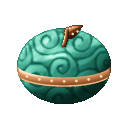

<!-- Generated by tools/build_pack_reference.py. Edit the pack sources and regenerate. -->

# Koro Koro no Mi

{ .entry-page-icon }

[Fruits](index.md) · [Missing Missing no Mi](../../reference/content/inomissing.md)

<!-- fruit inomissing:koro_koro_no_mi -->

| Stat | Value |
| --- | --- |
| Type | Paramecia |
| Tier | 1 |
| Fruit damage scaling | 1.00× at 10,000 Doriki → 2.25× at 50,000 Doriki |
| Abilities | 6 (6 active, 0 passive) |
| Fruit boxes | [Wooden Box](../fruit-boxes.md) |

See [damage calculations](../combat-stats.md#damage-from-doriki).

!!! note "Reading the stats"
    Listed base damage is for the named part of the move. Pack and Doriki multipliers are shown separately. Times assume 20 ticks per second.

<!-- move inomissing:wheels -->

## Wheels

{ .entry-move-icon loading=lazy } *Active · Transformation*

The user's hands and feet become wheels, they roll much faster than they walk and far faster on rails, without a minecart. Lit powered rails push them, unlit ones hold them back The other abilities of the fruit can only be used on the wheels

| Stat | Value |
| --- | --- |
| Cooldown | 3 s (60 ticks) |
| Pack multiplier when dealing damage | 1.25× |

<!-- move inomissing:ram -->

## Ram

{ .entry-move-icon loading=lazy } *Active*

On their wheels, the user charges where they are looking, the first enemy they hit is thrown back and takes more damage the faster the user was rolling

| Stat | Value |
| --- | --- |
| Base damage | 8 HP |
| Speed damage | 8 HP |
| Cooldown | 7 s (140 ticks) |
| Pack multiplier when dealing damage | 1.1× |

<!-- move inomissing:skid -->

## Skid

{ .entry-move-icon loading=lazy } *Active*

On their wheels, the user skids into a sliding half-turn that mows down the enemies around them and throws them back

| Stat | Value |
| --- | --- |
| Base damage | 9 HP |
| Cooldown | 8 s (160 ticks) |
| Pack multiplier when dealing damage | 1.25× |

<!-- move inomissing:rail_jump -->

## Rail Jump

{ .entry-move-icon loading=lazy } *Active*

On their wheels, the user takes off at full speed and comes down on the enemy they are looking at

| Stat | Value |
| --- | --- |
| Base damage | 12 HP |
| Cooldown | 11 s (220 ticks) |
| Pack multiplier when dealing damage | 1.25× |

<!-- move inomissing:bakudan_ame -->

## Bakudan Ame

{ .entry-move-icon loading=lazy } *Active*

On their wheels, the user throws up to 3 explosives from their inventory where they are looking, gunpowder makes small bursts and TNT large ones. The bursts don't break blocks and don't hurt allies

| Stat | Value |
| --- | --- |
| Small damage | 10 HP |
| Large damage | 20 HP |
| Cooldown | 6 s (120 ticks) |
| Pack multiplier when dealing damage | 1.1× |

<!-- move inomissing:spin -->

## Spin

{ .entry-move-icon loading=lazy } *Active*

On their wheels, the user makes the tool they hold spin with the wheel of their hand, they dig much faster for a while

| Stat | Value |
| --- | --- |
| Cooldown | 30 s (600 ticks) |
| Pack multiplier when dealing damage | 1.25× |

