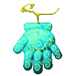
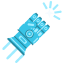
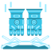
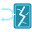
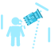
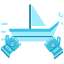

<!-- Generated by tools/build_pack_reference.py. Edit the pack sources and regenerate. -->

# Kote Kote no Mi

{ .entry-page-icon }

[Fruits](index.md) · [Missing Missing no Mi](../../reference/content/inomissing.md)

<!-- fruit inomissing:kote_kote_no_mi -->

| Stat | Value |
| --- | --- |
| Type | Paramecia |
| Tier | 2 |
| Fruit damage scaling | 1.00× at 10,000 Doriki → 2× at 50,000 Doriki |
| Abilities | 10 (10 active, 0 passive) |
| Fruit boxes | [Iron Box](../fruit-boxes.md) |

See [damage calculations](../combat-stats.md#damage-from-doriki).

!!! note "Reading the stats"
    Listed base damage is for the named part of the move. Pack and Doriki multipliers are shown separately. Times assume 20 ticks per second.

<!-- move inomissing:gauntlet_punch -->

## Gauntlet Punch

{ .entry-move-icon loading=lazy } *Active*

The user sends a giant gauntlet that punches where they are looking. It damages and pushes back every enemy around where it lands. Takes one of the user's two gauntlets. Both gauntlets strike in turn, six blows of 5 in a little more than a second. Each blow goes where the user is looking at that moment. Used again it stops. Takes both of the user's gauntlets.

| Stat | Value |
| --- | --- |
| Base damage | 16 HP |
| Cooldown | 5 s (100 ticks) |
| Rush damage | 5 HP |
| Rush cooldown | 12 s (240 ticks) |

<!-- move inomissing:gauntlet_hammer -->

## Gauntlet Hammer

{ .entry-move-icon loading=lazy } *Active*

The user's two gauntlets, clasped, rise over the spot they are looking at and crash down on it. Every enemy around it is hurt and thrown up. Takes both of the user's gauntlets.

| Stat | Value |
| --- | --- |
| Base damage | 30 HP |
| Cooldown | 14 s (280 ticks) |

<!-- move inomissing:gauntlet_grab -->

## Gauntlet Grab

{ .entry-move-icon loading=lazy } *Active*

The user sends a gauntlet that rips out the block they are looking at and holds it. Only plain blocks no harder than cobblestone can be taken. Takes one of the user's two gauntlets. Using it again throws the block where the user is looking. It hurts what it hits and stays where it lands. A block held too long falls by itself. Both gauntlets tear out a mass of ground under the block the user is looking at and hold it over their head. Used again it is thrown and bursts on what it hits, hurting every enemy around. The hole closes after a while. Takes both of the user's gauntlets.

| Stat | Value |
| --- | --- |
| Base damage | 16 HP |
| Cooldown | 8 s (160 ticks) |
| Boulder damage | 32 HP |
| Boulder cooldown | 16 s (320 ticks) |
| Conditional cooldown | 0.5 s (10 ticks) |

<!-- move inomissing:lightning_barrier -->

## Lightning Barrier

{ .entry-move-icon loading=lazy } *Active*

The user raises a pane of solid lightning in front of them. It sends back every projectile that reaches it. For 3 seconds a gauntlet waits before the user and catches the first enemy projectile that comes near, then throws it at the one who sent it, half as strong again. Takes one of the user's two gauntlets.

| Stat | Value |
| --- | --- |
| Cooldown | 14 s (280 ticks) |
| Catch cooldown | 10 s (200 ticks) |

<!-- move inomissing:tensei_hoshi -->

## Tensei Hoshi

{ .entry-move-icon loading=lazy } *Active*

The user sets panes of lightning around the enemy they are looking at. The user's own projectiles that miss it bounce off the panes and fly back at it. A Gauntlet Punch or a thrown block that hits it bounces off a pane and strikes it again from behind. Use the ability again to remove the panes.

| Stat | Value |
| --- | --- |
| Cooldown | 16 s (320 ticks) |

<!-- move inomissing:grande -->

## Grande

{ .entry-move-icon loading=lazy } *Active*

Two giant gauntlets raise a dome of lightning over the user. Projectiles from outside are sent back, enemies inside are thrown out, and the user and their allies inside take less damage. Every second a giant gauntlet crashes on the nearest enemy in the dome or near its wall. Takes both of the user's gauntlets. Use the ability again to lower the dome.

| Stat | Value |
| --- | --- |
| Cooldown | 24 s (480 ticks) |
| Pack multiplier when dealing damage | 0.75× |

<!-- move inomissing:gauntlet_vise -->

## Gauntlet Vise

{ .entry-move-icon loading=lazy } *Active*

Two gauntlets close on the enemy the user is looking at and crush it, then hold it in place for a moment. Takes both of the user's gauntlets.

| Stat | Value |
| --- | --- |
| Base damage | 24 HP |
| Cooldown | 14 s (280 ticks) |

<!-- move inomissing:gauntlet_lift -->

## Gauntlet Lift

{ .entry-move-icon loading=lazy } *Active*

The user's gauntlets throw them high in the air where they are looking. The fall that follows doesn't hurt. Three times in a row, in the air too, all three back once the user lands. Takes both of the user's gauntlets.

| Stat | Value |
| --- | --- |
| Cooldown | 8 s (160 ticks) |

<!-- move inomissing:solmente -->

## Solmente

{ .entry-move-icon loading=lazy } *Active*

Two gauntlets close on the small animal the user is looking at and make it the user's ally for a while. It follows them, defends them and obeys the Command ability. Takes both of the user's gauntlets.

| Stat | Value |
| --- | --- |
| Cooldown | 40 s (800 ticks) |

<!-- move inomissing:a_jien_te -->

## A Jien Te

{ .entry-move-icon loading=lazy } *Active*

Two gauntlets seize the boat or minecart the user is looking at and steer it where the user is looking. An enemy it runs into is hurt and thrown. Takes both of the user's gauntlets. Use the ability again to let go.

| Stat | Value |
| --- | --- |
| Cooldown | 20 s (400 ticks) |

