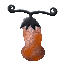
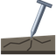
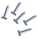
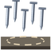
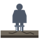

<!-- Generated by tools/build_pack_reference.py. Edit the pack sources and regenerate. -->

# Kugi Kugi no Mi

{ .entry-page-icon }

[Fruits](index.md) · [InoFruits](../../reference/content/inofruits.md)

<!-- fruit inofruits:kugi_kugi_no_mi -->

| Stat | Value |
| --- | --- |
| Type | Paramecia |
| Tier | 1 |
| Fruit damage scaling | 1.00× at 10,000 Doriki → 2.25× at 50,000 Doriki |
| Abilities | 6 (6 active, 0 passive) |
| Fruit boxes | [Wooden Box](../fruit-boxes.md) |

See [damage calculations](../combat-stats.md#damage-from-doriki).

!!! note "Reading the stats"
    Listed base damage is for the named part of the move. Pack and Doriki multipliers are shown separately. Times assume 20 ticks per second.

<!-- move inofruits:kugizuke -->

## Kugizuke

{ .entry-move-icon loading=lazy } *Active*

Throws a big nail that pins the target to the ground where it stands.

| Stat | Value |
| --- | --- |
| Cooldown | 12 s (240 ticks) |
| Pack multiplier when dealing damage | 2× |

<!-- move inofruits:kugibari -->

## Kugibari

{ .entry-move-icon loading=lazy } *Active*

Throws a few small nails, each one slows the target more and 3 nails pin it to the ground.

| Stat | Value |
| --- | --- |
| Cooldown | 8 s (160 ticks) |
| Pack multiplier when dealing damage | 2× |

<!-- move inofruits:kugi_ame -->

## Kugi Ame

{ .entry-move-icon loading=lazy } *Active*

Marks a spot and then rains small nails on it, each one slows the target more and 3 nails pin it to the ground

| Stat | Value |
| --- | --- |
| Cooldown | 14 s (280 ticks) |
| Pack multiplier when dealing damage | 2× |

<!-- move inofruits:kugi_yoroi -->

## Kugi Yoroi

{ .entry-move-icon loading=lazy } *Active · Transformation*

Nails come out of the user's whole body, enemies hitting the user in melee are damaged and get a nail and anything touching the user is damaged every second.

| Stat | Value |
| --- | --- |
| Cooldown | 16 s (320 ticks) |
| Contact damage | 2.5 HP |
| Pack multiplier when dealing damage | 2× |

<!-- move inofruits:kugi_dome -->

## Kugi Dome

{ .entry-move-icon loading=lazy } *Active*

The user nails their own feet to the ground, they cannot move but take no knockback and less damage until the ability ends.

| Stat | Value |
| --- | --- |
| Cooldown | 10 s (200 ticks) |
| Pack multiplier when dealing damage | 2× |

<!-- move inofruits:kuginuki -->

## Kuginuki

{ .entry-move-icon loading=lazy } *Active*

Pulls out every nail from every nearby target at once, dealing more damage the more nails they had

| Stat | Value |
| --- | --- |
| Base damage | 3 HP |
| Cooldown | 14 s (280 ticks) |
| Conditional cooldown | 0.5 s (10 ticks) |
| Pack multiplier when dealing damage | 1.95× |

