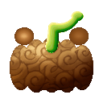
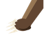
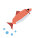
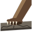

<!-- Generated by tools/build_pack_reference.py. Edit the pack sources and regenerate. -->

# Kuma Kuma no Mi, Model: Grizzly

{ .entry-page-icon }

[Fruits](index.md) · [InoFruits](../../reference/content/inofruits.md)

<!-- fruit inofruits:kuma_kuma_no_mi_model_grizzly -->

| Stat | Value |
| --- | --- |
| Type | Zoan |
| Tier | 2 |
| Fruit damage scaling | 1.00× at 10,000 Doriki → 2× at 50,000 Doriki |
| Abilities | 8 (6 active, 2 passive) |
| Fruit boxes | [Iron Box](../fruit-boxes.md) |

See [damage calculations](../combat-stats.md#damage-from-doriki).

!!! note "Reading the stats"
    Listed base damage is for the named part of the move. Pack and Doriki multipliers are shown separately. Times assume 20 ticks per second.

<!-- move inofruits:kuma_kuma_walk_point -->

## Kuma Kuma Walk Point

{ .entry-move-icon loading=lazy } *Active · Transformation*

Transforms the user into a grizzly hybrid with huge clawed arms, which focuses on strength.

| Stat | Value |
| --- | --- |
| Pack multiplier when dealing damage | 2.5× |

**Stats while transformed**

| Stat | Value |
| --- | --- |
| Movement speed | +5% of base |
| Punch damage | +7 HP |
| Armor | +6 |
| Step height | +0.5 blocks |
| Toughness | +2 |

<!-- move inofruits:kuma_kuma_heavy_point -->

## Kuma Kuma Heavy Point

{ .entry-move-icon loading=lazy } *Active · Transformation*

Transforms the user into a grizzly, which focuses on strength and charging.

| Stat | Value |
| --- | --- |
| Pack multiplier when dealing damage | 2.5× |

**Stats while transformed**

| Stat | Value |
| --- | --- |
| Movement speed | +10% of base |
| Maximum health | +50% |
| Punch damage | +10 HP |
| Armor | +8 |
| Step height | +1 blocks |
| Toughness | +3 |

<!-- move inofruits:claw_swipe -->

## Claw Swipe

{ .entry-move-icon loading=lazy } *Active*

Swipes a huge paw through everything in front of the user, knocking it away.

| Stat | Value |
| --- | --- |
| Base damage | 12 HP |
| Cooldown | 8 s (160 ticks) |
| Pack multiplier when dealing damage | 2.5× |

<!-- move inofruits:salmon_swipe -->

## Salmon Swipe

{ .entry-move-icon loading=lazy } *Active*

Flips the target up into the air with an upward swipe, like a bear catching a salmon.

| Stat | Value |
| --- | --- |
| Base damage | 8 HP |
| Cooldown | 10 s (200 ticks) |
| Conditional cooldown | 0.5 s (10 ticks) |
| Pack multiplier when dealing damage | 2.5× |

<!-- move inofruits:maul -->

## Maul

{ .entry-move-icon loading=lazy } *Active*

Charges forward and slams the first enemy in the way into the ground, pinning it for a moment.

| Stat | Value |
| --- | --- |
| Base damage | 12 HP |
| Cooldown | 12 s (240 ticks) |
| Pack multiplier when dealing damage | 2.5× |

<!-- move inofruits:roar -->

## Roar

{ .entry-move-icon loading=lazy } *Active*

Rears up and roars, slowing and weakening everyone nearby and scaring mobs away.

| Stat | Value |
| --- | --- |
| Cooldown | 20 s (400 ticks) |
| Pack multiplier when dealing damage | 2.5× |

<!-- move inofruits:fury -->

## Fury

{ .entry-move-icon loading=lazy } *Passive*

While in a form, the user deals more damage when below half health and even more when below a quarter.

| Stat | Value |
| --- | --- |
| Pack multiplier when dealing damage | 2.5× |

<!-- move inofruits:thick_fur -->

## Thick Fur

{ .entry-move-icon loading=lazy } *Passive*

While in a form, the user's thick fur softens melee blows, resists knockback and keeps the cold out.

| Stat | Value |
| --- | --- |
| Pack multiplier when dealing damage | 2.5× |

