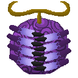
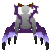
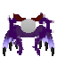
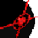
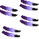
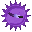

<!-- Generated by tools/build_pack_reference.py. Edit the pack sources and regenerate. -->

# Kumo Kumo no Mi, Model: Gyuki

{ .entry-page-icon }

[Fruits](index.md) · [Akuma no Mi](../../reference/content/akuma.md)

<!-- fruit akuma:kumo_kumo_no_mi_model_gyuki -->

| Stat | Value |
| --- | --- |
| Type | Mythical Zoan |
| Tier | 4 |
| Fruit damage scaling | 1.00× at 10,000 Doriki → 1.75× at 50,000 Doriki |
| Abilities | 11 (8 active, 3 passive) |
| Fruit boxes | [Noble Box](../fruit-boxes.md) |

See [damage calculations](../combat-stats.md#damage-from-doriki).

!!! note "Reading the stats"
    Listed base damage is for the named part of the move. Pack and Doriki multipliers are shown separately. Times assume 20 ticks per second.

<!-- move akuma:gyuki_leg_point -->

## Gyuki Leg Point

{ .entry-move-icon loading=lazy } *Active · Transformation*

Transforms the user into a hybrid gyuki

| Stat | Value |
| --- | --- |
| Pack multiplier when dealing damage | 6× |

<!-- move akuma:gyuki_walk_point -->

## Gyuki Walk Point

{ .entry-move-icon loading=lazy } *Active · Transformation*

Transforms the user into a full gyuki

| Stat | Value |
| --- | --- |
| Pack multiplier when dealing damage | 6× |

<!-- move akuma:gyuki_glare -->

## Gyuki Glare

{ .entry-move-icon loading=lazy } *Active*

The user glares at a target dealing internal damage.

| Stat | Value |
| --- | --- |
| Cooldown | 15 s (300 ticks) |
| Base damage | 60 HP |
| Pack multiplier when dealing damage | 6× |

<!-- move akuma:gyuki_ufo -->

## Gyuki UFO

{ .entry-move-icon loading=lazy } *Active*

The user spins and launches themselves forward, poisoning all enemies around them.

| Stat | Value |
| --- | --- |
| Cooldown | 15 s (300 ticks) |
| Pack multiplier when dealing damage | 6× |

<!-- move akuma:suppression -->

## Suppression

{ .entry-move-icon loading=lazy } *Active*

Pins targets down in an area, stunning them. Targets with strong enough haki can resist it half of the time.

| Stat | Value |
| --- | --- |
| Cooldown | 20 s (400 ticks) |
| Pack multiplier when dealing damage | 6× |

<!-- move akuma:gyuki_gatling -->

## Gyuki Gatling

{ .entry-move-icon loading=lazy } *Active*

The user lets out a barrage of their sharp legs to cause massive damage and destruction.

| Stat | Value |
| --- | --- |
| Cooldown | 17 s (340 ticks) |
| Pack multiplier when dealing damage | 6× |

<!-- move akuma:poison_pellets -->

## Poison Pellets

{ .entry-move-icon loading=lazy } *Active*

Shoots out a barrage of poison pellets that explode on impact and leave a cloud of poison behind.

| Stat | Value |
| --- | --- |
| Cooldown | 16 s (320 ticks) |
| Pack multiplier when dealing damage | 6× |

<!-- move akuma:venom_coating -->

## Venom Coating

{ .entry-move-icon loading=lazy } *Active*

The user coats themselves in venom, poisoning anyone they hit and anyone who hits them.

| Stat | Value |
| --- | --- |
| Cooldown | 40 s (800 ticks) |
| Pack multiplier when dealing damage | 6× |

<!-- move akuma:gyuki_immunities -->

## Gyuki Immunities

*Passive*

| Stat | Value |
| --- | --- |
| Pack multiplier when dealing damage | 6× |

<!-- move akuma:gyuki_night_vision -->

## Night Vision

*Passive*

Grants the user night vision.

| Stat | Value |
| --- | --- |
| Pack multiplier when dealing damage | 6× |

<!-- move akuma:gyuki_wall_climb -->

## Wall Climbing

*Passive*

Walk into a wall to climb it, stay put against it and hang from ceilings. Crouch to let go.

| Stat | Value |
| --- | --- |
| Pack multiplier when dealing damage | 6× |

