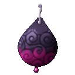
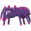
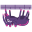
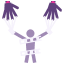
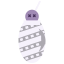
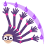
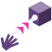

<!-- Generated by tools/build_pack_reference.py. Edit the pack sources and regenerate. -->

# Kumo Kumo no Mi, Model: Rosamygale Grauvogeli

{ .entry-page-icon }

[Fruits](index.md) · [Missing Missing no Mi](../../reference/content/inomissing.md)

<!-- fruit inomissing:kumo_kumo_no_mi_model_rosamygale_grauvogeli -->

| Stat | Value |
| --- | --- |
| Type | Ancient Zoan |
| Tier | 2 |
| Fruit damage scaling | 1.00× at 10,000 Doriki → 2× at 50,000 Doriki |
| Abilities | 10 (9 active, 1 passive) |
| Fruit boxes | [Iron Box](../fruit-boxes.md) |

See [damage calculations](../combat-stats.md#damage-from-doriki).

!!! note "Reading the stats"
    Listed base damage is for the named part of the move. Pack and Doriki multipliers are shown separately. Times assume 20 ticks per second.

<!-- move inomissing:rosamygale_heavy_point -->

## Rosamygale Heavy Point

{ .entry-move-icon loading=lazy } *Active · Transformation*

Transforms the user into a spider hybrid with 6 black arms and a spider abdomen, which weaves sticky webs. Its punches poison for 4 seconds.

| Stat | Value |
| --- | --- |
| Pack multiplier when dealing damage | 1.35× |

**Stats while transformed**

| Stat | Value |
| --- | --- |
| Movement speed | +10% of base |
| Punch damage | +9 HP |
| Armor | +16 |
| Toughness | +4 |
| Step height | +0.5 blocks |

<!-- move inomissing:rosamygale_walk_point -->

## Rosamygale Walk Point

{ .entry-move-icon loading=lazy } *Active · Transformation*

Transforms the user into a giant spider, which is fast, low to the ground and has a poisonous bite. Its punches poison for 4 seconds.

| Stat | Value |
| --- | --- |
| Pack multiplier when dealing damage | 1.35× |

**Stats while transformed**

| Stat | Value |
| --- | --- |
| Movement speed | +30% of base |
| Punch damage | +9 HP |
| Armor | +16 |
| Toughness | +3 |
| Step height | +1 blocks |
| Jump | +1 |

<!-- move inomissing:wall_walker -->

## Wall Walker

{ .entry-move-icon loading=lazy } *Passive*

While in a spider form the user climbs the walls they walk against and holds on to them while crouching. Once under a ceiling they stay on it and walk upside down, crouching lets go

| Stat | Value |
| --- | --- |
| Pack multiplier when dealing damage | 1.35× |

<!-- move inomissing:hard_gum -->

## Hard Gum

{ .entry-move-icon loading=lazy } *Active*

While in a spider form, the user lays a hidden web on the ground where they stand, the first one to step on it is held in place and wrapped in sticky web. The trap disappears after 60 seconds While in a spider form, the user throws a mass of sticky web where they are looking, it holds every enemy that walks into it. The web disappears after 40 seconds, burns easily and shatters in the cold

| Stat | Value |
| --- | --- |
| Cooldown | 12 s (240 ticks) |
| Trap cooldown | 8 s (160 ticks) |
| Conditional cooldown | 0.5 s (10 ticks) |
| Pack multiplier when dealing damage | 1.35× |

<!-- move inomissing:marianette -->

## Marianette

{ .entry-move-icon loading=lazy } *Active*

While in the spider hybrid form, the user shoots threads from their fingers at the enemy they are looking at, binding its limbs so it can't move. Use the ability again for Oshizumaria, the threads pull its arms apart, it is weakened and takes more damage from everyone for 5 seconds. Use it once more to let it go

| Stat | Value |
| --- | --- |
| Cooldown | 14 s (280 ticks) |
| Conditional cooldown | 0.5 s (10 ticks) |
| Pack multiplier when dealing damage | 1.35× |

<!-- move inomissing:ikidomaria -->

## Ikidomaria

{ .entry-move-icon loading=lazy } *Active*

While in the spider hybrid form, the user weaves a wall of net in front of them that stops enemies and projectiles. The wall disappears after 30 seconds, burns easily and shatters in the cold

| Stat | Value |
| --- | --- |
| Cooldown | 15 s (300 ticks) |
| Conditional cooldown | 0.5 s (10 ticks) |
| Pack multiplier when dealing damage | 1.35× |

<!-- move inomissing:cocoon -->

## Cocoon

{ .entry-move-icon loading=lazy } *Active*

While in a spider form, the user winds a nearby enemy that is already caught in a web, a trap or Marianette in a cocoon of silk, it can't move and is poisoned for 6 seconds

| Stat | Value |
| --- | --- |
| Cooldown | 16 s (320 ticks) |
| Conditional cooldown | 0.5 s (10 ticks) |
| Pack multiplier when dealing damage | 1.35× |

<!-- move inomissing:venom_bite -->

## Venom Bite

{ .entry-move-icon loading=lazy } *Active*

While in the full spider form, the user bites the enemy in front of them with their fangs and injects a strong poison for 6 seconds

| Stat | Value |
| --- | --- |
| Base damage | 22 HP |
| Cooldown | 10 s (200 ticks) |
| Pack multiplier when dealing damage | 1.35× |

<!-- move inomissing:venom_legs -->

## Venom Legs

{ .entry-move-icon loading=lazy } *Active*

While in the spider hybrid form, the user strikes the enemies in front of them with all 6 arms at once, the poison on their tips poisons them for 4 seconds

| Stat | Value |
| --- | --- |
| Base damage | 22 HP |
| Cooldown | 12 s (240 ticks) |
| Pack multiplier when dealing damage | 1.35× |

<!-- move inomissing:thread_pull -->

## Thread Pull

{ .entry-move-icon loading=lazy } *Active*

While in a spider form, the user throws a thread at the block they are looking at, the thread then pulls them to it. Use the ability again to let go

| Stat | Value |
| --- | --- |
| Cooldown | 7 s (140 ticks) |
| Conditional cooldown | 0.5 s (10 ticks) |
| Pack multiplier when dealing damage | 1.35× |

