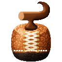
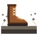
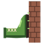
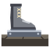
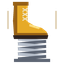

<!-- Generated by tools/build_pack_reference.py. Edit the pack sources and regenerate. -->

# Kutsu Kutsu no Mi

{ .entry-page-icon }

[Fruits](index.md) · [InoFruits](../../reference/content/inofruits.md)

<!-- fruit inofruits:kutsu_kutsu_no_mi -->

| Stat | Value |
| --- | --- |
| Type | Paramecia |
| Tier | 1 |
| Fruit damage scaling | 1.00× at 10,000 Doriki → 2.25× at 50,000 Doriki |
| Abilities | 7 (7 active, 0 passive) |
| Fruit boxes | [Wooden Box](../fruit-boxes.md) |

See [damage calculations](../combat-stats.md#damage-from-doriki).

!!! note "Reading the stats"
    Listed base damage is for the named part of the move. Pack and Doriki multipliers are shown separately. Times assume 20 ticks per second.

<!-- move inofruits:stomp -->

## Stomp

{ .entry-move-icon loading=lazy } *Active*

The user stomps the ground, damaging everyone nearby and launching them up. Hits harder and wider while Weighted Soles is active.

| Stat | Value |
| --- | --- |
| Base damage | 10 HP |
| Weighted damage | 16 HP |
| Cooldown | 6 s (120 ticks) |
| Pack multiplier when dealing damage | 1.2× |

<!-- move inofruits:water_soles -->

## Water Soles

{ .entry-move-icon loading=lazy } *Active*

The user can walk on water and lava like on solid ground. Crouching makes the user sink.

| Stat | Value |
| --- | --- |
| Cooldown | 2 s (40 ticks) |
| Pack multiplier when dealing damage | 1.35× |

<!-- move inofruits:wall_soles -->

## Wall Soles

{ .entry-move-icon loading=lazy } *Active*

The user can climb walls by walking into them, stay on them and hang from ceilings. Crouching makes the user let go

| Stat | Value |
| --- | --- |
| Cooldown | 2 s (40 ticks) |
| Pack multiplier when dealing damage | 1.35× |

<!-- move inofruits:silent_soles -->

## Silent Soles

{ .entry-move-icon loading=lazy } *Active*

The user makes no footsteps and no vibrations, mobs only notice the user from a quarter of the normal distance.

| Stat | Value |
| --- | --- |
| Cooldown | 2 s (40 ticks) |
| Pack multiplier when dealing damage | 1.35× |

<!-- move inofruits:weighted_soles -->

## Weighted Soles

{ .entry-move-icon loading=lazy } *Active*

The user becomes very heavy, they take no knockback but walk slower. Stomp hits harder and wider while this is active.

| Stat | Value |
| --- | --- |
| Cooldown | 2 s (40 ticks) |
| Pack multiplier when dealing damage | 1.35× |

<!-- move inofruits:spring_soles -->

## Spring Soles

{ .entry-move-icon loading=lazy } *Active*

The user jumps about 7 blocks high and takes no fall damage. Crouching makes the user jump normally

| Stat | Value |
| --- | --- |
| Cooldown | 2 s (40 ticks) |
| Pack multiplier when dealing damage | 1.35× |

<!-- move inofruits:skate_soles -->

## Skate Soles

{ .entry-move-icon loading=lazy } *Active*

The user skates fast on any ground and slides for a while before stopping.

| Stat | Value |
| --- | --- |
| Cooldown | 2 s (40 ticks) |
| Pack multiplier when dealing damage | 1.35× |

