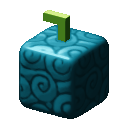
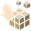
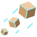
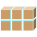
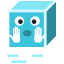
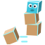
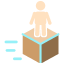

<!-- Generated by tools/build_pack_reference.py. Edit the pack sources and regenerate. -->

# Kyubu Kyubu no Mi

{ .entry-page-icon }

[Fruits](index.md) · [Missing Missing no Mi](../../reference/content/inomissing.md)

<!-- fruit inomissing:kyubu_kyubu_no_mi -->

| Stat | Value |
| --- | --- |
| Type | Paramecia |
| Tier | 1 |
| Fruit damage scaling | 1.00× at 10,000 Doriki → 2.25× at 50,000 Doriki |
| Abilities | 7 (7 active, 0 passive) |
| Fruit boxes | [Wooden Box](../fruit-boxes.md) |

See [damage calculations](../combat-stats.md#damage-from-doriki).

!!! note "Reading the stats"
    Listed base damage is for the named part of the move. Pack and Doriki multipliers are shown separately. Times assume 20 ticks per second.

<!-- move inomissing:cubreak -->

## Cubreak

{ .entry-move-icon loading=lazy } *Active*

The user breaks the block they are looking at and those around it into cubes that float above them, up to 6 cubes. Only plain blocks no harder than cobblestone can be broken If used while crouching, drops all the cubes

| Stat | Value |
| --- | --- |
| Cooldown | 4 s (80 ticks) |
| Drop cooldown | 1 s (20 ticks) |
| Pack multiplier when dealing damage | 1.35× |

<!-- move inomissing:cubooster -->

## Cubooster

{ .entry-move-icon loading=lazy } *Active*

Needs cubes taken with Cubreak. The user hurls their floating cubes one after another at the enemy they are looking at, up to 6 cubes, the damage is for each cube

| Stat | Value |
| --- | --- |
| Base damage | 3.5 HP |
| Cooldown | 8 s (160 ticks) |
| Pack multiplier when dealing damage | 1.35× |

<!-- move inomissing:cube_wall -->

## Cube Wall

{ .entry-move-icon loading=lazy } *Active*

Needs cubes taken with Cubreak. The user assembles their floating cubes into a wall of blocks in front of them, 3 blocks wide and 2 high

| Stat | Value |
| --- | --- |
| Cooldown | 6 s (120 ticks) |
| Conditional cooldown | 0.5 s (10 ticks) |
| Pack multiplier when dealing damage | 1.35× |

<!-- move inomissing:air_cube -->

## Air Cube

{ .entry-move-icon loading=lazy } *Active*

The user compresses the air into a cube in their hand, no block is needed If used again, throws the cube where the user is looking and it bursts like a bomb

| Stat | Value |
| --- | --- |
| Base damage | 12 HP |
| Cooldown | 12 s (240 ticks) |
| Unused cooldown | 4 s (80 ticks) |
| Pack multiplier when dealing damage | 1.35× |

<!-- move inomissing:living_cube -->

## Living Cube

{ .entry-move-icon loading=lazy } *Active*

The user turns the enemy they are looking at from up close into a cube, it can barely move and can no longer fight. The cube breaks after taking enough damage

| Stat | Value |
| --- | --- |
| Cooldown | 20 s (400 ticks) |
| Pack multiplier when dealing damage | 1.35× |

<!-- move inomissing:totem_cube -->

## Totem Cube

{ .entry-move-icon loading=lazy } *Active*

Needs an enemy turned into a cube with Living Cube. The user lifts it on top of a stack of cubes, then knocks the bottom cube away and the enemy falls

| Stat | Value |
| --- | --- |
| Base damage | 20 HP |
| Cooldown | 18 s (360 ticks) |
| Pack multiplier when dealing damage | 1.35× |

<!-- move inomissing:cube_ride -->

## Cube Ride

{ .entry-move-icon loading=lazy } *Active*

The user sits on a floating cube that carries them where they are looking for a short time, no block is needed

| Stat | Value |
| --- | --- |
| Cooldown | 15 s (300 ticks) |
| Pack multiplier when dealing damage | 1.35× |

