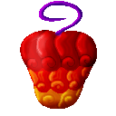
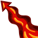
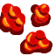

<!-- Generated by tools/build_pack_reference.py. Edit the pack sources and regenerate. -->

# Magu Magu no Mi

{ .entry-page-icon }

[Fruits](index.md) · [Mine Mine no Mi](../../reference/content/mineminenomi.md)

<!-- fruit mineminenomi:magu_magu_no_mi -->

| Stat | Value |
| --- | --- |
| Type | Logia |
| Tier | 3 |
| Fruit damage scaling | 1.00× at 10,000 Doriki → 1.75× at 50,000 Doriki |
| Abilities | 8 (6 active, 2 passive) |
| Fruit boxes | [Golden Box](../fruit-boxes.md) |

See [damage calculations](../combat-stats.md#damage-from-doriki).

[Jump to awakening](#awakening)

After awakening, this fruit’s original damaging moves deal **1.5× damage**. The awakening techniques below have their own values.

!!! note "Reading the stats"
    Listed base damage is for the named part of the move. Pack and Doriki multipliers are shown separately. Times assume 20 ticks per second.

<!-- move mineminenomi:dai_funka -->

## Dai Funka

{ .entry-move-icon loading=lazy } *Active*

Transforms the user's fist into pure magma before expanding and throwing it forward

| Stat | Value |
| --- | --- |
| Cooldown | 25 s (500 ticks) |

<!-- move mineminenomi:ryusei_kazan -->

## Ryusei Kazan

{ .entry-move-icon loading=lazy } *Active*

Functions like 'Dai Funka', but multiple fists are launched at the opponent

| Stat | Value |
| --- | --- |
| Cooldown | 20 s (400 ticks) |

<!-- move mineminenomi:meigo -->

## Meigo

{ .entry-move-icon loading=lazy } *Active*

The user transforms their arm into magma and thrusts it at the opponent at incredible speeds

| Stat | Value |
| --- | --- |
| Cooldown | 30 s (600 ticks) |

<!-- move mineminenomi:bakuretsu_kazan -->

## Bakuretsu Kazan

{ .entry-move-icon loading=lazy } *Active*

By spreading magma to the surroundings, the user turns everything into lava

| Stat | Value |
| --- | --- |
| Min cooldown | 5 s (100 ticks) |
| Max cooldown | 30 s (600 ticks) |

<!-- move mineminenomi:lava_flow -->

## Lava Flow

{ .entry-move-icon loading=lazy } *Active*

The user covers their legs into lava creating a path while walking trough it

| Stat | Value |
| --- | --- |
| Cooldown | 15 s (300 ticks) |

<!-- move mineminenomi:magma_coating -->

## Magma Coating

{ .entry-move-icon loading=lazy } *Active*

The user coats their arm with magma

| Stat | Value |
| --- | --- |
| Cooldown | 10 s (200 ticks) |

<!-- move mineminenomi:logia_invulnerability_magu -->

## Logia Invulnerability Magu

{ .entry-move-icon loading=lazy } *Passive*

<!-- move mineminenomi:heat_logia_immunities -->

## Heat Logia Immunities

*Passive*

| Stat | Value |
| --- | --- |
| Pack multiplier when dealing damage | 2.2× |

## Awakening

**Source** · Awaken Awaken no Mi

| Stat | Value |
| --- | --- |
| Doriki | 40,000 |
| Active time with the fruit | About 24 hours (1,728,000 ticks) |

<!-- move awakenawakennomi:meigo_no_jidai -->

### Meigo no Jidai { #awakening-meigo-no-jidai }

{ .entry-move-icon loading=lazy } *Active*

Melts the ground in a huge wave around the user, leaving burning magma and basalt behind.

| Stat | Value |
| --- | --- |
| Cooldown | 240 s (4800 ticks) |
| Impact damage | 60 HP |

<!-- move awakenawakennomi:kagutsuchi -->

### Kagutsuchi { #awakening-kagutsuchi }

{ .entry-move-icon loading=lazy } *Active*

Coats the user's fists in overheated magma, making their punches way stronger. Each hit burns a quarter of the Netsuryo gauge so the first punch hits the hardest.

| Stat | Value |
| --- | --- |
| Min damage | 15 HP |
| Max damage | 110 HP |
| Cooldown | 45 s (900 ticks) |

<!-- move awakenawakennomi:netsuryo -->

### Netsuryo { #awakening-netsuryo }

{ .entry-move-icon loading=lazy } *Passive*

The user stores heat while standing on magma, and twice as fast while standing in lava Stored heat turns into armor, the fuller the gauge the tougher the user gets. Heat slowly drains away from lava and Kagutsuchi burns it with every punch.
