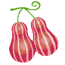
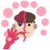

<!-- Generated by tools/build_pack_reference.py. Edit the pack sources and regenerate. -->

# Mane Mane no Mi

{ .entry-page-icon }

[Fruits](index.md) · [Missing Missing no Mi](../../reference/content/inomissing.md)

<!-- fruit inomissing:mane_mane_no_mi -->

| Stat | Value |
| --- | --- |
| Type | Paramecia |
| Tier | 1 |
| Fruit damage scaling | 1.00× at 10,000 Doriki → 2.25× at 50,000 Doriki |
| Abilities | 2 (2 active, 0 passive) |
| Fruit boxes | [Wooden Box](../fruit-boxes.md) |

See [damage calculations](../combat-stats.md#damage-from-doriki).

!!! note "Reading the stats"
    Listed base damage is for the named part of the move. Pack and Doriki multipliers are shown separately. Times assume 20 ticks per second.

<!-- move inomissing:face_touch -->

## Face Touch

{ .entry-move-icon loading=lazy } *Active*

The user touches whoever they look at and remembers their look. The one touched is not hurt and is not told. The ability mode key opens the memory.

| Stat | Value |
| --- | --- |
| Cooldown | 2 s (40 ticks) |
| Conditional cooldown | 0.5 s (10 ticks) |
| Pack multiplier when dealing damage | 1.65× |

<!-- move inomissing:mane_mane_memory -->

## Mane Mane Memory

{ .entry-move-icon loading=lazy } *Active*

The user takes the look of someone they have touched, and keeps it until they use the ability again or receive a blow. A friend of a copied player holds back their first blow, and under a creature look the user makes its cries. The ability mode key opens the memory, where the look is chosen.

| Stat | Value |
| --- | --- |
| Cooldown | 5 s (100 ticks) |
| Pack multiplier when dealing damage | 1.65× |

