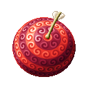
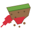

<!-- Generated by tools/build_pack_reference.py. Edit the pack sources and regenerate. -->

# Mato Mato no Mi

{ .entry-page-icon }

[Fruits](index.md) · [Missing Missing no Mi](../../reference/content/inomissing.md)

<!-- fruit inomissing:mato_mato_no_mi -->

| Stat | Value |
| --- | --- |
| Type | Paramecia |
| Tier | 1 |
| Fruit damage scaling | 1.00× at 10,000 Doriki → 2.25× at 50,000 Doriki |
| Abilities | 5 (5 active, 0 passive) |
| Fruit boxes | [Wooden Box](../fruit-boxes.md) |

See [damage calculations](../combat-stats.md#damage-from-doriki).

!!! note "Reading the stats"
    Listed base damage is for the named part of the move. Pack and Doriki multipliers are shown separately. Times assume 20 ticks per second.

<!-- move inomissing:mato_tsuke -->

## Mato Tsuke

{ .entry-move-icon loading=lazy } *Active*

The user touches the one they look at with their hand and marks them. Each hand holds one mark until it touches someone else with this ability. Everything the fruit throws flies to the mark of the hand in use The user sees where each mark is, from anywhere in the same world. A mark on a player lasts 10 minutes

| Stat | Value |
| --- | --- |
| Cooldown | 2 s (40 ticks) |
| Conditional cooldown | 0.5 s (10 ticks) |
| Pack multiplier when dealing damage | 1.3× |

<!-- move inomissing:mato_nage -->

## Mato Nage

{ .entry-move-icon loading=lazy } *Active*

For a while, everything the user shoots or throws flies to the mark of the hand in use and follows it. A thrown weapon hits with twice its attack, its enchantments counted. A shot that meets a block, a shield or someone else on its way flies on as a plain one

| Stat | Value |
| --- | --- |
| Cooldown | 25 s (500 ticks) |
| Pack multiplier when dealing damage | 1.3× |

<!-- move inomissing:mato_nikudan -->

## Nikudan

{ .entry-move-icon loading=lazy } *Active*

The user touches a creature next to them and it flies at the mark of the hand in use. Both get hurt when it lands, harder the farther it flew. A wall on the way stops it. Players and bosses can't be thrown

| Stat | Value |
| --- | --- |
| Base damage | 6 HP |
| Cooldown | 15 s (300 ticks) |
| Conditional cooldown | 0.5 s (10 ticks) |
| Pack multiplier when dealing damage | 1.3× |

<!-- move inomissing:mato_tobi_nori -->

## Tobi Nori

{ .entry-move-icon loading=lazy } *Active*

A block of the ground breaks off under the user or where they look, and they ride it through the air to the mark of the hand in use. They step off near the mark or on a wall, and the block goes back to its place

| Stat | Value |
| --- | --- |
| Cooldown | 30 s (600 ticks) |
| Conditional cooldown | 0.5 s (10 ticks) |
| Pack multiplier when dealing damage | 1.3× |

<!-- move inomissing:mato_hakobune -->

## Hakobune

{ .entry-move-icon loading=lazy } *Active*

The user lays both hands on the ground and a large mass of it breaks off in front of them, rises and rushes through walls and ground at the mark of the hand in use, crushing and throwing aside everyone on its way, and bursts on the mark. Without a mark it flies straight ahead and bursts on the first one it meets The hole closes after a while. A heavy blow to the user makes the mass fall

| Stat | Value |
| --- | --- |
| Base damage | 20 HP |
| Cooldown | 90 s (1800 ticks) |
| Conditional cooldown | 0.5 s (10 ticks) |
| Pack multiplier when dealing damage | 1.3× |

