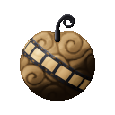

<!-- Generated by tools/build_pack_reference.py. Edit the pack sources and regenerate. -->

# Memo Memo no Mi

{ .entry-page-icon }

[Fruits](index.md) · [Missing Missing no Mi](../../reference/content/inomissing.md)

<!-- fruit inomissing:memo_memo_no_mi -->

| Stat | Value |
| --- | --- |
| Type | Paramecia |
| Tier | 1 |
| Fruit damage scaling | 1.00× at 10,000 Doriki → 2.25× at 50,000 Doriki |
| Abilities | 5 (5 active, 0 passive) |
| Fruit boxes | [Wooden Box](../fruit-boxes.md) |

See [damage calculations](../combat-stats.md#damage-from-doriki).

!!! note "Reading the stats"
    Listed base damage is for the named part of the move. Pack and Doriki multipliers are shown separately. Times assume 20 ticks per second.

<!-- move inomissing:memo_flashback -->

## Memories Fil Flashback

{ .entry-move-icon loading=lazy } *Active*

The user sends threads from their palms to the enemies in front. The touched enemies live old memories again and stand still for a moment, they can't move, hit or use abilities.

| Stat | Value |
| --- | --- |
| Cooldown | 14 s (280 ticks) |
| Pack multiplier when dealing damage | 1.65× |

<!-- move inomissing:memo_cut -->

## Cut

{ .entry-move-icon loading=lazy } *Active*

The user pulls the memories of the creature they look at as a film and cuts its quarrel out. The creature drops its target and its anger until something hits it. Needs shears in the bag. The cut frames are kept as a reel that remembers who the creature was angry at.

| Stat | Value |
| --- | --- |
| Cooldown | 15 s (300 ticks) |
| Conditional cooldown | 0.5 s (10 ticks) |
| Pack multiplier when dealing damage | 1.65× |

<!-- move inomissing:memo_paste -->

## Paste

{ .entry-move-icon loading=lazy } *Active*

The user pastes a false memory in the film of the creature they look at. The creature takes the user for a friend and fights for them for a while. Bosses can't be fooled. Needs shears in the bag. With a reel in a hand the creature gets the anger kept on it and goes for whoever that anger was for. The reel is used up.

| Stat | Value |
| --- | --- |
| Cooldown | 30 s (600 ticks) |
| Conditional cooldown | 0.5 s (10 ticks) |
| Pack multiplier when dealing damage | 1.65× |

<!-- move inomissing:memo_forgotten_skill -->

## Forgotten Skill

{ .entry-move-icon loading=lazy } *Active*

The user pulls the memories of the enemy they look at as a film and cuts frames out. The enemy forgets 3 to 6 random abilities of their current bar and can't use them for a while. Needs shears in the bag.

| Stat | Value |
| --- | --- |
| Cooldown | 40 s (800 ticks) |
| Conditional cooldown | 0.5 s (10 ticks) |
| Pack multiplier when dealing damage | 1.65× |

<!-- move inomissing:memo_rewind -->

## Rewind

{ .entry-move-icon loading=lazy } *Active*

The user pulls the memories of the one they look at as a film and watches it without cutting anything. They learn their fruit, their faction, who hit them last and who they hit last, and the abilities of a player's bar. The user sees them through walls for a while.

| Stat | Value |
| --- | --- |
| Cooldown | 15 s (300 ticks) |
| Conditional cooldown | 0.5 s (10 ticks) |
| Pack multiplier when dealing damage | 1.65× |

