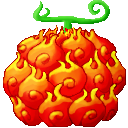

<!-- Generated by tools/build_pack_reference.py. Edit the pack sources and regenerate. -->

# Mera Mera no Mi

{ .entry-page-icon }

[Fruits](index.md) · [Mine Mine no Mi](../../reference/content/mineminenomi.md)

<!-- fruit mineminenomi:mera_mera_no_mi -->

| Stat | Value |
| --- | --- |
| Type | Logia |
| Tier | 3 |
| Fruit damage scaling | 1.00× at 10,000 Doriki → 1.75× at 50,000 Doriki |
| Abilities | 10 (8 active, 2 passive) |
| Fruit boxes | [Golden Box](../fruit-boxes.md) |

See [damage calculations](../combat-stats.md#damage-from-doriki).

[Jump to awakening](#awakening)

!!! note "Reading the stats"
    Listed base damage is for the named part of the move. Pack and Doriki multipliers are shown separately. Times assume 20 ticks per second.

<!-- move mineminenomi:hiken -->

## Hiken

{ .entry-move-icon loading=lazy } *Active*

Turns the user's fist into flames and launches it towards the target

| Stat | Value |
| --- | --- |
| Cooldown | 18 s (360 ticks) |
| Projectile damage | 50 HP |
| Explosion damage | 25 HP |
| Pack multiplier when dealing damage | 1.55× |

<!-- move mineminenomi:higan -->

## Higan

{ .entry-move-icon loading=lazy } *Active*

Turns the user's fingertips into flames and shoots bullets made of fire from them

| Stat | Value |
| --- | --- |
| Cooldown | 9 s (180 ticks) |
| Pack multiplier when dealing damage | 1.55× |

<!-- move mineminenomi:dai_enkai_entei -->

## Dai Enkai: Entei

{ .entry-move-icon loading=lazy } *Active*

Amasses the user's flames into a gigantic fireball that the user hurls at the opponent Creates a giant fire vortex around the user, trapping enemies within it and creating three fire dragons that will be shot towards the enemy at the end.

| Stat | Value |
| --- | --- |
| Cooldown | 25 s (500 ticks) |
| Entei min damage | 24 HP |
| Entei max damage | 104 HP |
| Onibi proj damage | 75 HP |
| Onibi pillar damage | 5 HP |
| Pack multiplier when dealing damage | 1.3× |

<!-- move mineminenomi:hidaruma -->

## Hidaruma

{ .entry-move-icon loading=lazy } *Active*

Creates small green fireballs that set the target on fire

| Stat | Value |
| --- | --- |
| Min cooldown | 10 s (200 ticks) |
| Max cooldown | 25 s (500 ticks) |
| Pack multiplier when dealing damage | 1.55× |

<!-- move mineminenomi:jujika -->

## Jujika

{ .entry-move-icon loading=lazy } *Active*

Launches a cross-shaped column of fire at the opponent

| Stat | Value |
| --- | --- |
| Cooldown | 12 s (240 ticks) |
| Pack multiplier when dealing damage | 1.55× |

<!-- move mineminenomi:heat_dash -->

## Heat Dash

{ .entry-move-icon loading=lazy } *Active*

Transforms the user into fire and launches them forward, setting on fire all enemies around the user.

| Stat | Value |
| --- | --- |
| Cooldown | 10 s (200 ticks) |
| Pack multiplier when dealing damage | 1.55× |

<!-- move mineminenomi:kyokaen -->

## Kyokaen

{ .entry-move-icon loading=lazy } *Active*

Creates a wall of fire protecting the user

| Stat | Value |
| --- | --- |
| Base damage | 3 HP |
| Min cooldown | 2 s (40 ticks) |
| Max cooldown | 7 s (140 ticks) |
| Pack multiplier when dealing damage | 1.55× |

<!-- move mineminenomi:hibashira -->

## Hibashira

{ .entry-move-icon loading=lazy } *Active*

Creates a fire pillar extending both upwards and downwards, burning every enemy within it

| Stat | Value |
| --- | --- |
| Min cooldown | 10 s (200 ticks) |
| Max cooldown | 12.5 s (250 ticks) |
| Base damage | 5 HP |
| Pack multiplier when dealing damage | 1.55× |

<!-- move mineminenomi:logia_invulnerability_mera -->

## Logia Invulnerability Mera

{ .entry-move-icon loading=lazy } *Passive*

| Stat | Value |
| --- | --- |
| Base damage | 5 HP |
| Pack multiplier when dealing damage | 1.55× |

<!-- move mineminenomi:heat_logia_immunities -->

## Heat Logia Immunities

*Passive*

| Stat | Value |
| --- | --- |
| Pack multiplier when dealing damage | 2.2× |

## Awakening

**Source** · Awaken Awaken no Mi

| Stat | Value |
| --- | --- |
| Doriki | 40,000 |
| Active time with the fruit | About 24 hours (1,728,000 ticks) |

<!-- move awakenawakennomi:crown_of_flames -->

### Crown of Flames { #awakening-crown-of-flames }

{ .entry-move-icon loading=lazy } *Active*

The user makes flames under their hands and feet to fly for 1 minute

| Stat | Value |
| --- | --- |
| Min cooldown | 10 s (200 ticks) |
| Max cooldown | 120 s (2400 ticks) |

<!-- move awakenawakennomi:crown_flight -->

### Crown Flight { #awakening-crown-flight }

*Passive*

<!-- move awakenawakennomi:homura -->

### Homura { #awakening-homura }

{ .entry-move-icon loading=lazy } *Passive*

Flames spread out from the user and burn nearby enemies, dealing more damage the weaker they are.

| Stat | Value |
| --- | --- |
| Min damage | 1 HP |
| Max damage | 10 HP |

