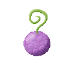

<!-- Generated by tools/build_pack_reference.py. Edit the pack sources and regenerate. -->

# Mini Mini No Mi

{ .entry-page-icon }

[Fruits](index.md) · [Mine Mine no Mi](../../reference/content/mineminenomi.md)

<!-- fruit mineminenomi:mini_mini_no_mi -->

| Stat | Value |
| --- | --- |
| Type | Paramecia |
| Tier | 1 |
| Fruit damage scaling | 1.00× at 10,000 Doriki → 2.25× at 50,000 Doriki |
| Abilities | 2 (1 active, 1 passive) |
| Fruit boxes | [Wooden Box](../fruit-boxes.md) |

See [damage calculations](../combat-stats.md#damage-from-doriki).

[Jump to awakening](#awakening)

After awakening, this fruit’s original damaging moves deal **1.5× damage**. The awakening techniques below have their own values.

!!! note "Reading the stats"
    Listed base damage is for the named part of the move. Pack and Doriki multipliers are shown separately. Times assume 20 ticks per second.

<!-- move mineminenomi:mini_mini -->

## Mini Mini

{ .entry-move-icon loading=lazy } *Active · Transformation*

Allows the user to become smaller than their actual size.

| Stat | Value |
| --- | --- |
| Pack multiplier when dealing damage | 2.8× |

<!-- move mineminenomi:paper_float -->

## Paper Float

{ .entry-move-icon loading=lazy } *Passive*

While in the mini form and holding a piece of paper the user is able to float.

| Stat | Value |
| --- | --- |
| Pack multiplier when dealing damage | 2.8× |

## Awakening

**Source** · Awaken Awaken no Mi

| Stat | Value |
| --- | --- |
| Doriki | 40,000 |
| Active time with the fruit | About 24 hours (1,728,000 ticks) |

<!-- move awakenawakennomi:gullivers_nightmare -->

### Gulliver's Nightmare { #awakening-gullivers-nightmare }

{ .entry-move-icon loading=lazy } *Active*

Shrinks every nearby enemy, making them way smaller and weaker.

| Stat | Value |
| --- | --- |
| Cooldown | 120 s (2400 ticks) |

<!-- move awakenawakennomi:lilliput_crush -->

### Lilliput Crush { #awakening-lilliput-crush }

{ .entry-move-icon loading=lazy } *Active*

Stomps down on everything nearby, the smaller a target is the harder it gets crushed Shrunken enemies get pinned to the ground for a moment.

| Stat | Value |
| --- | --- |
| Base damage | 30 HP |
| Max damage | 120 HP |
| Cooldown | 20 s (400 ticks) |

<!-- move awakenawakennomi:tiny_titan -->

### Tiny Titan { #awakening-tiny-titan }

{ .entry-move-icon loading=lazy } *Passive*

While in the mini form the user hits way harder against anything bigger than them
