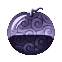
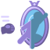
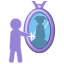
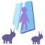

<!-- Generated by tools/build_pack_reference.py. Edit the pack sources and regenerate. -->

# Mira Mira no Mi

{ .entry-page-icon }

[Fruits](index.md) · [Missing Missing no Mi](../../reference/content/inomissing.md)

<!-- fruit inomissing:mira_mira_no_mi -->

| Stat | Value |
| --- | --- |
| Type | Paramecia |
| Tier | 1 |
| Fruit damage scaling | 1.00× at 10,000 Doriki → 2.25× at 50,000 Doriki |
| Abilities | 6 (6 active, 0 passive) |
| Fruit boxes | [Wooden Box](../fruit-boxes.md) |

See [damage calculations](../combat-stats.md#damage-from-doriki).

!!! note "Reading the stats"
    Listed base damage is for the named part of the move. Pack and Doriki multipliers are shown separately. Times assume 20 ticks per second.

<!-- move inomissing:mira_reflection -->

## Reflection

{ .entry-move-icon loading=lazy } *Active*

The user raises a mirror in front of them for a few seconds. Projectiles coming from the front are sent back, and melee hits from the front are stopped. Nothing is stopped from behind.

| Stat | Value |
| --- | --- |
| Cooldown | 12 s (240 ticks) |
| Pack multiplier when dealing damage | 1.65× |

<!-- move inomissing:mira_mirror -->

## Mirror

{ .entry-move-icon loading=lazy } *Active*

The user lays a standing mirror where they look. Using a mirror sends the user into Mirro-World, and each mirror inside leads back to its twin outside. A mirror laid inside Mirro-World makes its twin in the world. Others can only follow the user through a mirror for a few seconds, but anyone can walk out of Mirro-World. A mirror stays until someone breaks it, and a broken mirror leads nowhere.

| Stat | Value |
| --- | --- |
| Cooldown | 3 s (60 ticks) |
| Conditional cooldown | 0.5 s (10 ticks) |
| Pack multiplier when dealing damage | 1.65× |

<!-- move inomissing:mirro_world -->

## Mirro-World

{ .entry-move-icon loading=lazy } *Active*

Used inside Mirro-World next to a mirror, the user's hand comes out of its twin and pulls in the first enemy standing in front of it. The next punch of the user raises a mirror behind the target and pushes it into Mirro-World. The mirror stays where it rose. A creature stays inside until the user lets it out by sneaking and using that mirror. For a player every mirror inside stays shut for a minute. They come out sooner if the user is knocked out, dies or leaves, or if they follow the user through a mirror. Bosses can't be pushed in.

| Stat | Value |
| --- | --- |
| Cooldown | 30 s (600 ticks) |
| Conditional cooldown | 0.5 s (10 ticks) |
| Pack multiplier when dealing damage | 1.65× |

<!-- move inomissing:mira_image -->

## Mirror Image

{ .entry-move-icon loading=lazy } *Active*

With the ability mode key the user gives the look of the last one they copied to whoever they look at instead. A player has to crouch to take it. The user takes the look of whoever they look at. Creatures on the side of the one copied leave the user alone, and creatures that go for the one copied may go for the user instead. The look falls when the user is hit or uses the ability again. It gives no strength and no abilities.

| Stat | Value |
| --- | --- |
| Cooldown | 20 s (400 ticks) |
| Conditional cooldown | 0.5 s (10 ticks) |
| Pack multiplier when dealing damage | 1.65× |

<!-- move inomissing:mira_decoys -->

## Decoys

{ .entry-move-icon loading=lazy } *Active*

The animals around the user take the look of whoever the user looks at. Creatures that go for the one copied may go for one of the animals instead. An animal loses the look when it is hit.

| Stat | Value |
| --- | --- |
| Cooldown | 30 s (600 ticks) |
| Conditional cooldown | 0.5 s (10 ticks) |
| Pack multiplier when dealing damage | 1.65× |

<!-- move inomissing:mira_ask -->

## Ask the Mirrors

{ .entry-move-icon loading=lazy } *Active*

Every mirror of the world tells the user which players passed in front of it, how long ago and where.

| Stat | Value |
| --- | --- |
| Cooldown | 5 s (100 ticks) |
| Pack multiplier when dealing damage | 1.65× |

