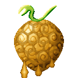
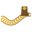

<!-- Generated by tools/build_pack_reference.py. Edit the pack sources and regenerate. -->

# Mitsu Mitsu no Mi

{ .entry-page-icon }

[Fruits](index.md) · [InoFruits](../../reference/content/inofruits.md)

<!-- fruit inofruits:mitsu_mitsu_no_mi -->

| Stat | Value |
| --- | --- |
| Type | Paramecia |
| Tier | 2 |
| Fruit damage scaling | 1.00× at 10,000 Doriki → 2× at 50,000 Doriki |
| Abilities | 6 (6 active, 0 passive) |
| Fruit boxes | [Iron Box](../fruit-boxes.md) |

See [damage calculations](../combat-stats.md#damage-from-doriki).

!!! note "Reading the stats"
    Listed base damage is for the named part of the move. Pack and Doriki multipliers are shown separately. Times assume 20 ticks per second.

<!-- move inofruits:mitsu_numa -->

## Mitsu Numa

{ .entry-move-icon loading=lazy } *Active*

Pours a big pool of honey that slows down anything standing in it, including the user.

| Stat | Value |
| --- | --- |
| Cooldown | 15 s (300 ticks) |
| Pulse damage | 2 HP |
| Pack multiplier when dealing damage | 1.2× |

<!-- move inofruits:mitsu_goromo -->

## Mitsu Goromo

{ .entry-move-icon loading=lazy } *Active*

Covers the target in honey, slowing their movement and attacks for 6 seconds.

| Stat | Value |
| --- | --- |
| Cooldown | 12 s (240 ticks) |
| Conditional cooldown | 0.5 s (10 ticks) |
| Pack multiplier when dealing damage | 1.2× |

<!-- move inofruits:mitsu_gusuri -->

## Mitsu Gusuri

{ .entry-move-icon loading=lazy } *Active*

The user eats some of their own honey, healing slowly for 8 seconds.

| Stat | Value |
| --- | --- |
| Cooldown | 30 s (600 ticks) |
| Pack multiplier when dealing damage | 1.2× |

<!-- move inofruits:kohaku -->

## Kohaku

{ .entry-move-icon loading=lazy } *Active*

Pours honey on the target which hardens, keeping them stuck for 3 seconds.

| Stat | Value |
| --- | --- |
| Cooldown | 20 s (400 ticks) |
| Conditional cooldown | 0.5 s (10 ticks) |
| Pack multiplier when dealing damage | 1.2× |

<!-- move inofruits:amahada -->

## Amahada

{ .entry-move-icon loading=lazy } *Active*

Covers the user in honey for 14 seconds, making anyone who hits them stuck.

| Stat | Value |
| --- | --- |
| Cooldown | 16 s (320 ticks) |
| Pack multiplier when dealing damage | 1.2× |

<!-- move inofruits:mitsu_suberi -->

## Mitsu Suberi

{ .entry-move-icon loading=lazy } *Active*

The user slides on honey under their feet, leaving a sticky trail behind

| Stat | Value |
| --- | --- |
| Base damage | 6 HP |
| Cooldown | 10 s (200 ticks) |
| Pack multiplier when dealing damage | 1.2× |

