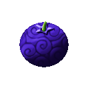

<!-- Generated by tools/build_pack_reference.py. Edit the pack sources and regenerate. -->

# Moa Moa no Mi

{ .entry-page-icon }

[Fruits](index.md) · [Missing Missing no Mi](../../reference/content/inomissing.md)

<!-- fruit inomissing:moa_moa_no_mi -->

| Stat | Value |
| --- | --- |
| Type | Paramecia |
| Tier | 2 |
| Fruit damage scaling | 1.00× at 10,000 Doriki → 2× at 50,000 Doriki |
| Abilities | 7 (7 active, 0 passive) |
| Fruit boxes | [Iron Box](../fruit-boxes.md) |

See [damage calculations](../combat-stats.md#damage-from-doriki).

!!! note "Reading the stats"
    Listed base damage is for the named part of the move. Pack and Doriki multipliers are shown separately. Times assume 20 ticks per second.

<!-- move inomissing:jubai_sandan -->

## Jubai Sandan

{ .entry-move-icon loading=lazy } *Active*

The user blows on specks of dust and enlarges them ten times, firing 8 pebbles in a cone where they are looking.

| Stat | Value |
| --- | --- |
| Base damage | 4 HP |
| Cooldown | 8 s (160 ticks) |

<!-- move inomissing:gojubai_ho -->

## Gojubai Ho

{ .entry-move-icon loading=lazy } *Active*

The user throws a handful of small things and enlarges them fifty times, firing 5 cannonballs that burst where they land.

| Stat | Value |
| --- | --- |
| Base damage | 8 HP |
| Cooldown | 14 s (280 ticks) |

<!-- move inomissing:hyakubai_gan -->

## Hyakubai Gan

{ .entry-move-icon loading=lazy } *Active*

The next projectile fired by the user is enlarged a hundred times in flight and bursts where it lands. Fired from a cannon, a cannonball becomes Hyakubai Ho, which hits harder and bursts wider.

| Stat | Value |
| --- | --- |
| Base damage | 26 HP |
| Cooldown | 20 s (400 ticks) |
| Unused cooldown | 4 s (80 ticks) |
| Ho damage | 39 HP |

<!-- move inomissing:hyakubai_giri -->

## Hyakubai Giri

{ .entry-move-icon loading=lazy } *Active*

The user throws the weapon they are holding and enlarges it a hundred times, cutting every enemy on its way.

| Stat | Value |
| --- | --- |
| Base damage | 22 HP |
| Cooldown | 16 s (320 ticks) |

<!-- move inomissing:moa_soku -->

## Jubai Soku

{ .entry-move-icon loading=lazy } *Active*

The user multiplies their own speed by ten, thirty or a hundred. The faster they go, the shorter it lasts.

| Stat | Value |
| --- | --- |
| Cooldown | 20 s (400 ticks) |

<!-- move inomissing:hyakubai_soku_renda -->

## Hyakubai Soku: Renda

{ .entry-move-icon loading=lazy } *Active*

The user rushes at a hundred times their speed to the enemy they are looking at and hits everyone in front of them with a barrage of 12 punches.

| Stat | Value |
| --- | --- |
| Cooldown | 18 s (360 ticks) |

<!-- move inomissing:gojubai_soku_gekitsui -->

## Gojubai Soku: Gekitsui

{ .entry-move-icon loading=lazy } *Active*

The user rushes to the enemy they are looking at, grabs them and at fifty times their speed swings them around before slamming them into the ground. A target at least twice as big as the user is swung over their head, hits the ground harder and the impact reaches further.

| Stat | Value |
| --- | --- |
| Base damage | 26 HP |
| Cooldown | 20 s (400 ticks) |
| Big damage | 39 HP |
| Conditional cooldown | 0.5 s (10 ticks) |

