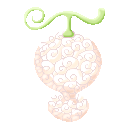
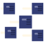
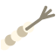
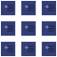

<!-- Generated by tools/build_pack_reference.py. Edit the pack sources and regenerate. -->

# Mochi Mochi no Mi

{ .entry-page-icon }

[Fruits](index.md) · [Missing Missing no Mi](../../reference/content/inomissing.md)

<!-- fruit inomissing:mochi_mochi_no_mi -->

| Stat | Value |
| --- | --- |
| Type | Paramecia |
| Tier | 3 |
| Fruit damage scaling | 1.00× at 10,000 Doriki → 1.75× at 50,000 Doriki |
| Abilities | 23 (21 active, 2 passive) |
| Fruit boxes | [Golden Box](../fruit-boxes.md) |

See [damage calculations](../combat-stats.md#damage-from-doriki).

!!! note "Reading the stats"
    Listed base damage is for the named part of the move. Pack and Doriki multipliers are shown separately. Times assume 20 ticks per second.

<!-- move inomissing:mochi_stretching_arm -->

## Stretching Arm

{ .entry-move-icon loading=lazy } *Active*

The user's arm of soft mochi stretches and punches the enemy they look at from far away. The mochi sticks to the enemy and holds it a moment

| Stat | Value |
| --- | --- |
| Base damage | 7 HP |
| Cooldown | 6 s (120 ticks) |
| Conditional cooldown | 0.5 s (10 ticks) |

<!-- move inomissing:mochi_lump -->

## Mochi Lump

{ .entry-move-icon loading=lazy } *Active*

The user throws a lump of soft mochi where they look. The first enemy it hits is stuck in it. Water and rain free whoever is stuck, and a stuck player holds the use key to eat their way out

| Stat | Value |
| --- | --- |
| Base damage | 4 HP |
| Cooldown | 7 s (140 ticks) |

<!-- move inomissing:mochi_flowing_body -->

## Flowing Body

{ .entry-move-icon loading=lazy } *Active*

The body of the user opens like soft mochi while they slip a few blocks where they are looking. Nothing can hit them while it is open

| Stat | Value |
| --- | --- |
| Cooldown | 8 s (160 ticks) |

<!-- move inomissing:mochi_extra_arms -->

## Extra Arms

{ .entry-move-icon loading=lazy } *Passive*

Extra arms of soft mochi follow each of the user's own hits in close combat with more punches, once a second on the same enemy. They harden only while the user's Armament Haki is on

| Stat | Value |
| --- | --- |
| Base damage | 3 HP |

<!-- move inomissing:mochi_kaku -->

## Kaku Mochi

{ .entry-move-icon loading=lazy } *Active*

The user presses their forearms into square blocks of hardened mochi. Their punches hit far harder for a while. Needs Armament Haki hardening unlocked

| Stat | Value |
| --- | --- |
| Cooldown | 20 s (400 ticks) |

**Stats while transformed**

| Stat | Value |
| --- | --- |
| Punch damage | +8 HP |

<!-- move inomissing:mochi_naguri -->

## Naguri Mochi

{ .entry-move-icon loading=lazy } *Active*

The user throws a barrage of square fists of hardened mochi where they are looking. Needs Armament Haki hardening unlocked

| Stat | Value |
| --- | --- |
| Base damage | 4 HP |
| Cooldown | 12 s (240 ticks) |

<!-- move inomissing:mochi_yaki -->

## Yaki Mochi

{ .entry-move-icon loading=lazy } *Active*

The user's forearm swells and shoots its fist far away, so fast that it catches fire. It hits every enemy in its way and sets them on fire. Needs Armament Haki hardening unlocked

| Stat | Value |
| --- | --- |
| Base damage | 18 HP |
| Cooldown | 11 s (220 ticks) |

<!-- move inomissing:mochi_yanagi -->

## Yanagi Mochi

{ .entry-move-icon loading=lazy } *Active*

The user's raised leg grows many long legs of mochi that stamp the ground in front again and again. Every enemy under them is hit at each stamp

| Stat | Value |
| --- | --- |
| Cooldown | 15 s (300 ticks) |
| Base damage | 3 HP |

<!-- move inomissing:mochi_tori -->

## Tori Mochi

{ .entry-move-icon loading=lazy } *Active*

A whip of mochi winds around the enemy the user looks at and throws it where the user is looking

| Stat | Value |
| --- | --- |
| Base damage | 8 HP |
| Cooldown | 10 s (200 ticks) |
| Conditional cooldown | 0.5 s (10 ticks) |

<!-- move inomissing:mochi_tsuki -->

## Mochi Tsuki

{ .entry-move-icon loading=lazy } *Active*

The user twists their arm of mochi tight and lets it go while it thrusts the weapon they hold. The drilling stab hits every enemy in a line and the weapon adds its damage. Needs a weapon in hand

| Stat | Value |
| --- | --- |
| Cooldown | 10 s (200 ticks) |
| Base damage | 12 HP |
| Conditional cooldown | 0.5 s (10 ticks) |

<!-- move inomissing:mochi_hadan -->

## Mochi Hadan

{ .entry-move-icon loading=lazy } *Active*

The user shoots a hardened fingertip as a bullet and their forearm becomes a Gatling gun of mochi. While it is out, holding right click with an empty hand fires a stream of bullets. Needs Armament Haki hardening unlocked Use the ability again to put the Gatling gun away

| Stat | Value |
| --- | --- |
| Cooldown | 15 s (300 ticks) |
| Base damage | 2 HP |
| First damage | 6 HP |

<!-- move inomissing:mochi_zan_giri -->

## Zan Giri Mochi

{ .entry-move-icon loading=lazy } *Active*

The user rolls forward as a spiked ring of mochi, the first enemy it meets gets hurt and stops it. Then their arm swells into spiked mochi, they twist their body like a spring and let it go. A giant arm whips round them, hits every enemy in reach and throws them away. Needs Armament Haki hardening unlocked

| Stat | Value |
| --- | --- |
| Roll damage | 6 HP |
| Base damage | 24 HP |
| Cooldown | 15 s (300 ticks) |

<!-- move inomissing:mochi_wall -->

## Mochi Wall

{ .entry-move-icon loading=lazy } *Active*

The user raises a wall of soft mochi in front of them. It stops bodies and hits, and an enemy who touches it gets stuck. Water and rain free whoever is stuck, and a stuck player holds the use key to eat their way out. Using the ability again brings the wall down

| Stat | Value |
| --- | --- |
| Cooldown | 20 s (400 ticks) |

<!-- move inomissing:mochi_nagare -->

## Nagare Mochi

{ .entry-move-icon loading=lazy } *Active*

Awakened. The ground around the enemy the user looks at turns to mochi and seizes it, even far away. The enemy and those next to it are stuck, and the mochi on the ground slows whoever walks in it

| Stat | Value |
| --- | --- |
| Cooldown | 20 s (400 ticks) |
| Base damage | 25 HP |
| Conditional cooldown | 0.5 s (10 ticks) |

<!-- move inomissing:mochi_kagami -->

## Kagami Mochi

{ .entry-move-icon loading=lazy } *Active*

Awakened. Mochi falls on the enemy the user looks at and buries it in a shell of mochi for a while. The shell goes by itself and the world is left as it was

| Stat | Value |
| --- | --- |
| Cooldown | 25 s (500 ticks) |
| Base damage | 45 HP |
| Conditional cooldown | 0.5 s (10 ticks) |

<!-- move inomissing:mochi_amadare -->

## Amadare Mochi

{ .entry-move-icon loading=lazy } *Active*

Awakened. The ground around the user grows blunt arms of mochi that close on every enemy nearby and hold them a moment

| Stat | Value |
| --- | --- |
| Cooldown | 18 s (360 ticks) |
| Base damage | 30 HP |

<!-- move inomissing:mochi_muso_donuts -->

## Muso Donuts

{ .entry-move-icon loading=lazy } *Active*

Awakened. Rings of mochi swell in the air around the user and stay with them for a while, facing where they look. The giant arms and the spikes of the awakening come out of the rings that stand too Used again the rings go. The longer they stood the longer the cooldown

| Stat | Value |
| --- | --- |
| Min cooldown | 10 s (200 ticks) |

<!-- move inomissing:mochi_chikara -->

## Chikara Mochi

{ .entry-move-icon loading=lazy } *Active*

Awakened. A donut of mochi swells over the user's shoulder and a giant arm of hardened mochi shoots out of it, or out of a nearer ring of Muso Donuts, and punches the enemy the user looks at, sending it flying

| Stat | Value |
| --- | --- |
| Cooldown | 25 s (500 ticks) |
| Base damage | 70 HP |
| Conditional cooldown | 0.5 s (10 ticks) |

<!-- move inomissing:mochi_ginchaku -->

## Mochi Ginchaku

{ .entry-move-icon loading=lazy } *Active*

Awakened. A donut of mochi swells over the user's shoulder and throws its giant arm again and again at the enemy nearest to it. Every ring of Muso Donuts does the same

| Stat | Value |
| --- | --- |
| Cooldown | 25 s (500 ticks) |
| Base damage | 4 HP |

<!-- move inomissing:mochi_kuzu -->

## Kuzu Mochi

{ .entry-move-icon loading=lazy } *Active*

Awakened. A donut of mochi swells over the user's shoulder and nine giant arms of hardened mochi come out of it one after the other and pound the place the user is looking at. The rings of Muso Donuts throw arms too

| Stat | Value |
| --- | --- |
| Cooldown | 30 s (600 ticks) |
| Conditional cooldown | 0.5 s (10 ticks) |

<!-- move inomissing:mochi_kashiwa -->

## Kashiwa Mochi

{ .entry-move-icon loading=lazy } *Active*

Awakened. Two donuts of mochi swell over the user's shoulders and two giant open hands come out of them and clap on the enemy the user looks at, it stays stuck in their mochi. While right click is held they clap again and again

| Stat | Value |
| --- | --- |
| Cooldown | 25 s (500 ticks) |
| Base damage | 26 HP |
| Conditional cooldown | 0.5 s (10 ticks) |

<!-- move inomissing:mochi_kuri -->

## Kuri Mochi

{ .entry-move-icon loading=lazy } *Active*

Awakened. A donut of mochi swells beside the user, bristles with hardened spikes and shoots them. Kuri Mochi shoots where the user is looking, from the donut over their shoulder or the nearest ring of Muso Donuts Kuri Mochi Sentry leaves the donut in the air in front of the user, it shoots the nearest enemy it sees by itself for a while

| Stat | Value |
| --- | --- |
| Cooldown | 20 s (400 ticks) |
| Base damage | 6 HP |

<!-- move inomissing:mochi_body -->

## Mochi Body

{ .entry-move-icon loading=lazy } *Passive*

The user's body of mochi opens around the hits they see coming. Needs the future sight of Observation Haki unlocked
