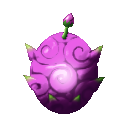

<!-- Generated by tools/build_pack_reference.py. Edit the pack sources and regenerate. -->

# Modo Modo no Mi

{ .entry-page-icon }

[Fruits](index.md) · [Missing Missing no Mi](../../reference/content/inomissing.md)

<!-- fruit inomissing:modo_modo_no_mi -->

| Stat | Value |
| --- | --- |
| Type | Paramecia |
| Tier | 2 |
| Fruit damage scaling | 1.00× at 10,000 Doriki → 2× at 50,000 Doriki |
| Abilities | 6 (6 active, 0 passive) |
| Fruit boxes | [Iron Box](../fruit-boxes.md) |

See [damage calculations](../combat-stats.md#damage-from-doriki).

!!! note "Reading the stats"
    Listed base damage is for the named part of the move. Pack and Doriki multipliers are shown separately. Times assume 20 ticks per second.

<!-- move inomissing:modo_modo -->

## Modo Modo

{ .entry-move-icon loading=lazy } *Active*

The user touches the enemy in front of them and sends them twelve years back, they become smaller and weaker for a minute, and more so with each touch After 5 touches a creature disappears and drops nothing. Players and bosses only get weaker

| Stat | Value |
| --- | --- |
| Cooldown | 3 s (60 ticks) |
| Pack multiplier when dealing damage | 1.5× |

<!-- move inomissing:modo_modo_shot -->

## Modo Modo Shot

{ .entry-move-icon loading=lazy } *Active*

The user throws a ball of pink energy, the first enemy it hits is sent twelve years back like with a touch

| Stat | Value |
| --- | --- |
| Cooldown | 7 s (140 ticks) |
| Pack multiplier when dealing damage | 1.5× |

<!-- move inomissing:back_to_lava -->

## Back to Lava

{ .entry-move-icon loading=lazy } *Active*

The user turns the stone they are looking at and the stone around it back into lava. The lava stays

| Stat | Value |
| --- | --- |
| Cooldown | 20 s (400 ticks) |
| Pack multiplier when dealing damage | 1.5× |

<!-- move inomissing:entomb -->

## Entomb

{ .entry-move-icon loading=lazy } *Active*

The lava or soft ground under the feet of the enemy the user is looking at hardens back into rock and holds them. It lasts less on players and bosses

| Stat | Value |
| --- | --- |
| Cooldown | 20 s (400 ticks) |
| Conditional cooldown | 0.5 s (10 ticks) |
| Pack multiplier when dealing damage | 1.5× |

<!-- move inomissing:own_youth -->

## Own Youth

{ .entry-move-icon loading=lazy } *Active · Transformation*

The user sends their own body back in time, they become small and quick but their blows are weaker

| Stat | Value |
| --- | --- |
| Cooldown | 10 s (200 ticks) |
| Pack multiplier when dealing damage | 1.5× |

<!-- move inomissing:renew -->

## Renew

{ .entry-move-icon loading=lazy } *Active*

The user repairs the damaged item they are holding

| Stat | Value |
| --- | --- |
| Cooldown | 300 s (6000 ticks) |
| Pack multiplier when dealing damage | 1.5× |

