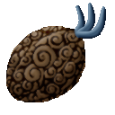
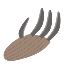

<!-- Generated by tools/build_pack_reference.py. Edit the pack sources and regenerate. -->

# Mogu Mogu no Mi

{ .entry-page-icon }

[Fruits](index.md) · [Mine Mine no Mi](../../reference/content/mineminenomi.md)

<!-- fruit mineminenomi:mogu_mogu_no_mi -->

| Stat | Value |
| --- | --- |
| Type | Zoan |
| Tier | 1 |
| Fruit damage scaling | 1.00× at 10,000 Doriki → 2.25× at 50,000 Doriki |
| Abilities | 3 (3 active, 0 passive) |
| Fruit boxes | [Wooden Box](../fruit-boxes.md) |

See [damage calculations](../combat-stats.md#damage-from-doriki).

[Jump to awakening](#awakening)

After awakening, this fruit’s original damaging moves deal **1.5× damage**. The awakening techniques below have their own values.

Keep using your normal combat forms after awakening. See the [awakened Zoan form stats](../devil-fruits.md#what-changes-after-awakening) for the upgrade.

!!! note "Reading the stats"
    Listed base damage is for the named part of the move. Pack and Doriki multipliers are shown separately. Times assume 20 ticks per second.

<!-- move mineminenomi:mogu_heavy_point -->

## Mogu Heavy Point

{ .entry-move-icon loading=lazy } *Active · Transformation*

Transforms the user into a mole, which focuses on strength and digging speed

| Stat | Value |
| --- | --- |
| Pack multiplier when dealing damage | 2.6× |

<!-- move mineminenomi:mogura_banana -->

## Mogura Banana

{ .entry-move-icon loading=lazy } *Active*

Hit the enemy with big mole claws to launch them away

| Stat | Value |
| --- | --- |
| Cooldown | 6 s (120 ticks) |
| Pack multiplier when dealing damage | 1.8× |

<!-- move mineminenomi:mogura_tonpo -->

## Mogura Tonpo

{ .entry-move-icon loading=lazy } *Active*

Digs a massive tunnel forwards while in mole form

| Stat | Value |
| --- | --- |
| Cooldown | 12 s (240 ticks) |
| Base damage | 15 HP |
| Pack multiplier when dealing damage | 2.6× |

## Awakening

**Source** · Awaken Awaken no Mi

| Stat | Value |
| --- | --- |
| Doriki | 40,000 |
| Active time with the fruit | About 24 hours (1,728,000 ticks) |

<!-- move awakenawakennomi:mogu_dig -->

### Mogu Dig { #awakening-mogu-dig }

{ .entry-move-icon loading=lazy } *Active*

Lets the user swim through blocks after running into the ground Lets the user swim through blocks, breaking them along the way.

| Stat | Value |
| --- | --- |
| Cooldown | 1 s (20 ticks) |

<!-- move awakenawakennomi:subterranean_dash -->

### Subterranean Dash { #awakening-subterranean-dash }

{ .entry-move-icon loading=lazy } *Active*

Dashes forward really fast while burrowing underground.

| Stat | Value |
| --- | --- |
| Cooldown | 6 s (120 ticks) |
| Base damage | 25 HP |

