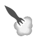
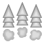
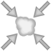
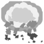

<!-- Generated by tools/build_pack_reference.py. Edit the pack sources and regenerate. -->

# Moku Moku no Mi

{ .entry-page-icon }

[Fruits](index.md) · [Mine Mine no Mi](../../reference/content/mineminenomi.md)

<!-- fruit mineminenomi:moku_moku_no_mi -->

| Stat | Value |
| --- | --- |
| Type | Logia |
| Tier | 3 |
| Fruit damage scaling | 1.00× at 10,000 Doriki → 1.75× at 50,000 Doriki |
| Abilities | 11 (8 active, 3 passive) |
| Fruit boxes | [Golden Box](../fruit-boxes.md) |

See [damage calculations](../combat-stats.md#damage-from-doriki).

[Jump to awakening](#awakening)

After awakening, this fruit’s original damaging moves deal **1.5× damage**. The awakening techniques below have their own values.

!!! note "Reading the stats"
    Listed base damage is for the named part of the move. Pack and Doriki multipliers are shown separately. Times assume 20 ticks per second.

<!-- move mineminenomi:white_blow -->

## White Blow

{ .entry-move-icon loading=lazy } *Active*

Shoots a cloud of smoke to engulf the opponent and trap them

| Stat | Value |
| --- | --- |
| Cooldown | 5 s (100 ticks) |
| Pack multiplier when dealing damage | 3.05× |

<!-- move mineminenomi:white_snake -->

## White Snake

{ .entry-move-icon loading=lazy } *Active*

Launches a long dense cloud of smoke in the shape of a snake that will damage and give poison to its target

| Stat | Value |
| --- | --- |
| Cooldown | 12 s (240 ticks) |
| Pack multiplier when dealing damage | 5.1× |

<!-- move mineminenomi:white_launcher -->

## White Launcher

{ .entry-move-icon loading=lazy } *Active*

Transforms the user into smoke and launches them forward

| Stat | Value |
| --- | --- |
| Cooldown | 10 s (200 ticks) |
| Base damage | 15 HP |
| Pack multiplier when dealing damage | 5.1× |

<!-- move mineminenomi:white_strike -->

## White Strike

{ .entry-move-icon loading=lazy } *Active*

Surrounds the nearby area with smoke, slowing down nearby entities

| Stat | Value |
| --- | --- |
| Cooldown | 20 s (400 ticks) |
| Pack multiplier when dealing damage | 5.1× |

<!-- move mineminenomi:white_blow_rush -->

## White Blow Rush

{ .entry-move-icon loading=lazy } *Active*

Shoots multiple clouds of smoke to engulf the opponent and trap them

| Stat | Value |
| --- | --- |
| Cooldown | 6 s (120 ticks) |
| Pack multiplier when dealing damage | 3.05× |

<!-- move mineminenomi:white_out -->

## White Out

{ .entry-move-icon loading=lazy } *Active*

Fires both fists at an enemy and lifts them up, moving them around according to the user's movements

| Stat | Value |
| --- | --- |
| Cooldown | 12 s (240 ticks) |
| Projectile hit | 0.1 HP |
| Pack multiplier when dealing damage | 5.1× |
| Projectile hit at 50,000 Doriki with pack multiplier | 0.8925 HP |

<!-- move mineminenomi:moku_special_fly -->

## Moku Special Fly

*Passive*

Allows the user to fly

| Stat | Value |
| --- | --- |
| Pack multiplier when dealing damage | 5.1× |

<!-- move mineminenomi:white_pull -->

## White Pull

{ .entry-move-icon loading=lazy } *Active*

Pulls all nearby entities surrounded by smoke toward the user.

| Stat | Value |
| --- | --- |
| Cooldown | 10 s (200 ticks) |
| Pack multiplier when dealing damage | 5.1× |

<!-- move mineminenomi:smoke_launch -->

## Smoke Launch

{ .entry-move-icon loading=lazy } *Active*

Launches all nearby entities surrounded by smoke in the sky.

| Stat | Value |
| --- | --- |
| Cooldown | 15 s (300 ticks) |
| Pack multiplier when dealing damage | 5.1× |

<!-- move mineminenomi:logia_invulnerability_moku -->

## Logia Invulnerability Moku

{ .entry-move-icon loading=lazy } *Passive*

| Stat | Value |
| --- | --- |
| Pack multiplier when dealing damage | 5.1× |

<!-- move mineminenomi:moku_immunities -->

## Moku Immunities

*Passive*

| Stat | Value |
| --- | --- |
| Pack multiplier when dealing damage | 5.1× |

## Awakening

**Source** · Awaken Awaken no Mi

| Stat | Value |
| --- | --- |
| Doriki | 40,000 |
| Active time with the fruit | About 24 hours (1,728,000 ticks) |

<!-- move awakenawakennomi:white_night -->

### White Night { #awakening-white-night }

{ .entry-move-icon loading=lazy } *Active*

Fills the sky with white smoke that marks and blinds everyone caught inside Enemies that stay in the smoke start choking harder the longer they stay. The mark lasts after the dome and works with White Pull and Smoke Launch

| Stat | Value |
| --- | --- |
| Zone cooldown | 120 s (2400 ticks) |
| Choke min damage | 6 HP |
| Choke max damage | 14 HP |
| Cooldown | 120 s (2400 ticks) |

<!-- move awakenawakennomi:white_ash -->

### White Ash { #awakening-white-ash }

{ .entry-move-icon loading=lazy } *Active*

Burns off all the smoke on the field at once, hurting every marked enemy. More smoke on a target means more damage Enemies with no smoke on them are not hurt.

| Stat | Value |
| --- | --- |
| Cooldown | 30 s (600 ticks) |
| Aborted cooldown | 3 s (60 ticks) |
| Floor damage | 30 HP |
| Max damage | 130 HP |

<!-- move awakenawakennomi:white_plague -->

### White Plague { #awakening-white-plague }

{ .entry-move-icon loading=lazy } *Passive*

Marked enemies near the user spread the smoke to whoever stands next to them Smoke spread this way is thin and needs another ability to thicken it.
