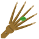

<!-- Generated by tools/build_pack_reference.py. Edit the pack sources and regenerate. -->

# Mori Mori no Mi

{ .entry-page-icon }

[Fruits](index.md) · [Missing Missing no Mi](../../reference/content/inomissing.md)

<!-- fruit inomissing:mori_mori_no_mi -->

| Stat | Value |
| --- | --- |
| Type | Logia |
| Tier | 3 |
| Fruit damage scaling | 1.00× at 10,000 Doriki → 1.75× at 50,000 Doriki |
| Abilities | 13 (9 active, 4 passive) |
| Fruit boxes | [Golden Box](../fruit-boxes.md) |

See [damage calculations](../combat-stats.md#damage-from-doriki).

!!! note "Reading the stats"
    Listed base damage is for the named part of the move. Pack and Doriki multipliers are shown separately. Times assume 20 ticks per second.

<!-- move inomissing:logia_invulnerability_mori -->

## Logia Invulnerability Mori

{ .entry-move-icon loading=lazy } *Passive*

The user's body is made of living wood, fire always hurts them and deals 50% more damage.

| Stat | Value |
| --- | --- |
| Pack multiplier when dealing damage | 1.4× |

<!-- move inomissing:kogosei -->

## Kogosei

{ .entry-move-icon loading=lazy } *Passive*

During the day and under the sky, the user does not get hungry and slowly regenerates health. Does not work during rain, night or under a roof.

The sunlight check accounts for local precipitation.

| Stat | Value |
| --- | --- |
| Pack multiplier when dealing damage | 1.4× |

<!-- move inomissing:ryokuka -->

## Hosaku

*Active*

Every plant around the user grows as with bone meal, crops, saplings and flowers, and the dirt turns into grass. Nothing grows in a claim the user can't build in.

| Stat | Value |
| --- | --- |
| Harvest cooldown | 10 s (200 ticks) |
| Cooldown | 10 s (200 ticks) |
| Conditional cooldown | 0.5 s (10 ticks) |
| Pack multiplier when dealing damage | 1.4× |

<!-- move inomissing:jukon -->

## Jukon

{ .entry-move-icon loading=lazy } *Active*

Roots come out of the ground where the user is looking and grab up to 6 enemies. They are stuck in place but can still attack. Use the ability again for Kyusui, the roots drain the enemies every second, healing the user and weakening them. Jukai sends a wave of roots forward through the ground, it hits every enemy on its way and tangles them for a moment.

| Stat | Value |
| --- | --- |
| Seize damage | 24 HP |
| Cooldown | 14 s (280 ticks) |
| Wave damage | 32 HP |
| Wave cooldown | 15 s (300 ticks) |
| Conditional cooldown | 0.5 s (10 ticks) |
| Pack multiplier when dealing damage | 1.4× |

<!-- move inomissing:edayari -->

## Edayari

{ .entry-move-icon loading=lazy } *Active*

The user's fingers extend into long branches that spread out in a fan and pierce every enemy on them. They are stuck in place but can still attack. Use the ability again for Kyusui, the branches drain the enemies every second, healing the user and weakening them. Eda Shigure thrusts the branch again and again where the user looks, hitting every enemy on the line each time.

| Stat | Value |
| --- | --- |
| Base damage | 28 HP |
| Cooldown | 8 s (160 ticks) |
| Thrust damage | 5 HP |
| Shigure cooldown | 16 s (320 ticks) |
| Pack multiplier when dealing damage | 1.4× |

<!-- move inomissing:senbon_kui -->

## Senbon Kui

{ .entry-move-icon loading=lazy } *Active*

Sharp wooden stakes burst out of the user's whole body, hitting every enemy around, making them bleed and throwing them back.

| Stat | Value |
| --- | --- |
| Base damage | 28 HP |
| Bleed | 5 s (100 ticks) |
| Cooldown | 12 s (240 ticks) |
| Pack multiplier when dealing damage | 1.4× |

<!-- move inomissing:konwan -->

## Konwan

{ .entry-move-icon loading=lazy } *Active*

Two arms of sharp roots grow out of the user's back. While active, each of their own hits in close combat is followed by a hit of a root arm that makes the enemy bleed.

| Stat | Value |
| --- | --- |
| Cooldown | 20 s (400 ticks) |
| Base damage | 8 HP |
| Bleed | 3 s (60 ticks) |
| Pack multiplier when dealing damage | 1.4× |

<!-- move inomissing:jurin_heki -->

## Jurin Heki

{ .entry-move-icon loading=lazy } *Active*

A wall of trees rises out of the ground in front of the user. It stops enemies and projectiles and takes hits until it breaks. Fire burns it unless Bokarin is active. Using the ability again brings the wall down. As a golem, the wall is twice as big and its wood harder.

| Stat | Value |
| --- | --- |
| Cooldown | 20 s (400 ticks) |
| Pack multiplier when dealing damage | 1.4× |

<!-- move inomissing:kinniku_mori_mori -->

## Kinniku Mori Mori

{ .entry-move-icon loading=lazy } *Active*

While standing on natural ground, the user transforms into a tree golem, increasing the damage and the range of their punches and their armor but making them slower. The other abilities are also stronger and bigger while in this form. The size can be changed before using it, the giant golem lasts less and has a longer cooldown.

| Stat | Value |
| --- | --- |
| Least cooldown | 0.01 s (0.2 ticks) |
| Pack multiplier when dealing damage | 1.4× |

**Stats while transformed**

| Stat | Value |
| --- | --- |
| Step height | +1 blocks |

<!-- move inomissing:wakagi -->

## Wakagi

{ .entry-move-icon loading=lazy } *Passive*

If the user would die while in the golem form, the golem falls instead and the user grows back from a sapling a few blocks away with a part of their health. Does not work if killed by a very strong fire attack.

| Stat | Value |
| --- | --- |
| Cooldown | 300 s (6000 ticks) |
| Pack multiplier when dealing damage | 1.4× |

<!-- move inomissing:bokarin -->

## Bokarin

{ .entry-move-icon loading=lazy } *Active*

The user fills their wood with water so fire doesn't deal extra damage to them anymore, except for very strong fire attacks. The user moves and attacks slower while active.

| Stat | Value |
| --- | --- |
| Cooldown | 5 s (100 ticks) |
| Pack multiplier when dealing damage | 1.4× |

<!-- move inomissing:hanaguruma -->

## Hanaguruma

{ .entry-move-icon loading=lazy } *Active*

A giant flower grows on the user's back and spins like a propeller allowing them to fly. Fire burns the flower and stops the flight. Can't be used in the golem form.

| Stat | Value |
| --- | --- |
| Cooldown | 2 s (40 ticks) |
| Pack multiplier when dealing damage | 1.4× |

<!-- move inomissing:hisho -->

## Hisho

{ .entry-move-icon loading=lazy } *Passive*

While the flower is spinning the user can fly, until they have no more stamina.

| Stat | Value |
| --- | --- |
| Pack multiplier when dealing damage | 1.4× |

