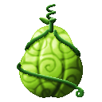

<!-- Generated by tools/build_pack_reference.py. Edit the pack sources and regenerate. -->

# Mosa Mosa no Mi

{ .entry-page-icon }

[Fruits](index.md) · [Missing Missing no Mi](../../reference/content/inomissing.md)

<!-- fruit inomissing:mosa_mosa_no_mi -->

| Stat | Value |
| --- | --- |
| Type | Paramecia |
| Tier | 1 |
| Fruit damage scaling | 1.00× at 10,000 Doriki → 2.25× at 50,000 Doriki |
| Abilities | 8 (7 active, 1 passive) |
| Fruit boxes | [Wooden Box](../fruit-boxes.md) |

See [damage calculations](../combat-stats.md#damage-from-doriki).

!!! note "Reading the stats"
    Listed base damage is for the named part of the move. Pack and Doriki multipliers are shown separately. Times assume 20 ticks per second.

<!-- move inomissing:greenery -->

## Greenery

{ .entry-move-icon loading=lazy } *Passive*

Shows the plants the user can use, the plants they carry are shown in green when there are enough plants around them to use the abilities for free

| Stat | Value |
| --- | --- |
| Pack multiplier when dealing damage | 1.5× |

<!-- move inomissing:mosa_mosa_dance -->

## Mosa Mosa Dance

{ .entry-move-icon loading=lazy } *Active*

The user dances, making the plants around them grow and covering the grass with tall grass and flowers

| Stat | Value |
| --- | --- |
| Cooldown | 15 s (300 ticks) |
| Pack multiplier when dealing damage | 1.5× |

<!-- move inomissing:thorn_whip -->

## Thorn Whip

{ .entry-move-icon loading=lazy } *Active*

The user lashes a thorny vine where they are looking, damaging all the enemies on its way

| Stat | Value |
| --- | --- |
| Base damage | 10 HP |
| Cooldown | 6 s (120 ticks) |
| Pack multiplier when dealing damage | 1.25× |

<!-- move inomissing:vine_grip -->

## Vine Grip

{ .entry-move-icon loading=lazy } *Active*

A vine shoots out of the closest plant and wraps around the enemy the user is looking at, they are stuck in place but can still attack. Use the ability again to release the enemy

| Stat | Value |
| --- | --- |
| Seize damage | 8 HP |
| Cooldown | 14 s (280 ticks) |
| Pack multiplier when dealing damage | 1.5× |

<!-- move inomissing:green_wall -->

## Green Wall

{ .entry-move-icon loading=lazy } *Active*

The plants in front of the user rise into a wall that stops enemies and projectiles for a while. Using the ability again brings the wall down

| Stat | Value |
| --- | --- |
| Cooldown | 20 s (400 ticks) |
| Pack multiplier when dealing damage | 1.5× |

<!-- move inomissing:devouring_plant -->

## Devouring Plant

{ .entry-move-icon loading=lazy } *Active*

Plants rise around the enemy the user is looking at and swallow them, they can't move, attack or use abilities and are damaged every second. Use the ability again to release the enemy

| Stat | Value |
| --- | --- |
| Seize damage | 6 HP |
| Bite damage | 3 HP |
| Cooldown | 18 s (360 ticks) |
| Pack multiplier when dealing damage | 1.5× |

<!-- move inomissing:root_bridge -->

## Root Bridge

{ .entry-move-icon loading=lazy } *Active*

Roots grow in front of the user into a bridge that lasts for a while, it goes up or down when the user is looking up or down

| Stat | Value |
| --- | --- |
| Cooldown | 12 s (240 ticks) |
| Conditional cooldown | 0.5 s (10 ticks) |
| Pack multiplier when dealing damage | 1.5× |

<!-- move inomissing:mosa_mosa_kuzushi -->

## Mosa Mosa Kuzushi

{ .entry-move-icon loading=lazy } *Active*

The user dances wildly, big plants rise next to all the enemies around them and slam them

| Stat | Value |
| --- | --- |
| Base damage | 16 HP |
| Cooldown | 30 s (600 ticks) |
| Conditional cooldown | 0.5 s (10 ticks) |
| Pack multiplier when dealing damage | 1.5× |

